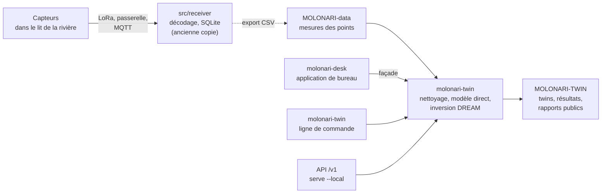
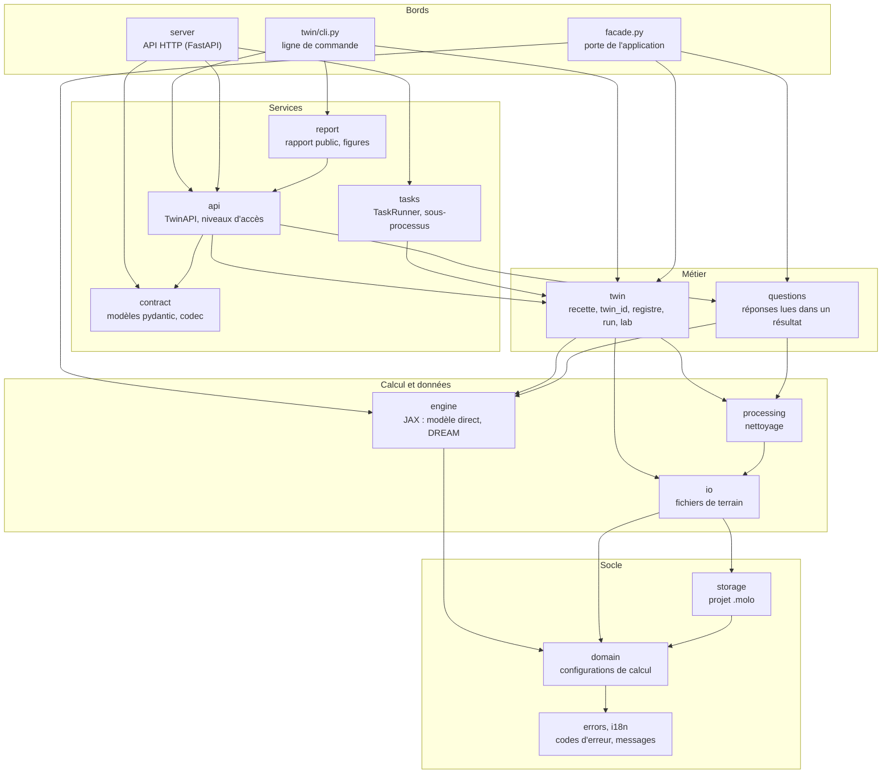

# MOLONARI-API

Dépôt logiciel du projet MOLONARI : il reçoit les mesures des capteurs de rivière, les range, et calcule à partir d'elles les échanges d'eau et de chaleur entre la rivière et la nappe.

| | |
|---|---|
| Branche de travail | `CGS-MOLO` (sur `main`, `molonari_desk/` n'existe pas encore) |
| Paquets | `molonari-twin` **0.9.0-alpha.2** (backend, CLI), `molonari-desk` **0.7.0** (application), `molonaviz` 1.0.1 (ancienne application) |
| API HTTP | `/v1` **1.0.0-alpha.8** |
| Installé par | le manifeste `molonari.cgs` de [MOLONARI1D](https://github.com/flipoyo/MOLONARI1D) (ComplexGitSync), dans le dossier `Molonaviz/` de l'espace |
| Dates | toutes en UTC |

## Sommaire

1. [Notices](#notices)
2. [Ce que contient le dépôt](#ce-que-contient-le-dépôt)
3. [Architecture](#architecture)
4. [Démarrer](#démarrer)
5. [Tests et intégration continue](#tests-et-intégration-continue)
6. [Versions](#versions)
7. [Évolution prévue](#évolution-prévue)

## Notices

Chaque nom ouvre la notice. Commencez par la ligne qui correspond à ce que vous voulez faire.

| Notice | Pour qui | Contenu |
|---|---|---|
| **Twin (backend et CLI)** | | |
| [Prise en main du twin](molonari_desk/docs/README_TWIN.md) | toute personne qui lance un twin | installation de l'operating space, commandes, parcours jusqu'au rapport public, [architecture](molonari_desk/docs/README_TWIN.md#21-architecture), [4 niveaux d'accès](molonari_desk/docs/README_TWIN.md#23-les-4-niveaux), [moteur JAX](molonari_desk/docs/README_TWIN.md#24-le-moteur-jax), limites |
| [README du backend](molonari_desk/backend/README.md) | développeur | `molonari-twin` : installation seule, ligne de commande, API HTTP locale, façade, tests |
| [Référence de l'API /v1](molonari_desk/backend/docs/API_V1.md) | développeur, intégrateur | les questions posées à un twin : paramètres, sorties, niveaux d'accès, erreurs (fichier généré) |
| [Historique du backend](molonari_desk/backend/CHANGELOG.md) | tous | changements de `molonari-twin` par version |
| **Application de bureau** | | |
| [README de l'espace molonari_desk](molonari_desk/README.md) | utilisateur, développeur | les deux paquets, installation, utilisation pas à pas, formats acceptés, format des twins et des résultats |
| [Notice d'utilisation](molonari_desk/docs/NOTICE_UTILISATEUR.md) | technicien, étudiant, chercheur | importer, nettoyer, calculer, lire les résultats ; raccourcis ; dépannage |
| [Notice scientifique](molonari_desk/docs/NOTICE_SCIENTIFIQUE.md) | hydrogéologue | modèle physique, inversion bayésienne (DREAM), paramètres, fiabilité des résultats, limites |
| [README de l'application](molonari_desk/frontend/README.md) | développeur | `molonari-desk` : lancement, traduction, tests, distribution PyInstaller |
| [Historique de l'application](molonari_desk/frontend/CHANGELOG.md) | tous | changements de `molonari-desk` (molonaviz2 jusqu'à 0.6.0) |
| **Suite du projet** | | |
| [Guide des futurs étudiants](molonari_desk/docs/README_ETUDIANTS.md) | équipe suivante | démarrer en 30 minutes, carte du projet, conventions, glossaire, idées de développement, pièges connus |
| [Audit de séparation du twin](molonari_desk/docs/AUDIT_SEPARATION_TWIN.md) | mainteneur | inventaire du dépôt, code à déplacer vers MOLONARI-computo et MOLONARI-hardware, plan de migration |
| **Réception des données** | | |
| [README du receiver](src/receiver/README.md) | opérateur du serveur | réception MQTT, décodage Protobuf, insertion en base SQLite, certificats (en anglais) |
| [Configuration de la base](src/receiver/Database%20configuration.md) | opérateur du serveur | déclarer laboratoire, étude et appareils avec `GUI_virtual_lab` (en anglais) |
| **Ancienne application Molonaviz** | | |
| [Guide d'utilisation Molonaviz 2023](src/molonaviz/docs/UserguideMolonaViZ2023.pdf) | utilisateur de l'ancienne version | PDF ; [version Word](src/molonaviz/docs/UserguideMolonaViZ2023.docx) |
| [Schéma de la base Molonaviz](src/molonaviz/docs/erd.png) | développeur | diagramme entité-association ; [SQL](src/molonaviz/docs/ERD_structure.sql), [carte des tables](src/molonaviz/docs/SQL_map_REF.png) |

## Ce que contient le dépôt

```
MOLONARI-API/                       (monté dans Molonaviz/ par cgs)
├── molonari_desk/                  espace uv, un seul uv.lock
│   ├── backend/                    paquet molonari-twin : données, calcul, twins, questions, API /v1
│   ├── frontend/                   paquet molonari-desk : application PySide6
│   ├── docs/                       notices et guides (table ci-dessus)
│   ├── examples/twins/             twin_01 à twin_04 : twin.yaml + measurements.csv
│   ├── tools/                      génération des docs, contrôle de version, chaînes à traduire
│   └── Makefile                    run, twin, test, test-slow, package, strings
├── src/
│   ├── receiver/                   réception MQTT des capteurs vers SQLite
│   └── molonaviz/                  ancienne application PyQt5 (Molonaviz)
├── tests/                          tests de l'ancienne application
├── TestDatabase/                   sauvegarde d'une base Molonaviz d'essai
├── pyproject.toml, pixi.toml       installation de molonaviz et du receiver (pixi)
└── .github/workflows/              tests et contrôle de version de molonari_desk
```

Deux mondes cohabitent :

- **`molonari_desk/`**, le code actuel, installé avec **uv**. C'est lui qui porte le twin et l'API.
- **`src/`, `tests/`, `TestDatabase/`**, l'ancien code, installé avec **pixi** : l'application Molonaviz (PyQt5) et le receiver MQTT. Une base Molonaviz s'importe dans MOLONARI Desk (**Fichier › Importer une base Molonaviz**).

## Architecture

### Le dépôt dans la chaîne MOLONARI



Le receiver et les deux paquets de `molonari_desk/` sont dans ce dépôt. MOLONARI-data et MOLONARI-TWIN sont d'autres dépôts, montés à côté par cgs. Le receiver d'ici est une ancienne copie : la version maintenue est dans MOLONARI-computo (`MOLO-data-process/raw_to_processed/receiver.py`).

### Les deux paquets de molonari_desk

| | `molonari-twin` (backend) | `molonari-desk` (frontend) |
|---|---|---|
| Rôle | lire les données de terrain, nettoyer, calculer, gérer les twins, répondre aux questions | fenêtres, graphiques, saisie des réglages |
| Dépend de | JAX, NumPy, pandas, SciPy, ArviZ, pydantic ; FastAPI en option (`--extra server`) | PySide6, pyqtgraph, matplotlib, et `molonari-twin` |
| N'importe pas | Qt, aucune bibliothèque graphique, ni `molonari_desk` | JAX, ArviZ, scipy : aucun calcul (installés avec le backend, jamais importés) |
| Point d'entrée | `molonari-twin` (CLI), `TwinAPI` (Python), `serve --local` (HTTP) | `molonari-desk` |

Le frontend n'importe du backend que `molonari_twin.facade`, dans le même processus, sans serveur. `tests/test_architecture.py`, dans chaque paquet, vérifie ces deux règles.

### Les couches du backend

Les flèches vont de celui qui dépend vers celui dont il dépend.



Quatre règles tiennent l'ensemble :

- `engine` ne connaît ni les twins ni les fichiers ;
- `twin` orchestre : il lit la recette `twin.yaml`, calcule le `twin_id`, lance le calcul et écrit les résultats ;
- `questions` lisent des résultats déjà écrits, sans appeler JAX ;
- `contract` ne contient aucune logique et n'importe ni FastAPI ni JAX.

L'API HTTP ne calcule jamais dans son processus : elle confie chaque calcul à un `TaskRunner`, qui le lance dans un sous-processus. Le détail est dans le [README du backend](molonari_desk/backend/README.md#api-http-locale).

### Un twin

Un twin est la copie numérique d'un point de mesure : une colonne 1D de sédiments sous la rivière. Il est défini entièrement par son `twin.yaml` (données, paramètres du sol, réglages, graine, version du code). Même recette, mêmes données et même code donnent les mêmes résultats, octet pour octet. Format des dossiers et des résultats : [README de l'espace](molonari_desk/README.md#twins-jumeaux-numériques).

### Niveaux d'accès

`--level` choisit ce qu'on peut demander : **user** (eau, chaleur, température), **dev** et **opx** (tout, dont lancer des calculs). Il n'y a pas d'authentification : le niveau oriente l'usage, ce n'est pas une sécurité. Voir la [référence de l'API](molonari_desk/backend/docs/API_V1.md#niveaux-daccès).

## Démarrer

Le plus simple est d'installer tout l'espace MOLONARI avec [ComplexGitSync](https://github.com/flipoyo/ComplexGitSync) :

```bash
cgitsync bootstrap molonari.cgs        # manifeste du dépôt MOLONARI1D, branche CGS-MOLO
export CGSHOME=<dossier indiqué à la fin du bootstrap>
cd "$CGSHOME/Molonaviz/molonari_desk"
uv sync
uv run molonari-desk                   # application
uv run molonari-twin --help            # ligne de commande
```

Dans un clone seul de ce dépôt, sans `pyheatmy` à côté (il ne sert qu'aux tests) :

```bash
cd molonari_desk
uv sync --frozen --no-default-groups
uv run --frozen --no-default-groups molonari-desk
```

Le backend seul, sans Qt : `uv sync --package molonari-twin`. Installation complète et operating space : [prise en main du twin](molonari_desk/docs/README_TWIN.md).

Ancien code (Molonaviz et receiver), depuis la racine du dépôt :

```bash
pixi install
pixi run molonaviz          # ancienne application
pixi run run-server         # receiver MQTT (régler d'abord src/receiver/settings/config.json)
```

## Tests et intégration continue

Depuis `molonari_desk/` :

```bash
make test          # backend puis frontend, suites rapides
make test-slow     # calculs longs du backend
```

Deux workflows GitHub tournent sur les PR qui touchent `molonari_desk/` :

- `molonari-desk-tests.yml`, aussi à chaque push sur `CGS-MOLO` : un job backend sans PySide6 (suites rapide et slow, ligne de commande) et un job frontend sous Xvfb ;
- `molonari-desk-version.yml`, aussi sur les tags `molonari-twin-v*` et `molonari-desk-v*` : cohérence entre `pyproject.toml`, `CHANGELOG.md` et le tag (`tools/check_version.py`).

Les tests du backend lisent des mesures de MOLONARI-data : la CI clone ce dépôt à côté, dans `data/`, comme dans l'espace cgs. `pyheatmy` et `bayesian_inversion`, références du moteur JAX, sont figés par commit dans `uv.lock`.

## Versions

Chaque paquet a sa version dans son `pyproject.toml`, son historique et ses tags :

| Paquet | Version | Historique | Tags |
|---|---|---|---|
| `molonari-twin` | 0.9.0-alpha.2 | [CHANGELOG](molonari_desk/backend/CHANGELOG.md) | `molonari-twin-vX.Y.Z` |
| `molonari-desk` | 0.7.0 | [CHANGELOG](molonari_desk/frontend/CHANGELOG.md) | `molonari-desk-vX.Y.Z` |
| `molonaviz` | 1.0.1 | — | — |

## Évolution prévue

MOLONARI-API sert au MVP. La version finale de MOLONARI compte quatre dépôts (MOLONARI-hardware, MOLONARI-computo, MOLONARI-TWIN, MOLONARI-data), et le code d'ici doit y être réparti :

| Code | Destination |
|---|---|
| `molonari_desk/backend` (`molonari-twin`) | MOLONARI-computo, sous-dépôt `MOLO-twin` |
| `molonari_desk/frontend` (`molonari-desk`) | MOLONARI-hardware, dossier `molonaviz/` |
| `src/receiver` | déjà dans MOLONARI-computo (`MOLO-data-process`) ; à retirer d'ici |
| `src/molonaviz`, `TestDatabase`, `tests` | restent dans MOLONARI-API |

Le découpage interne du backend est conservé tel quel, pour que les `twin_id` et les chemins des tests restent valables. Inventaire, risques et plan en lots : [audit de séparation du twin](molonari_desk/docs/AUDIT_SEPARATION_TWIN.md).
