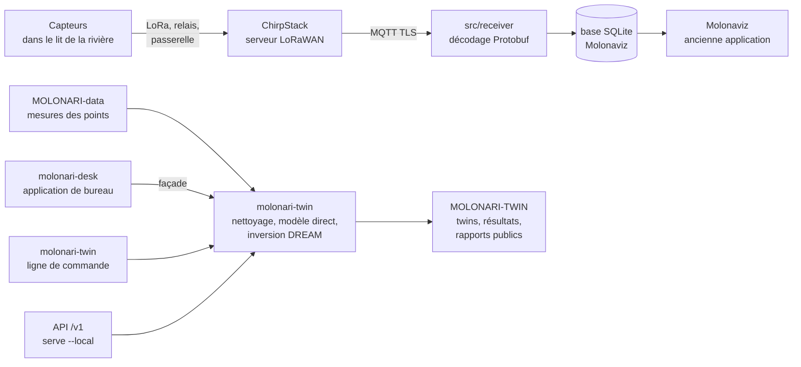
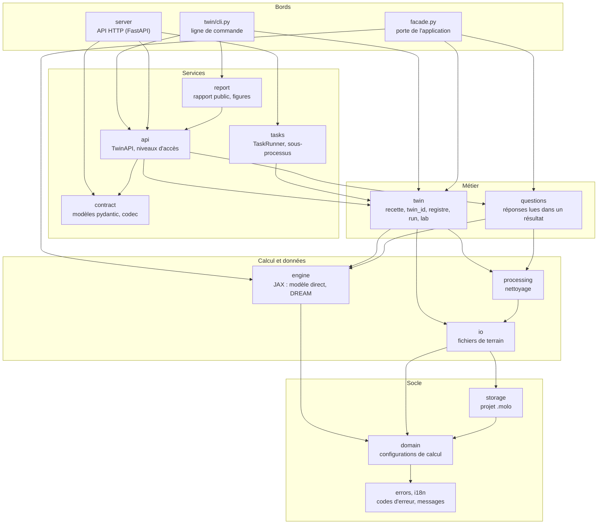

# MOLONARI-API

Dépôt logiciel du projet MOLONARI : il reçoit les mesures des capteurs de rivière, les range, et calcule à partir d'elles les échanges d'eau et de chaleur entre la rivière et la nappe.

| | |
|---|---|
| Branche de travail | `CGS-MOLO` (sur `main`, `molonari_desk/` n'existe pas encore) |
| Paquets | `molonari-twin` **0.9.0-alpha.2** (backend, CLI), `molonari-desk` **0.7.0** (application), `molonaviz` 1.0.1 (ancienne application) |
| API HTTP | `/v1` **1.0.0-alpha.8** |
| Installé par | le manifeste `molonari.cgs` de [MOLONARI1D](https://github.com/flipoyo/MOLONARI1D) (ComplexGitSync), dans le dossier `Molonaviz/` de l'espace |
| Dates | toutes en UTC |

## Sommaire

1. [Notices](#notices)
2. [Ce que contient le dépôt](#ce-que-contient-le-dépôt)
3. [Architecture](#architecture)
4. [Receiver](#receiver)
5. [Molonaviz](#molonaviz)
6. [Démarrer](#démarrer)
7. [Tests et intégration continue](#tests-et-intégration-continue)
8. [Versions](#versions)
9. [Évolution prévue](#évolution-prévue)

## Notices

Chaque nom ouvre la notice. Commencez par la ligne qui correspond à ce que vous voulez faire.

| Notice | Pour qui | Contenu |
|---|---|---|
| **Twin (backend et CLI)** | | |
| [Prise en main du twin](molonari_desk/docs/README_TWIN.md) | toute personne qui lance un twin | installation de l'operating space, commandes, parcours jusqu'au rapport public, [architecture](molonari_desk/docs/README_TWIN.md#21-architecture), [4 niveaux d'accès](molonari_desk/docs/README_TWIN.md#23-les-4-niveaux), [moteur JAX](molonari_desk/docs/README_TWIN.md#24-le-moteur-jax), limites |
| [README du backend](molonari_desk/backend/README.md) | développeur | `molonari-twin` : installation seule, ligne de commande, API HTTP locale, façade, tests |
| [Référence de l'API /v1](molonari_desk/backend/docs/API_V1.md) | développeur, intégrateur | les questions posées à un twin : paramètres, sorties, niveaux d'accès, erreurs (fichier généré) |
| [Historique du backend](molonari_desk/backend/CHANGELOG.md) | tous | changements de `molonari-twin` par version |
| **Application de bureau** | | |
| [README de l'espace molonari_desk](molonari_desk/README.md) | utilisateur, développeur | les deux paquets, installation, utilisation pas à pas, formats acceptés, format des twins et des résultats |
| [Notice d'utilisation](molonari_desk/docs/NOTICE_UTILISATEUR.md) | technicien, étudiant, chercheur | importer, nettoyer, calculer, lire les résultats ; raccourcis ; dépannage |
| [Notice scientifique](molonari_desk/docs/NOTICE_SCIENTIFIQUE.md) | hydrogéologue | modèle physique, inversion bayésienne (DREAM), paramètres, fiabilité des résultats, limites |
| [README de l'application](molonari_desk/frontend/README.md) | développeur | `molonari-desk` : lancement, traduction, tests, distribution PyInstaller |
| [Historique de l'application](molonari_desk/frontend/CHANGELOG.md) | tous | changements de `molonari-desk` (molonaviz2 jusqu'à 0.6.0) |
| **Suite du projet** | | |
| [Guide des futurs étudiants](molonari_desk/docs/README_ETUDIANTS.md) | équipe suivante | démarrer en 30 minutes, carte du projet, conventions, glossaire, idées de développement, pièges connus |
| [Audit de séparation du twin](molonari_desk/docs/AUDIT_SEPARATION_TWIN.md) | mainteneur | inventaire du dépôt, code à déplacer vers MOLONARI-computo et MOLONARI-hardware, plan de migration |
| **Réception des données** | | |
| [README du receiver](src/receiver/README.md) | opérateur du serveur | réception MQTT, décodage Protobuf, insertion en base SQLite, certificats (en anglais) |
| [Configuration de la base](src/receiver/Database%20configuration.md) | opérateur du serveur | déclarer laboratoire, étude et appareils avec `GUI_virtual_lab` (en anglais) |
| **Ancienne application Molonaviz** | | |
| [Guide d'utilisation Molonaviz 2023](src/molonaviz/docs/UserguideMolonaViZ2023.pdf) | utilisateur de l'ancienne version | PDF ; [version Word](src/molonaviz/docs/UserguideMolonaViZ2023.docx) |
| [Schéma de la base Molonaviz](src/molonaviz/docs/erd.png) | développeur | diagramme entité-association ; [SQL](src/molonaviz/docs/ERD_structure.sql), [carte des tables](src/molonaviz/docs/SQL_map_REF.png) |

## Ce que contient le dépôt

```
MOLONARI-API/                       (monté dans Molonaviz/ par cgs)
├── molonari_desk/                  espace uv, un seul uv.lock
│   ├── backend/                    paquet molonari-twin : données, calcul, twins, questions, API /v1
│   ├── frontend/                   paquet molonari-desk : application PySide6
│   ├── docs/                       notices et guides (table ci-dessus)
│   ├── examples/twins/             twin_01 à twin_04 : twin.yaml + measurements.csv
│   ├── tools/                      génération des docs, contrôle de version, chaînes à traduire
│   └── Makefile                    run, twin, test, test-slow, package, strings
├── src/
│   ├── receiver/                   réception MQTT des capteurs vers SQLite
│   └── molonaviz/                  ancienne application PyQt5 (Molonaviz)
├── tests/                          tests de l'ancienne application
├── TestDatabase/                   sauvegarde d'une base Molonaviz d'essai
├── pyproject.toml, pixi.toml       installation de molonaviz et du receiver (pixi)
└── .github/workflows/              tests et contrôle de version de molonari_desk
```

Deux mondes cohabitent :

- **`molonari_desk/`**, le code actuel, installé avec **uv**. C'est lui qui porte le twin et l'API.
- **`src/`, `tests/`, `TestDatabase/`**, installés avec **pixi** : le [receiver](#receiver) MQTT et l'application [Molonaviz](#molonaviz) (PyQt5). C'est le code le plus ancien, mais l'équipe matériel s'en sert toujours pour la chaîne de transmission : c'est lui qui reçoit les mesures des capteurs et les range dans une base Molonaviz. Une base Molonaviz s'importe dans MOLONARI Desk (**Fichier › Importer une base Molonaviz**).

## Architecture

### Le dépôt dans la chaîne MOLONARI



Le receiver, Molonaviz et les deux paquets de `molonari_desk/` sont dans ce dépôt. Le serveur ChirpStack est décrit dans [MOLONARI-hardware](https://github.com/flipoyo/MOLONARI-hardware/tree/CGS-MOLO/specs/v2-2025/gateway) (`specs/v2-2025/gateway/`). MOLONARI-data et MOLONARI-TWIN sont d'autres dépôts, montés à côté par cgs.

Les deux moitiés ne sont pas reliées dans ce dépôt : le receiver écrit dans une base Molonaviz, et le twin lit les fichiers de MOLONARI-data. Une réécriture du receiver qui range les messages bruts directement dans MOLONARI-data existe dans MOLONARI-computo (`MOLO-data-process/raw_to_processed/receiver.py`). Elle n'a pas encore été essayée contre un vrai serveur.

### Les deux paquets de molonari_desk

| | `molonari-twin` (backend) | `molonari-desk` (frontend) |
|---|---|---|
| Rôle | lire les données de terrain, nettoyer, calculer, gérer les twins, répondre aux questions | fenêtres, graphiques, saisie des réglages |
| Dépend de | JAX, NumPy, pandas, SciPy, ArviZ, pydantic ; FastAPI en option (`--extra server`) | PySide6, pyqtgraph, matplotlib, et `molonari-twin` |
| N'importe pas | Qt, aucune bibliothèque graphique, ni `molonari_desk` | JAX, ArviZ, scipy : aucun calcul (installés avec le backend, jamais importés) |
| Point d'entrée | `molonari-twin` (CLI), `TwinAPI` (Python), `serve --local` (HTTP) | `molonari-desk` |

Le frontend n'importe du backend que `molonari_twin.facade`, dans le même processus, sans serveur. `tests/test_architecture.py`, dans chaque paquet, vérifie ces deux règles.

### Les couches du backend

Les flèches vont de celui qui dépend vers celui dont il dépend.



Quatre règles tiennent l'ensemble :

- `engine` ne connaît ni les twins ni les fichiers ;
- `twin` orchestre : il lit la recette `twin.yaml`, calcule le `twin_id`, lance le calcul et écrit les résultats ;
- `questions` lisent des résultats déjà écrits, sans appeler JAX ;
- `contract` ne contient aucune logique et n'importe ni FastAPI ni JAX.

L'API HTTP ne calcule jamais dans son processus : elle confie chaque calcul à un `TaskRunner`, qui le lance dans un sous-processus. Le détail est dans le [README du backend](molonari_desk/backend/README.md#api-http-locale).

### Un twin

Un twin est la copie numérique d'un point de mesure : une colonne 1D de sédiments sous la rivière. Il est défini entièrement par son `twin.yaml` (données, paramètres du sol, réglages, graine, version du code). Même recette, mêmes données et même code donnent les mêmes résultats, octet pour octet. Format des dossiers et des résultats : [README de l'espace](molonari_desk/README.md#twins-jumeaux-numériques).

### Niveaux d'accès

`--level` choisit ce qu'on peut demander : **user** (eau, chaleur, température), **dev** et **opx** (tout, dont lancer des calculs). Il n'y a pas d'authentification : le niveau oriente l'usage, ce n'est pas une sécurité. Voir la [référence de l'API](molonari_desk/backend/docs/API_V1.md#niveaux-daccès).

## Receiver

Le receiver (`src/receiver/`) est le dernier maillon de la chaîne de transmission. Il écoute le serveur ChirpStack en MQTT, décode les mesures des capteurs et les range dans une base SQLite.

### Le trajet d'une mesure

1. Le datalogger du point de mesure encode ses mesures en **Protobuf** (`sensor.proto`, message `SensorData`, 44 octets sur 51 possibles en LoRaWAN DR0) : identifiant de l'appareil, heure de la mesure, heure de réception par le relais, et jusqu'à six valeurs brutes du convertisseur 12 bits (0 à 4095). Le fichier doit rester identique à `encode.h` du firmware.
2. Le relais et la passerelle transmettent le message à ChirpStack, qui le publie en MQTT.
3. Le receiver s'abonne au topic en TLS, met chaque message dans une file, et un fil de traitement le décode (`decoder.py`) : base64, Protobuf, puis tension `valeur / 4095 × 3,3 V`. Une valeur absente devient `NaN`.
4. Il ajoute les identifiants et les heures du réseau (relais, passerelle, réception par ChirpStack, compteur de trames), filtre les appareils si `device_euis` n'est pas vide, puis insère la mesure.

### Deux modes d'insertion

`database.real_database_insertion` dans `settings/config.json` choisit la base :

| Valeur | Base écrite | Contenu |
|---|---|---|
| `false` | `database.filename`, table `RawMeasurements` | une ligne par message : identifiants, heures, six tensions `a0` à `a5` ; mode d'essai |
| `true` | une base Molonaviz ; si elle n'a pas encore de table `SamplingPoint`, elle est créée depuis `database.ERD_structure` et remplie avec le [laboratoire virtuel](#le-laboratoire-virtuel) | la mesure est rattachée à son point par le trio datalogger, relais, passerelle, puis écrite dans `RawMeasuresVolt`, `RawMeasuresTemp` et `RawMeasuresPress` |

En mode `true`, les voies ont un sens fixe :

| Voie | Mesure | Table |
|---|---|---|
| `a0` | tension du capteur de pression | `RawMeasuresPress.Voltage` |
| `a1` | température du lit de la rivière | `RawMeasuresPress.TempBed` |
| `a2` à `a5` | les 4 thermomètres de la tige (`Temp1` à `Temp4`) | `RawMeasuresVolt` (tensions) et `RawMeasuresTemp` (températures) |

La tension devient une température par `SPointCoordinator.calibrate_temperature` (`src/molonaviz/backend/`). Depuis le 2026-11-13, la formule est un ajustement sur les mesures d'étalonnage de l'équipe : T (°C) = 146,133 × exp(−1,1428 × V). Elle remplace la formule de la thermistance (paramètres β et V_ref du thermomètre), qui donnait des valeurs fausses en 2026. Le commentaire du code précise que l'erreur venait peut-être d'une mauvaise valeur de β : la question reste ouverte. β et V_ref sont toujours lus dans la base, mais la formule ne s'en sert plus.

### Le laboratoire virtuel

Pour qu'une mesure trouve son point, la base doit connaître le matériel. Il est décrit dans les CSV de `src/molonaviz/backend/virtual-lab/` : `Labo`, `Study`, `Gateway`, `Relay`, `Datalogger`, `Thermometer`, `PressureSensor`, `Shaft`, `SamplingPoint`. On les remplit à la main ou avec l'interface `python -m src.receiver.GUI_virtual_lab` (tkinter). Ils ne sont lus qu'à la création de la base : un appareil ajouté ensuite doit aussi être ajouté à la base existante. Un message dont le trio datalogger, relais, passerelle n'est pas connu est écarté, avec un message dans la console. Pas à pas : [configuration de la base](src/receiver/Database%20configuration.md).

### Configuration et lancement

`settings/config.json` contient deux blocs :

- `mqtt` : `broker`, `port`, `topic`, `client_id`, `keepalive`, chemins des certificats (`ca_cert`, `client_cert`, `client_key`), `device_euis`, `message_queue_max` ;
- `database` : `filename`, `real_database_insertion`, `ERD_structure`.

Les trois certificats se téléchargent dans ChirpStack (**Applications › Integrations › MQTT › Get certificate**). Ils expirent, en général au bout d'un an. Toutes les commandes se lancent depuis la racine du dépôt, car les chemins sont relatifs :

```bash
pixi run run-server                         # = python -m src.receiver.main ; Ctrl-C pour arrêter
python -m src.receiver.GUI_virtual_lab      # déclarer laboratoire, étude et appareils
```

Détails, en anglais : [README du receiver](src/receiver/README.md).

**Défauts connus**

- `python -m src.receiver.main --export fichier.csv` échoue (`TypeError`) : `main.py` appelle `init_db` et `export_csv` sans le `logger` qu'elles attendent.
- `tests/test_config.py` lit `src/receiver/config.json` et des clés (`MQTT_BROKER`, `DB_FILENAME`) qui n'existent plus.
- `logger_timestamps.py` sait écrire les heures de l'appareil, du relais et de la passerelle dans `timestamps.log`, mais le receiver ne l'appelle plus.

## Molonaviz

Molonaviz (`src/molonaviz/`, paquet `molonaviz` 1.0.1) est la première application de bureau de MOLONARI, écrite en PyQt5. MOLONARI Desk la remplace pour le calcul, mais sa base reste celle que remplit le receiver.

### Ce qu'elle fait

L'interface est en anglais.

- **Database › Open Database** : une base est un dossier qui contient `Molonari.sqlite` et les sous-dossiers `Notices/`, `Schemes/` et `Scripts/`. Le chemin de la dernière base est gardé dans `src/molonaviz/config.txt` (non suivi par git).
- **Laboratory** : importer un laboratoire (thermomètres, capteurs de pression, tiges) ou y ajouter un élément.
- **Study** : créer, ouvrir ou fermer une étude.
- **Point** : importer, ouvrir ou retirer un point de mesure, puis le nettoyer, lancer le modèle direct ou l'inversion MCMC, et lire les cartes de température, les flux d'eau et de chaleur et la distribution des paramètres.
- **Preferences › Temperature** : affichage en Kelvin ou en Celsius.

Mode d'emploi complet, en français : [guide Molonaviz 2023](src/molonaviz/docs/UserguideMolonaViZ2023.pdf), aussi ouvert par **Help › Open Userguide (FR)**.

### Organisation du code

| Dossier | Rôle |
|---|---|
| `main.py` | fenêtre principale, menus, point d'entrée `molonaviz` |
| `frontend/` | fenêtres et dialogues (`dialog*.py`), vue d'un point (`SamplingPointViewer.py`), graphiques, fichiers Qt Designer (`ui/`) |
| `backend/` | accès à la base (`DatabaseManager`, `StudyAndLabManager`, `SamplingPointManager`, `SPointCoordinator`), calculs (`Compute.py`), schéma SQL, laboratoire virtuel |
| `interactions/` | modèles et vues entre les deux, messages internes, script de nettoyage d'exemple (`sample_text.txt`) |
| `utils/` | fonctions communes, chemins des ressources |
| `docs/` | guide 2023, schéma de la base |

### La base

Une seule base SQLite, décrite par `docs/ERD_structure.sql` ([diagramme](src/molonaviz/docs/erd.png)) :

- **matériel** : `Labo`, `Study`, `Gateway`, `Relay`, `Datalogger`, `Thermometer`, `PressureSensor`, `Shaft`, `SamplingPoint` ;
- **mesures** : `RawMeasuresVolt`, `RawMeasuresTemp`, `RawMeasuresPress` (écrites par le receiver ou importées), `CleanedMeasures` ;
- **calculs** : `Point`, `Layer`, `Parameters`, `BestParameters`, `ParametersDistribution`, `InputMCMC`, `Quantile`, `Date`, `Depth`, `TemperatureAndHeatFlows`, `WaterFlow`, `RMSE`.

`TestDatabase/` contient une sauvegarde d'une base d'essai.

### Lancer

```bash
pixi install
pixi run molonaviz
```

Molonaviz importe **pyheatmy** dès le démarrage (`backend/Compute.py`), mais ni `pyproject.toml` ni `pixi.toml` ne le déclarent : sans lui, l'application s'arrête sur `ModuleNotFoundError`. Il faut l'installer dans l'environnement, depuis le dépôt `MOLO-pyheatmy` de MOLONARI-computo. La compatibilité de Molonaviz avec la version actuelle de pyheatmy n'a pas été vérifiée.

## Démarrer

Le plus simple est d'installer tout l'espace MOLONARI avec [ComplexGitSync](https://github.com/flipoyo/ComplexGitSync) :

```bash
cgitsync bootstrap molonari.cgs        # manifeste du dépôt MOLONARI1D, branche CGS-MOLO
export CGSHOME=<dossier indiqué à la fin du bootstrap>
cd "$CGSHOME/Molonaviz/molonari_desk"
uv sync
uv run molonari-desk                   # application
uv run molonari-twin --help            # ligne de commande
```

Dans un clone seul de ce dépôt, sans `pyheatmy` à côté (il ne sert qu'aux tests) :

```bash
cd molonari_desk
uv sync --frozen --no-default-groups
uv run --frozen --no-default-groups molonari-desk
```

Le backend seul, sans Qt : `uv sync --package molonari-twin`. Installation complète et operating space : [prise en main du twin](molonari_desk/docs/README_TWIN.md).

Receiver et Molonaviz : `pixi install` depuis la racine du dépôt, puis voir [Receiver › Configuration et lancement](#configuration-et-lancement) et [Molonaviz › Lancer](#lancer).

## Tests et intégration continue

Depuis `molonari_desk/` :

```bash
make test          # backend puis frontend, suites rapides
make test-slow     # calculs longs du backend
```

Deux workflows GitHub tournent sur les PR qui touchent `molonari_desk/` :

- `molonari-desk-tests.yml`, aussi à chaque push sur `CGS-MOLO` : un job backend sans PySide6 (suites rapide et slow, ligne de commande) et un job frontend sous Xvfb ;
- `molonari-desk-version.yml`, aussi sur les tags `molonari-twin-v*` et `molonari-desk-v*` : cohérence entre `pyproject.toml`, `CHANGELOG.md` et le tag (`tools/check_version.py`).

Les tests du backend lisent des mesures de MOLONARI-data : la CI clone ce dépôt à côté, dans `data/`, comme dans l'espace cgs. `pyheatmy` et `bayesian_inversion`, références du moteur JAX, sont figés par commit dans `uv.lock`.

## Versions

Chaque paquet a sa version dans son `pyproject.toml`, son historique et ses tags :

| Paquet | Version | Historique | Tags |
|---|---|---|---|
| `molonari-twin` | 0.9.0-alpha.2 | [CHANGELOG](molonari_desk/backend/CHANGELOG.md) | `molonari-twin-vX.Y.Z` |
| `molonari-desk` | 0.7.0 | [CHANGELOG](molonari_desk/frontend/CHANGELOG.md) | `molonari-desk-vX.Y.Z` |
| `molonaviz` | 1.0.1 | — | — |

## Évolution prévue

MOLONARI-API sert au MVP. La version finale de MOLONARI compte quatre dépôts (MOLONARI-hardware, MOLONARI-computo, MOLONARI-TWIN, MOLONARI-data), et le code d'ici doit y être réparti :

| Code | Destination |
|---|---|
| `molonari_desk/backend` (`molonari-twin`) | MOLONARI-computo, sous-dépôt `MOLO-twin` |
| `molonari_desk/frontend` (`molonari-desk`) | MOLONARI-hardware, dossier `molonaviz/` |
| `src/receiver` | réécrit dans MOLONARI-computo (`MOLO-data-process`) ; à retirer d'ici quand la réécriture aura été essayée sur le vrai serveur |
| `src/molonaviz`, `TestDatabase`, `tests` | restent dans MOLONARI-API |

Le découpage interne du backend est conservé tel quel, pour que les `twin_id` et les chemins des tests restent valables. Inventaire, risques et plan en lots : [audit de séparation du twin](molonari_desk/docs/AUDIT_SEPARATION_TWIN.md).
