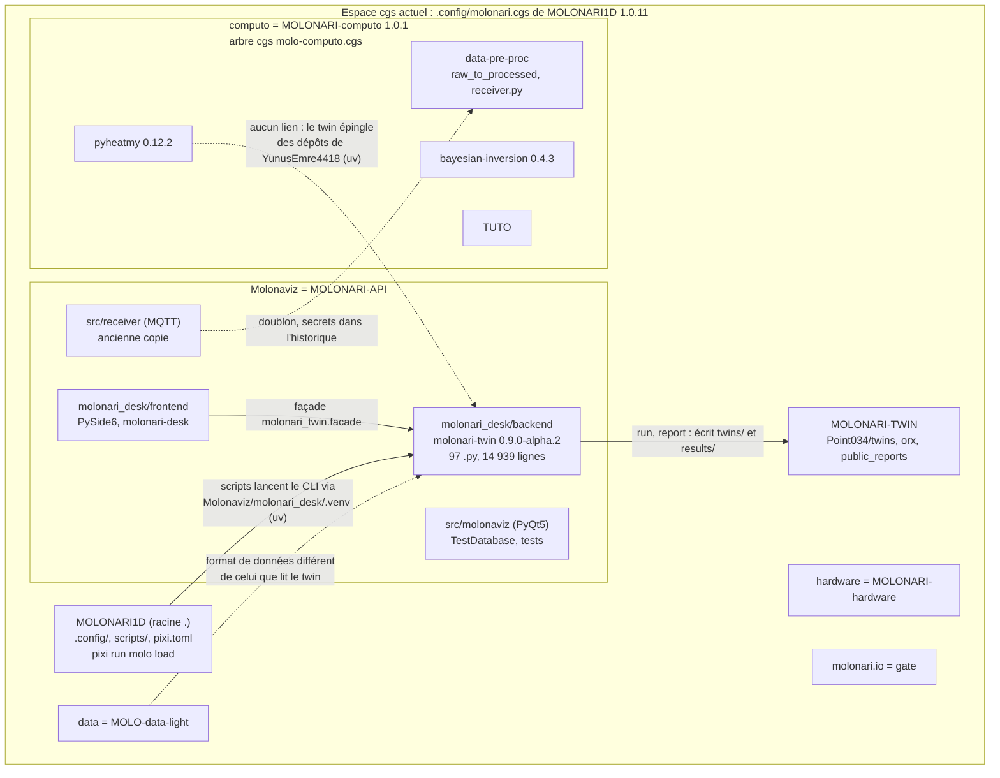
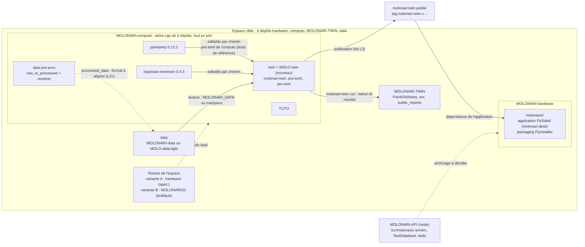
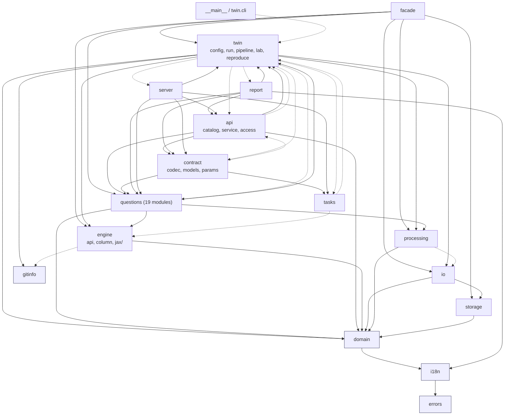
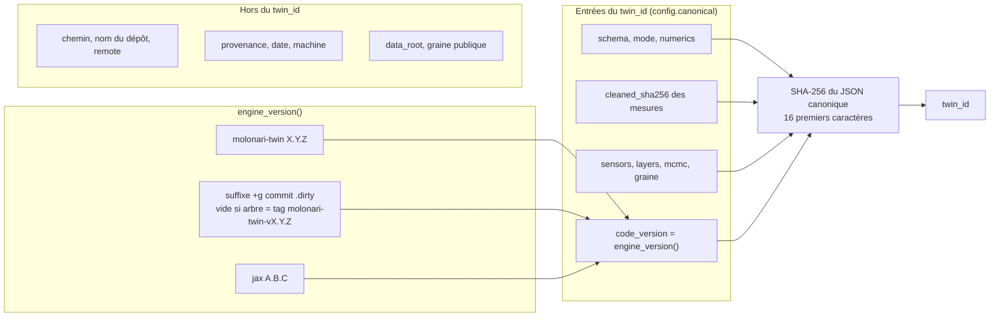
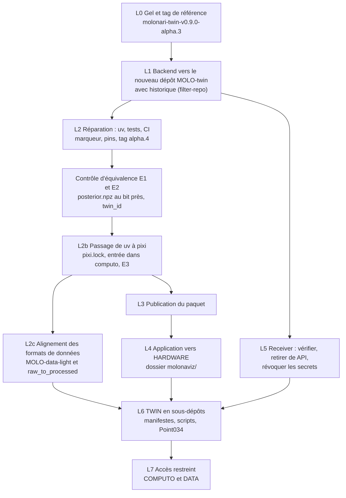

> État au 2026-11-13 (MOLONARI1D 1.0.11, MOLONARI-computo 1.0.1, molonari-twin 0.9.0-alpha.2)

# Audit de séparation du twin et du logiciel de bureau

Séparer `molonari-twin` (backend, CLI) de `molonari-desk` (application PySide6) pour lancer des twins en CLI depuis un espace cgs à **4 dépôts : MOLONARI-hardware, MOLONARI-computo, MOLONARI-TWIN, MOLONARI-data**. L'audit suit la spécification 4 niveaux (`SPEC_MOLONARI_4_NIVEAUX.md`, sections 1, 8 et 9, et son manifeste final : documents de travail, hors dépôt) et l'état distant du 2026-11-13 :

- le **code du twin** va dans l'arbre de **MOLONARI-computo**, qui est devenu un arbre cgs de 5 dépôts tout en pixi : il y entre comme un 6ᵉ sous-dépôt, `MOLO-twin` (6.1) ;
- le **receiver** est déjà dans computo (MOLO-data-process) : il reste à vérifier, à retirer de MOLONARI-API et à révoquer les secrets (3.8) ;
- l'**application de bureau** va dans **MOLONARI-hardware**, dossier `molonaviz/` ;
- MOLONARI-API ne garde que l'ancien `src/molonaviz`, `TestDatabase` et `tests/`.

Audit en lecture seule, fait les 2026-11-12 et 2026-11-13 sur le dépôt `Molonaviz` local (branche `CGS-MOLO`, commit `e324a40`, qui contient les PR #140 et #141) et, pour les dépôts distants, sur `origin/CGS-MOLO` et `gh api`. Aucun dépôt n'a été modifié.

## Sommaire

1. [Résumé exécutif](#1-résumé-exécutif)
2. [Avant / après](#2-avant--après)
3. [Inventaire classé](#3-inventaire-classé)
4. [Graphe des dépendances internes](#4-graphe-des-dépendances-internes)
5. [Points de couplage à adapter](#5-points-de-couplage-à-adapter)
6. [Disposition cible dans MOLONARI-computo et MOLONARI-hardware](#6-disposition-cible-dans-molonari-computo-et-molonari-hardware)
7. [Manifeste cible de l'espace](#7-manifeste-cible-de-lespace)
8. [Impact sur les twins existants](#8-impact-sur-les-twins-existants)
9. [Plan de migration en lots](#9-plan-de-migration-en-lots)
10. [Risques](#10-risques)
11. [Checklist de vérification](#11-checklist-de-vérification)
12. [Annexe : méthode et vérifications](#12-annexe--méthode-et-vérifications)

---

## 1. Résumé exécutif

- **Verdict : faisable, sans refonte du calcul.** Le backend n'importe ni Qt ni `molonari_desk` (garde-fou `test_architecture.py`, vérifié par grep). Ses 97 fichiers Python (14 939 lignes) se copient avec leur historique dans un nouveau dépôt `MOLO-twin`, monté dans l'arbre de computo comme les autres `MOLO-*`.
- **Effort : environ 9 jours-personne** pour les lots 0 à 5, dont 1 jour de contrôle d'équivalence (calcul MCMC), 1 jour pour le passage à pixi (L2b) et 2 jours pour aligner les formats de données (L2c). Les lots 6 (TWIN en sous-dépôts) et 7 (accès restreint) sont ceux de la spéc. et ne sont pas chiffrés ici.
- **Ce qui change** : 5 fichiers source du backend (`errors.py`, `fr.json`, `twin/config.py`, `engine/reference.py`, `twin/provenance.py`) et les autres fichiers « à adapter » de l'inventaire (tests, outils, CI, verrou, manifestes et scripts de la racine), presque tous pour un chemin ou un nom de dossier.
- **Risque 1 : le `twin_id` change à la copie.** Il contient `engine_version()`, donc le commit du code si l'arbre n'est pas exactement un tag. Les deux twins de Point034 ne sont déjà plus « calculés » au HEAD actuel (`e324a40`) : `molonari-twin id` donne `b20fdba62ea7b62c`, non `1b9098e8fc673df4` (section 8).
- **Risque 2 : le twin ne lit pas MOLO-data-light.** Le dépôt de données de `molonari.cgs` n'a ni `Laboratory/`, ni `SamplingPoints/`, ni le manifeste `molonari-processed/1.1.0` que le twin exige (3.10). Il faut un lot d'alignement (L2c).
- **Risque 3 : secrets de configuration du receiver** dans l'historique public de MOLONARI-API : à révoquer et à régénérer ; ne jamais les copier ni les reprendre dans un historique (10).
- **Passage de uv à pixi.** Computo est déjà en pixi (6.4). L'environnement du twin passe de uv à pixi au lot L2b, après le contrôle d'équivalence, avec JAX gardé sur PyPI aux mêmes versions.
- **Racine de l'espace : deux pratiques.** La spéc. met MOLONARI-hardware en racine ; le responsable met MOLONARI1D en racine, avec `.config/`. La seconde demande le moins de changements (7.1).

### 1.1 En chiffres

Périmètre : fichiers suivis par git de `Molonaviz/molonari_desk/` (HEAD local `e324a40`), de l'ancien molonaviz, du receiver, des tests et de la CI de `Molonaviz/`, et des fichiers de la racine MOLONARI1D qui touchent le twin (état distant). Lignes comptées comme `wc -l` ; un fichier binaire compte pour un fichier et zéro ligne.

| Classe | Fichiers | Lignes |
|---|---:|---:|
| ✅ COPIER | 161 | 31 913 |
| 🔧 ADAPTER | 34 | 9 790 |
| 🖥️ VERS HARDWARE | 60 | 9 551 |
| ⛔ NON | 101 | 22 128 |
| **Total inventorié** | **356** | **73 382** |

Lecture :

- **✅ COPIER tel quel** : 161 fichiers, 31 913 lignes (dont les exemples, les fixtures, `API_V1.md`). Vers `MOLO-twin`.
- **🔧 COPIER + ADAPTER** : 34 fichiers, 9 790 lignes (dont `uv.lock`, 1 993 lignes, remplacé par `pixi.lock`). Vers `MOLO-twin`, sauf les manifestes et scripts de la racine.
- **🖥️ VERS HARDWARE (application)** : 60 fichiers, 9 551 lignes (frontend, packaging, notices) vers `MOLONARI-hardware/molonaviz/`.
- **⛔ NE PAS COPIER** : 101 fichiers, 22 128 lignes (ce qui reste dans MOLONARI-API, le receiver déjà présent dans computo, ce qui reste à la racine MOLONARI1D). Les fichiers de secrets du receiver ne sont pas détaillés ni comptés.

Le paquet `molonari_twin` seul : 97 fichiers Python, 14 939 lignes, plus `i18n/fr.json` (383 lignes). Il se copie en entier, car l'application en a besoin par sa façade.

### 1.2 Faits vérifiés qui précisent le cadrage de départ

| Point | Cadrage | Constaté |
|---|---|---|
| Règle de la racine cgs | « premier dépôt sans `relative_path` » | Faux. Est racine : l'entrée avec `relative_path = "."`, sinon celle dont le nom est celui du projet, sinon le dépôt unique (`git_tree.py` L1594-1620). Testé avec le code de `dev-hub/` : deux dépôts sans `relative_path` et un projet d'un autre nom ne donnent aucune racine. |
| Sous-commandes | 10, puis 13 | **14** depuis les PR #140 et #141 : `validate`, `id`, `run`, `continue`, `list`, `report`, `reproduce`, `questions`, `ask`, `generate`, `reports`, `plot`, `lab`, `serve` (sortie de `molonari-twin --help`). |
| `molonari-twin plot --help` | — | Plante (`ValueError: unsupported format character 'b'`) : `twin/cli.py` L394 contient « 90 % bands » dans une aide argparse, le `%` doit être doublé. À corriger au lot L2. |
| `twin/ids*` | à lire | N'existe pas. Le `twin_id` est calculé dans `twin/config.py` L386-388 (`TwinConfig.twin_id`). |
| `DATA_DIR`, `LAB_DIR`, `POINT034_DIR` de `conftest.py` | données lues par les tests | Définies L12-14 et jamais utilisées. Le checkout d'un dépôt de données dans la CI ne sert à rien. |
| Tests du frontend | indépendants | `frontend/tests/conftest.py` L9 lit `backend/tests/fixtures` ; `test_twin_window.py` L10-17 importe des modules internes du backend. |
| Marqueur `molonari.cgs` | fichier à la racine de l'espace | Plus à la racine : `.config/molonari.cgs` depuis MOLONARI1D 1.0.x. `data_root()` ne le trouve plus aujourd'hui (7.2). |
| Receiver | à déplacer dans computo | Déjà dans computo : `MOLO-data-process/raw_to_processed/receiver.py`, avec `config.example.json` et deux fichiers de tests. |
| Dépôt de données de l'espace | MOLONARI-data | `.config/molonari.cgs` monte **MOLO-data-light** ; MOLONARI-data est en commentaire. |
| pyheatmy, bayesian_inversion | pins de YunusEmre4418 : 0.12.0 et 0.4.0 | Dépôts `flipoyo/MOLO-pyheatmy` (0.12.2) et `flipoyo/MOLO-bayesian` (0.4.3), dans l'arbre de computo. |

### 1.3 Conformité à la spécification

Lu : `SPEC_MOLONARI_4_NIVEAUX.md` L60, section 8 et section 9 ; le manifeste final de la spéc. ; `hardware/install.cgs` (documents de travail, hors dépôt, sauf ce dernier) ; et l'état distant du 13/11. La colonne « Audit » dit où il suit la spéc. et ce qu'il y ajoute ou en écarte.

| Point | Spéc. | Audit |
|---|---|---|
| Racine de l'espace | MOLONARI-hardware, `relative_path = "."` | **Écart de pratique** : le responsable met MOLONARI1D en racine (`.config/`). Les deux variantes sont chargées sans erreur (7.1) ; la variante B (pratique) demande le moins de changements. |
| Manifeste | 4 dépôts : hardware `.`, data `data/`, computo `pyheatmy/`, TWIN `MOLONARI-TWIN/` | Idem, avec computo monté en `computo` (nom actuel) et un dépôt de données à choisir (MOLONARI-data ou MOLO-data-light). **Complément** : aucun fichier suivi de hardware n'entre en collision avec les montages (vérifié) ; son `.gitignore` doit les lister. |
| Backend | COMPUTO `src/molonari_twin/`, avec historique, tags `molonari-twin-v*` | **Adapté** : computo est un arbre de dépôts. Le backend devient un dépôt `MOLO-twin` monté en `./twin` ; historique et tags conservés. **Complément** : arbre du tag identique ; deux noms de chemin à suivre (`molonaviz2/backend` puis `molonari_desk/backend`). |
| Receiver | COMPUTO `raw_to_processed/receiver/`, sans secrets, `config.example.json`, chemins réécrits | **Déjà fait** dans MOLO-data-process. Reste : vérifier, retirer de MOLONARI-API, révoquer et régénérer les secrets. |
| Application | HARDWARE `molonaviz/`, dépend du paquet publié, contrainte périmée et `BACKEND` du spec PyInstaller | Idem. **Complément** : les tests du frontend lisent les fixtures du backend ; le dossier s'appelle `molonari_desk` (renommage postérieur à la spéc.). |
| Reste dans MOLONARI-API | ancien `src/molonaviz`, `TestDatabase`, `tests/` | Idem (3.7). |
| Ordre des lots | 1 backend, 2 réparation, contrôle, 3 publication, 4 application, 5 receiver, 6 TWIN, 7 accès | Idem (9). **Compléments** : lot 0 de gel, contrôle E1/E2 à tag égal, L2b (pixi), L2c (formats de données). |
| Identité des twins | recréer le tag ; mêmes identifiants après le lot 2 ; ils changent au lot 6 | Idem. **Complément** : les identifiants de Point034 portent un suffixe `+g<commit>` qu'aucun tag ne reproduit, et le HEAD actuel les a déjà changés (8.2). |
| pyheatmy | « inchangé dans ce déplacement » | **Complément** : 0.12.2 et bayesian_inversion 0.4.3 sont dans l'arbre de computo ; l'écart avec les 0.12.0 et 0.4.0 des tests de référence est à vérifier (6.2). |
| Marqueur de l'espace | non traité | **Complément** : accepter `.cgitsync` en plus de `molonari.cgs` (7.2). |
| Données traitées | `processed_data/<point>/` lu par COMPUTO, hash du manifeste vérifié | **Complément** : deux formats incompatibles (3.10) ; lot L2c. |
| Environnement | uv (spéc. antérieure à pixi) | **Complément** : pixi (6.4). |
| Commits du backend | 89 | 152 sur les chemins élargis et les deux noms de dossier. |

---

## 2. Avant / après

### 2.1 Espace actuel (`.config/molonari.cgs`, MOLONARI1D 1.0.11)

Le twin vit dans MOLONARI-API, à côté du logiciel de bureau, d'une ancienne copie du receiver et de l'ancien outil. Computo est un arbre de 5 dépôts (pyheatmy, bayesian-inversion, data-pre-proc, TUTO) sans code twin. Les scripts de la racine appellent le CLI par le `.venv` uv de `molonari_desk`. Le dépôt de données monté est MOLO-data-light.



### 2.2 Espace cible (4 dépôts)

Le twin devient un sous-dépôt `MOLO-twin` de l'arbre de computo, avec son `pixi.toml` et son `pixi.lock` comme les autres `MOLO-*`. L'application est dans `MOLONARI-hardware/molonaviz/` et dépend du paquet publié. MOLONARI-API ne garde que l'ancien outil. La racine de l'espace dépend de la variante retenue (7.1).



Flux conservés : le CLI lit les données et écrit les twins et résultats (MOLONARI-TWIN). Flux nouveaux : l'application lit le code par le paquet publié ; les tests de référence lisent pyheatmy et bayesian-inversion par chemin dans l'arbre de computo ; le format de `processed_data` produit par `raw_to_processed` doit devenir celui que lit le twin (L2c).

---


## 3. Inventaire classé

Légende : **✅ COPIER** tel quel (vers le dépôt `MOLO-twin`) · **🔧 ADAPTER** (copier, puis modifier ; la raison dit quoi) · **🖥️ VERS HARDWARE** (application de bureau, dossier `molonaviz/` de MOLONARI-hardware) · **⛔ NON** (ne pas copier : reste dans MOLONARI-API, déjà présent dans computo, ou reste à la racine MOLONARI1D).

Chaque tableau donne sa base de chemins. Les lignes sont celles de `wc -l` ; pour un dossier, c'est la somme des fichiers texte suivis par git, avec leur nombre entre parenthèses. Les zones `backend/src`, `backend/tests`, CI, `molonari_desk/` (dans son ensemble) et l'ancien molonaviz couvrent tous leurs fichiers suivis (vérifié par script). La zone de la racine MOLONARI1D ne liste que les fichiers qui touchent le twin, lus sur `origin/CGS-MOLO`. Le receiver est listé sans son dossier de secrets (3.8).

### 3.1 backend/src : le paquet molonari_twin

> Base : `Molonaviz/molonari_desk/backend/src/molonari_twin/`. Un chemin qui finit par `/` désigne un dossier : lignes et fichiers sont ceux des fichiers suivis par git.

| Chemin | Rôle | Lignes | Classe | Raison |
|---|---|---:|---|---|
| `__init__.py` | version lue par importlib.metadata | 8 | ✅ COPIER | Aucun chemin. |
| `__main__.py` | commande `molonari-twin` et `python -m molonari_twin` | 13 | ✅ COPIER | Aucun chemin. |
| `errors.py` | catalogue des codes d'erreur et messages | 396 | 🔧 ADAPTER | L219 et L239 citent le marqueur `molonari.cgs`, L236 cite `twin.cgs`. Tout changement du texte anglais doit être répercuté dans `i18n/fr.json` (test_catalog). |
| `facade.py` | seule porte du frontend | 224 | ✅ COPIER | Aucun chemin. Reste dans le paquet : l'application (hardware) l'importe par le paquet publié. |
| `gitinfo.py` | seul module qui appelle git | 114 | ✅ COPIER | Indépendant du nom du dépôt. `version_suffix` cherche le tag `molonari-twin-v<version>` : ce tag doit exister dans MOLO-twin. |
| `i18n/__init__.py` | catalogue de traduction | 68 | ✅ COPIER | Docstring L6 cite `molonari_desk` (cosmétique). |
| `i18n/fr.json` | traductions françaises des chaînes du backend | 383 | 🔧 ADAPTER | À suivre mot pour mot si un message de `errors.py` ou une aide de `cli.py` change. |
| `api/` | TwinAPI, catalogue de questions, niveaux d'accès | 742 (5 f.) | ✅ COPIER | Aucun chemin. |
| `contract/` | contrat HTTP : modèles pydantic, codec | 510 (5 f.) | ✅ COPIER | Aucun chemin. |
| `domain/` | modèles de domaine et configurations de calcul | 334 (3 f.) | ✅ COPIER | Aucun chemin. |
| `engine/__init__.py` | paquet vide | 0 | ✅ COPIER | — |
| `engine/api.py` | façade du moteur, `engine_version()` | 98 | ✅ COPIER | L41 : `parents[3]` désigne la racine du dépôt MOLO-twin (là où est `pyproject.toml`) avec la disposition `src/molonari_twin/`. Aucun changement alors. |
| `engine/column.py` | colonne d'entrée du modèle | 82 | ✅ COPIER | Aucun chemin. |
| `engine/diagnostics.py` | diagnostics ArviZ | 47 | ✅ COPIER | Aucun chemin. |
| `engine/layout.py` | grille et capteurs | 100 | ✅ COPIER | Aucun chemin. |
| `engine/reference.py` | adaptateur vers pyheatmy et bayesian_inversion (tests) | 71 | 🔧 ADAPTER | L6 et L10 : docstring sur le lieu des pins ; L43 : dossier temporaire `molonari_desk_pyheatmy`. |
| `engine/results.py` | résultats du moteur | 135 | ✅ COPIER | Aucun chemin. |
| `engine/stats.py` | statistiques des chaînes | 186 | ✅ COPIER | Aucun chemin. |
| `engine/jax/` | moteur JAX : direct, DREAM, appareil | 922 (4 f.) | ✅ COPIER | Aucun chemin. |
| `io/` | imports HOBO, laboratoire, anciens projets, dates | 852 (5 f.) | ✅ COPIER | Aucun chemin. `legacy_import.py` (144 lignes) ne sert qu'à l'application. |
| `processing/` | nettoyage des mesures | 172 (2 f.) | ✅ COPIER | Aucun chemin. |
| `questions/` | catalogue de questions (19 modules) | 2 072 (24 f.) | ✅ COPIER | Aucun chemin. |
| `report/` | rapport public : figures SVG, générateur | 2 029 (8 f.) | ✅ COPIER | Aucun chemin. |
| `server/` | API HTTP locale (FastAPI) | 217 (2 f.) | ✅ COPIER | Aucun chemin. |
| `storage/` | projet `.molo` (SQLite) de desk | 457 (2 f.) | ✅ COPIER | Aucun chemin. Le CLI ne s'en sert pas ; l'application l'utilise par la façade. |
| `tasks/` | TaskRunner, base des tâches | 745 (7 f.) | ✅ COPIER | `local.py` L37-38 : base dans `~/.cache/molonari-twin/` (par utilisateur, pas par espace). Passer `--tasks-db`. |
| `twin/__init__.py` | paquet | 1 | ✅ COPIER | — |
| `twin/cli.py` | analyseur et sous-commandes | 594 | ✅ COPIER | L33, L37, L60-62, L133 : textes, pas de chemin. L501 `Path.cwd()` : le dossier courant est l'espace. |
| `twin/config.py` | twin.yaml, `twin_id`, racine des données | 1 033 | 🔧 ADAPTER | L115-117 et L406-421 : `MOLONARI_DATA`, `data_root.txt`, marqueur `molonari.cgs`, dossier `data/`. |
| `twin/create.py` | création d'un twin | 75 | ✅ COPIER | Aucun chemin. |
| `twin/generate.py` | état généré depuis un échantillon publié | 325 | ✅ COPIER | L261 : sortie par défaut dans le dossier courant. |
| `twin/lab.py` | virtual lab (lab.yaml, `lab build`) | 205 | ✅ COPIER | Passe par `config.data_root`. |
| `twin/orx.py` | graine réservée (orx.yaml) | 116 | ✅ COPIER | Aucun chemin. |
| `twin/pipeline.py` | mesures brutes vers mesures nettoyées | 306 | ✅ COPIER | Aucun chemin. |
| `twin/processed.py` | données traitées et manifeste | 189 | ✅ COPIER | Aucun chemin. |
| `twin/provenance.py` | provenance git du code et du twin | 105 | 🔧 ADAPTER | L3 : docstring `molonari_desk/backend/`. L28-29 : `code_path()` remonte de 2 niveaux, valable pour `twin/src/molonari_twin/twin/`. |
| `twin/registry.py` | registry.csv et dossier results/ | 114 | ✅ COPIER | Aucun chemin. |
| `twin/reports.py` | lecture des rapports publics | 106 | ✅ COPIER | L7 : texte sur la disposition de MOLONARI-TWIN, inchangé. |
| `twin/reproduce.py` | reproduce, export, compare | 439 | ✅ COPIER | Aucun chemin. |
| `twin/plot.py` | sous-commande `plot` (tracés SVG d'un twin, niveau opx) | 92 | ✅ COPIER | L56 : sortie par défaut `<dossier courant>/<ref>_plots`. Aucun changement. |
| `twin/results.py` | lecture des résultats | 239 | ✅ COPIER | Aucun chemin. |
| `twin/run.py` | run_twin, twin de dev, statut | 406 | ✅ COPIER | L156 : `Path.cwd()` par défaut pour `--space`. Aucun changement. |

Le CLI ne se sert pas de `storage/`, `io/legacy_import.py` ni `facade.py` (825 lignes en tout). Ils restent dans le paquet parce que l'application les appelle par la façade. On pourra les sortir plus tard ; ce n'est pas une condition de la séparation.

Les PR #140 (rapport public) et #141 (commande `plot`) ont ajouté `report/interpretation.py`, `report/plots.py`, `report/readme.py` et `twin/plot.py` : le backend passe de 93 à 97 fichiers Python et de 13 401 à 14 939 lignes. Aucun ne contient de chemin à adapter.

### 3.2 backend/tests

> Base : `Molonaviz/molonari_desk/backend/tests/`. Un chemin qui finit par `/` désigne un dossier : lignes et fichiers sont ceux des fichiers suivis par git.

| Chemin | Rôle | Lignes | Classe | Raison |
|---|---|---:|---|---|
| `leaks.py` | détecteur de fuite de valeurs (graine, bornes) dans les exports et rapports | 53 | ✅ COPIER |  |
| `svgcheck.py` | assistant de test : validité des SVG | 40 | ✅ COPIER |  |
| `conftest.py` | fixtures communes | 91 | 🔧 ADAPTER | L10-14 : `REPO_ROOT`, `WORKSPACE_ROOT`, `DATA_DIR`, `LAB_DIR`, `POINT034_DIR` (plus utilisés hors conftest) ; L18 : `EXAMPLE_TWINS` en `parents[2]`. |
| `test_access.py` | niveaux d'accès | 123 | ✅ COPIER |  |
| `test_api.py` | TwinAPI | 375 | 🔧 ADAPTER | L20 : `EXAMPLES = parents[2]/examples/twins`. |
| `test_api_doc.py` | API_V1.md à jour | 30 | 🔧 ADAPTER | L6 : `WORKSPACE = parents[2]` (tools/). |
| `test_architecture.py` | garde-fou sans Qt, façade unique | 236 | 🔧 ADAPTER | L14-15 : `SOURCE`, `EXAMPLES` ; `FORBIDDEN` garde `molonari_desk`. |
| `test_catalog.py` | catalogue français exact | 37 | 🔧 ADAPTER | L10 : `WORKSPACE = parents[2]` (tools/extract_strings.py). |
| `test_cleanup.py` | nettoyage | 118 | ✅ COPIER |  |
| `test_cli.py` | sous-commandes | 136 | 🔧 ADAPTER | L13 : `EXAMPLES`. |
| `test_contract.py` | contrat | 125 | ✅ COPIER |  |
| `test_data_questions.py` | questions de données | 172 | ✅ COPIER |  |
| `test_determinism.py` | déterminisme (slow) | 414 | ✅ COPIER | Pose `MOLONARI_DATA` : indépendant du marqueur. |
| `test_dream_vs_bayesian_inversion.py` | DREAM JAX contre bayesian_inversion (slow) | 380 | ✅ COPIER | Exige le pin de bayesian_inversion. |
| `test_engine_dream.py` | moteur DREAM | 370 | ✅ COPIER |  |
| `test_engine_forward.py` | modèle direct contre pyheatmy (1e-9) | 142 | ✅ COPIER | Exige pyheatmy 0.12.0 (voir 6.2). |
| `test_generate.py` | état généré | 399 | ✅ COPIER |  |
| `test_gitinfo.py` | état git | 80 | ✅ COPIER |  |
| `test_io.py` | imports | 299 | ✅ COPIER |  |
| `test_lab.py` | virtual lab | 485 | 🔧 ADAPTER | L167 : crée `molonari.cgs` factice dans un espace de test. |
| `test_messages.py` | messages et erreurs | 216 | ✅ COPIER |  |
| `test_pipeline.py` | pipeline | 468 | ✅ COPIER |  |
| `test_plot_cli.py` | sous-commande `plot` | 341 | ✅ COPIER |  |
| `test_questions.py` | questions | 1 129 | 🔧 ADAPTER | L363 : `EXAMPLES`. |
| `test_questions_cli.py` | questions en CLI | 210 | ✅ COPIER |  |
| `test_reliability.py` | fiabilité | 219 | ✅ COPIER |  |
| `test_report.py` | rapport | 1 032 | ✅ COPIER |  |
| `test_report_output.py` | sorties du rapport | 115 | ✅ COPIER |  |
| `test_reports.py` | lecture des rapports publics | 157 | ✅ COPIER |  |
| `test_reproduce.py` | reproduce (slow) | 92 | ✅ COPIER |  |
| `test_reproduce_export.py` | export et compare | 172 | ✅ COPIER |  |
| `test_server.py` | serveur HTTP | 584 | 🔧 ADAPTER | L27 : `EXAMPLES`. |
| `test_server_levels.py` | niveaux du serveur | 183 | ✅ COPIER |  |
| `test_stats.py` | statistiques | 123 | ✅ COPIER |  |
| `test_storage.py` | projet .molo, import des anciennes bases | 289 | 🔧 ADAPTER | L9, L121, L152 : `REPO_ROOT/src/molonaviz/docs/ERD_structure.sql`, hors du backend. Copier le .sql en fixture. |
| `test_svgplot.py` | tracés SVG | 340 | ✅ COPIER |  |
| `test_tasks.py` | tâches | 323 | ✅ COPIER |  |
| `test_twin.py` | twin, twin_id, mode strict | 576 | 🔧 ADAPTER | L115 : `EXAMPLES`. |
| `test_twin_publication.py` | publication | 373 | ✅ COPIER |  |
| `test_twin_schema.py` | schémas 1.x et 2.0.0 | 577 | 🔧 ADAPTER | L15 : `FIXTURES.parents[2]` ; L551 : `molonari.cgs` factice. |
| `test_version.py` | version unique, tag | 94 | 🔧 ADAPTER | L9-11 : `WORKSPACE = parents[2]` (tools/check_version.py). |
| `test_visibility.py` | visibilité | 310 | ✅ COPIER | L23 : `docs/API_V1.md` du backend, copié avec lui. |
| `fixtures/` | HOBO, Point034, lab, openapi_v1.json | 4 283 (27 f.) | ✅ COPIER | Aucun chemin. |

Treize fichiers de tests changent, dont neuf seulement par un `parents[N]`. La suite compte 39 fichiers `test_*.py`, dont 10 portent le marqueur `slow`.

### 3.3 Outils, Makefile, paquet et verrou

> Base : `Molonaviz/molonari_desk/`. Un chemin qui finit par `/` désigne un dossier : lignes et fichiers sont ceux des fichiers suivis par git.

| Chemin | Rôle | Lignes | Classe | Raison |
|---|---|---:|---|---|
| `backend/pyproject.toml` | paquet molonari-twin 0.9.0-alpha.2 | 52 | 🔧 ADAPTER | Devient `pyproject.toml` du dépôt MOLO-twin ; sources du groupe dev (pyheatmy, bayesian_inversion) ; `pixi.toml` ajouté au lot L2b (6.4). |
| `uv.lock` | verrou unique de l'espace uv (backend et frontend) | 1 993 | 🔧 ADAPTER | Copier vers MOLO-twin puis `uv lock` après retrait du membre frontend : uv garde les versions déjà figées (jax 0.11.2, numpy 2.5.4). Remplacé par `pixi.lock` au lot L2b. L'application (hardware) régénère le sien. |
| `pyproject.toml` | racine de l'espace uv (membres backend et frontend) | 35 | 🖥️ VERS HARDWARE | Devient `molonaviz/pyproject.toml` dans hardware, sans membre backend : dépendance sur le paquet `molonari-twin` publié. |
| `Makefile` | cibles run, twin, test, test-slow, strings, package | 33 | 🔧 ADAPTER | Cibles `twin`, `test-backend`, `test-slow`, `strings` copiées vers `Makefile` de MOLO-twin (remplacé par des tâches pixi au lot L2b) ; `run`, `package`, `selftest-package` vont avec l'application dans hardware (spéc. section 9). |
| `tools/check_version.py` | SemVer, CHANGELOG, tag | 85 | 🔧 ADAPTER | L16 `WORKSPACE`, table `PACKAGES` : retirer `molonari-desk-v` côté MOLO-twin. Desk garde sa copie. |
| `tools/extract_strings.py` | chaînes sans traduction | 87 | 🔧 ADAPTER | L21-23 `BACKEND`, `FRONTEND`. Côté MOLO-twin : seulement le backend ; la partie frontend va dans hardware. |
| `tools/gen_api_doc.py` | génère backend/docs/API_V1.md | 243 | 🔧 ADAPTER | L15-16 `WORKSPACE`, `OUTPUT` ; L101 `sys.path`. |
| `tools/gen_notice_tables.py` | tables de la notice scientifique | 76 | 🖥️ VERS HARDWARE | Lit `molonari_desk.notice` (frontend) : suit l'application dans hardware. |
| `.gitignore` | dist, build, examples/results… | 12 | ✅ COPIER | Reprendre les lignes utiles. |

### 3.4 CI

> Base : `Molonaviz/.github/workflows/`. Un chemin qui finit par `/` désigne un dossier : lignes et fichiers sont ceux des fichiers suivis par git.

| Chemin | Rôle | Lignes | Classe | Raison |
|---|---|---:|---|---|
| `molonari-desk-tests.yml` | jobs backend (sans Qt, slow, CLI) et frontend (Xvfb) | 77 | 🔧 ADAPTER | Le job backend part dans MOLO-twin (avec `-m slow`). Le job frontend va dans hardware ; il installe `molonari-twin` publié. |
| `molonari-desk-version.yml` | SemVer des paquets, tags `molonari-twin-v*` et `molonari-desk-v*` | 22 | 🔧 ADAPTER | Séparer : tags `molonari-twin-v*` dans MOLO-twin, `molonari-desk-v*` dans hardware. |

### 3.5 Docs, exemples, notices

> Base : `Molonaviz/molonari_desk/`. Un chemin qui finit par `/` désigne un dossier : lignes et fichiers sont ceux des fichiers suivis par git.

| Chemin | Rôle | Lignes | Classe | Raison |
|---|---|---:|---|---|
| `backend/README.md` | présentation du backend | 103 | 🔧 ADAPTER | Liens relatifs vers l'espace uv à réécrire. |
| `backend/CHANGELOG.md` | historique des versions du twin | 389 | ✅ COPIER | Garder tel quel : le test de version le lit. |
| `backend/docs/API_V1.md` | référence des questions, générée | 551 | ✅ COPIER | Régénérée par `gen_api_doc.py` ; `test_visibility` et `test_api_doc` la lisent. |
| `examples/twins/` | 4 twins 1.x de démonstration (mesures incluses) | 5 839 (8 f.) | ✅ COPIER | Aucune donnée externe. Utilisés par 11 fichiers de tests. |
| `docs/NOTICE_UTILISATEUR.md` | notice de l'application | 372 | 🖥️ VERS HARDWARE | Suit l'application (`molonaviz/docs/`) ; emplacement non précisé par la spéc. |
| `docs/NOTICE_SCIENTIFIQUE.md` | notice scientifique | 430 | 🖥️ VERS HARDWARE | Tables générées depuis le frontend : suit l'application ; MOLO-twin la cite par lien. |
| `README.md` | présentation de l'espace desk | 218 | 🖥️ VERS HARDWARE | À réécrire dans `molonaviz/README.md` (hardware) ; MOLO-twin a son propre `README.md`. |

### 3.6 Application de bureau (frontend molonari-desk) : vers MOLONARI-hardware, dossier `molonaviz/`

> Base : `Molonaviz/molonari_desk/frontend/`. Un chemin qui finit par `/` désigne un dossier : lignes et fichiers sont ceux des fichiers suivis par git.

| Chemin | Rôle | Lignes | Classe | Raison |
|---|---|---:|---|---|
| `src/` | application PySide6 (41 fichiers) | 6 478 (41 f.) | 🖥️ VERS HARDWARE | Dans `src/`, seul `molonari_twin.facade` est importé (grep). Dépend du paquet publié. |
| `tests/` | tests Qt et architecture du frontend | 1 476 (10 f.) | 🖥️ VERS HARDWARE | `conftest.py` L8-9 lit `backend/tests/fixtures` ; `test_app.py` L14 pointe vers `tools/` ; `test_twin_window.py` L10-17 importe des modules internes du backend. |
| `packaging/` | spec PyInstaller | 39 (1 f.) | 🖥️ VERS HARDWARE | L11 `BACKEND = ROOT.parent / "backend"` et L28 `pathex` : à remplacer par le paquet installé. Le paquet gelé n'a pas de suffixe local. |
| `pyproject.toml` | paquet molonari-desk 0.7.0 | 37 | 🖥️ VERS HARDWARE | `molonari-twin>=0.9.0a1,<0.10` (périmée à la prochaine version) : dépendre du paquet publié ; corriger aussi `BACKEND` dans le spec PyInstaller. |
| `CHANGELOG.md` | historique de desk | 346 | 🖥️ VERS HARDWARE |  |
| `README.md` | présentation | 44 | 🖥️ VERS HARDWARE |  |

### 3.7 Ancien molonaviz (PyQt5) et dépôt MOLONARI-API

> Base : `Molonaviz/`. Un chemin qui finit par `/` désigne un dossier : lignes et fichiers sont ceux des fichiers suivis par git.

| Chemin | Rôle | Lignes | Classe | Raison |
|---|---|---:|---|---|
| `src/molonaviz/backend/` | ancien backend (DatabaseManager…) | 3 077 (19 f.) | ⛔ NON | Reste dans MOLONARI-API (spéc. section 9). PyQt5 + SQLite ; le twin ne s'en sert pas. |
| `src/molonaviz/frontend/` | ancienne interface PyQt5 | 6 424 (37 f.) | ⛔ NON | Idem. |
| `src/molonaviz/interactions/` | interactions de l'ancien outil | 278 (6 f.) | ⛔ NON | Idem. |
| `src/molonaviz/utils/` | utilitaires de l'ancien outil | 277 (3 f.) | ⛔ NON | Idem. |
| `src/molonaviz/main.py` | point d'entrée de l'ancien outil | 592 | ⛔ NON | Idem. |
| `src/molonaviz/__init__.py` | paquet | 0 | ⛔ NON | Vide. |
| `src/molonaviz/docs/ERD_structure.sql` | schéma SQL de l'ancienne base | 116 | ✅ COPIER | Seul fichier utile : fixture de `test_storage.py`. À copier dans `tests/fixtures/` de MOLO-twin. |
| `src/molonaviz/docs/ERD_ORIGINAL.png` | schéma | — | ⛔ NON | Documentation de l'ancien outil. |
| `src/molonaviz/docs/ERD_VParadigm.vpd` | schéma | 0 | ⛔ NON | Idem. |
| `src/molonaviz/docs/SQL_map_REF.png` | schéma | — | ⛔ NON | Idem. |
| `src/molonaviz/docs/UserguideMolonaViZ2023.docx` | guide | — | ⛔ NON | Idem. |
| `src/molonaviz/docs/UserguideMolonaViZ2023.pdf` | guide | — | ⛔ NON | Idem. |
| `src/molonaviz/docs/__init__.py` | paquet | 0 | ⛔ NON | Vide. |
| `src/molonaviz/docs/erd.png` | schéma | — | ⛔ NON | Idem. |
| `src/molonaviz/imgs/` | images de l'ancien outil | 0 (4 f.) | ⛔ NON | Idem. |
| `tests/test_Molonaviz.py` | test de structure de l'ancien outil | 5 | ⛔ NON | Reste dans MOLONARI-API. |
| `tests/test_config.py` | test de configuration du receiver | 20 | ⛔ NON | Suit le receiver, qui est déjà dans computo avec ses propres tests (`test_receiver.py`, `test_wire.py`). Le test d'origine est déjà cassé. |
| `TestDatabase/` | Molonari.sqlite.backup | 0 (1 f.) | ⛔ NON | Reste dans MOLONARI-API. Base d'essai de l'ancien outil et du receiver. |
| `pyproject.toml` | paquet molonaviz 1.0.1 (PyQt5, paho-mqtt) | 40 | ⛔ NON | Reste avec l'ancien outil. |
| `pixi.toml` | environnement pixi de l'ancien outil | 21 | ⛔ NON | Idem. |
| `pixi.lock` | verrou pixi | 8 626 | ⛔ NON | Idem. |

### 3.8 src/receiver (MQTT) : déjà dans MOLONARI-computo, à retirer de MOLONARI-API

> Base : `Molonaviz/src/receiver/`. Un chemin qui finit par `/` désigne un dossier : lignes et fichiers sont ceux des fichiers suivis par git.

| Chemin | Rôle | Lignes | Classe | Raison |
|---|---|---:|---|---|
| `adapt_nodered_mqtt.py` | client MQTT, file, décodage | 262 | ⛔ NON | Déjà repris par `raw_to_processed/receiver.py` de MOLO-data-process. Ne rien copier. |
| `db_insertion.py` | insertion dans SQLite (PyQt5) | 91 | ⛔ NON | Idem. |
| `decoder.py` | décodage base64 + protobuf | 65 | ⛔ NON | Idem. |
| `GUI_virtual_lab.py` | interface Tk du virtual lab | 249 | ⛔ NON | Remplacée par `virtual_lab.py` de MOLO-data-process. |
| `logger_timestamps.py` | journal des horodatages | 41 | ⛔ NON | Idem receiver. |
| `main.py` | point d'entrée | 32 | ⛔ NON | Idem receiver. |
| `sensor.proto` | message protobuf | 9 | ⛔ NON | Une définition existe aussi dans `hardware/tests/Connection_test/`. |
| `sensor_pb2.py` | protobuf généré | 38 | ⛔ NON | Idem. |
| `README.md` | présentation | 74 | ⛔ NON | Idem receiver. |
| `Database configuration.md` | schéma de la base du receiver | 48 | ⛔ NON | Idem receiver. |
| `__init__.py` | paquet | 0 | ⛔ NON | Vide. |
| `timestamps.log` | journal | 0 | ⛔ NON | Ne se versionne pas. |

Le dossier de secrets de configuration du receiver, suivi dans MOLONARI-API, n'est pas détaillé ici et n'est pas compté dans les totaux.

**Le receiver est déjà dans MOLONARI-computo** (`MOLO-data-process`, `raw_to_processed/receiver.py`, avec `config.example.json` et `tests/test_receiver.py`). Le lot L5 se réduit à trois gestes, sans extraction d'historique :

1. **Vérifier** que le receiver de MOLO-data-process couvre celui de MOLONARI-API : décodage base64 et protobuf, routage par appareil, tests sans réseau (`ingest_messages` n'ouvre aucune connexion). `listen`, seule fonction qui parle au broker, n'a pas été essayée contre un vrai serveur (docstring du module).
2. **Retirer** `src/receiver/` de MOLONARI-API, avec `tests/test_config.py` (déjà non fonctionnel : il lit un fichier de configuration qui n'existe pas à l'endroit cité, avec des clés absentes). Le `.gitignore` de MOLO-data-process exclut déjà la configuration réelle et les secrets du receiver.
3. **Révoquer et régénérer** les secrets. Des secrets de configuration du receiver sont dans l'historique public de MOLONARI-API : à révoquer et à régénérer ; ne jamais les copier ni les reprendre dans un historique. Réécrire l'historique de MOLONARI-API est une décision à part (dépôt public, `git push --force`) : la révocation, elle, est indispensable dans tous les cas.

### 3.9 Racine MOLONARI1D 1.0.11 (état distant origin/CGS-MOLO) : fichiers qui touchent le twin

> Base : `./`. Un chemin qui finit par `/` désigne un dossier : lignes et fichiers sont ceux des fichiers suivis par git.

| Chemin | Rôle | Lignes | Classe | Raison |
|---|---|---:|---|---|
| `.config/molonari.cgs` | manifeste de l'espace actuel (7 dépôts, MOLONARI1D en racine) | 11 | 🔧 ADAPTER | À réécrire pour l'espace à 4 dépôts (7.1) : retirer MOLONARI-API et la gate, ajouter MOLONARI-TWIN. |
| `.config/install-orx.cgs` | manifeste OPX (MOLONARI1D, API, data, hardware, TWIN) | 10 | 🔧 ADAPTER | Retirer MOLONARI-API (lot 6). |
| `.config/simu-direct.cgs` | manifeste de l'expérience SIMU | 12 | 🔧 ADAPTER | Idem (lot 6) ; garde `uv` dans `[environment] tools` : à retirer au lot L2b. |
| `.config/molonari-light.cgs` | manifeste léger (sans données) | 9 | 🔧 ADAPTER | Retirer MOLONARI-API. |
| `.config/molonari-vps.cgs` | manifeste du serveur molonari.io (dépôts publics) | 11 | 🔧 ADAPTER | Retirer MOLONARI-API. |
| `scripts/simu_direct.sh` | expérience SIMU (204 lignes) | 204 | 🔧 ADAPTER | L23 `BACKEND`, L29 `REPOS`, L74 boucle, L89-90 `uv sync`. |
| `scripts/demo_lundi.sh` | démo de bout en bout (211 lignes) | 211 | 🔧 ADAPTER | L24 `BACKEND`, L71 `uv sync`, L73-74 `TWIN_CLI` et `PYTHON`. |
| `scripts/molo.py` | chargeur `pixi run molo load / update / status` | 56 | ⛔ NON | Reste : il appelle `cgitsync`, indifférent au contenu des dépôts. |
| `pixi.toml` | environnement de MOLONARI1D (cgitsync) et tâches `molo` | 27 | ⛔ NON | Reste. Plus d'environnement `simu` ni de molonaviz. |
| `pixi.lock` | verrou pixi de la racine | 1 534 | ⛔ NON | Reste. |
| `README.md` | présentation de MOLONARI1D | 175 | ⛔ NON | Reste. |
| `INSTALL.md` | installation | 67 | ⛔ NON | Reste ; à mettre à jour (`pixi run molo load …`). |

### 3.10 Recouvrement entre `raw_to_processed` et le twin

MOLO-data-process (paquet `molonari-pipeline`, module `raw_to_processed`) fait pour la chaîne « brut → traité » ce que le twin fait avec `lab build`, `io/` et `data_root()`. Les deux écrivent un `processed_data/<point>/manifest.json` : les deux manifestes ne sont pas compatibles.

| Sujet | Twin (`molonari-twin`) | `raw_to_processed` (MOLO-data-process) |
|---|---|---|
| Laboratoire | `lab.yaml` (`molonari-lab/1.0.0`) ; dossier `Laboratory/` (`pressure_sensors/`, `shafts/`, `temperature_sensors/`) et `SamplingPoints/<point>/` | `lab/lab.json` (`schema: 1`) : calibrations, sampling points, appareils ; `sampling_points/<point>/metadata.json` ; schémas `schemas/lab.schema.json` et `sampling_point.schema.json` |
| Commande de construction | `molonari-twin lab build LAB --point P` | `python -m raw_to_processed run DATA_ROOT [P]` (`pixi run molonari process P`) |
| Fichier de mesures | `processed_data/<point>/measurements.csv` | `processed_data/<point>/data/measures.csv` |
| Colonnes | `date,temp_bed,t1,t2,t3,t4,pressure` | `Date,Temp1,Temp2,Temp3,Temp4,TempBed,Pressure` |
| Dates | `2016-06-27 12:00:00`, UTC, sans fuseau | `2016-06-27T11:00:00Z` |
| Manifeste | `schema: "molonari-processed/1.1.0"` ; clés exigées : `lab` (texte), `point`, `code_version`, `offset`, `sigma_pressure`, `sigma_temperature`, `depths` (4 nombres), `cleaned_sha256` (64 hex), `processing.start/end` | `schema: 1`, `step: "v1_to_ready"`, `twin_version`, `calibration`, `code.package_digest`, `env`, `inputs`, `lab` (objet), `outputs` (dont `git_tree`), `params`, `report` |
| Empreinte des mesures | `cleaned_sha256` : SHA-256 du CSV canonique (17 chiffres, dates à la seconde) ; entre dans le `twin_id` | `outputs.digest` et `outputs.files` : autre canonisation (3 décimales pour les températures, 5 pour la pression) |
| Profondeurs, décalage | dans le manifeste (`depths`, `offset`) | dans `sampling_points/<point>/metadata.json` (`sensor_depths_m`) ; incertitudes `sigma_*` absentes |
| Lien au code | version du paquet | empreinte du paquet et git tree |

**Peut-il lire MOLO-data-light tel quel ? Non.** Lu sur `origin/CGS-MOLO` (`gh api`) : `processed_data/Point034/manifest.json` et `lab/lab.json`. Quatre blocages, vérifiés dans `twin/processed.py` (`_check_manifest`, `read_processed`) :

1. `manifest.json` : `schema` vaut `1`, le twin exige `molonari-processed/1.1.0` (`E_PROCESSED_SCHEMA`) ; `lab` est un objet, `code_version`, `offset`, `sigma_pressure`, `sigma_temperature`, `depths` et `cleaned_sha256` manquent (`E_PROCESSED_MANIFEST_KEY`).
2. Le fichier de mesures s'appelle `data/measures.csv`, pas `measurements.csv` ; colonnes, ordre et format des dates diffèrent.
3. `lab build` du twin lit `Laboratory/` et `SamplingPoints/`, absents de MOLO-data-light (qui a `raw_data/`, `sampling_points/` et `lab/`).
4. Les valeurs ne sont pas identiques : sur les 1 430 instants communs, les températures sont égales, la pression diffère jusqu'à 5×10⁻⁶ (comparaison faite sur les deux fichiers de Point034) ; MOLO-data-light garde 1 436 lignes, dont 6 hors de la fenêtre du twin. Les deux écarts changent `cleaned_sha256`, donc le `twin_id` et les résultats au bit près. `validate.py` de `raw_to_processed` tolère un écart de pression de 1×10⁻⁴ (« proche »).

Conséquence : brancher le twin sur MOLO-data-light n'est pas une copie de fichiers. Trois options pour le lot L2c :

| Option | Contenu | Remarque |
|---|---|---|
| **A (recommandée)** | `raw_to_processed` devient le seul producteur de `processed_data/` ; le twin lit son format par un lecteur dédié (`read_processed` pour le schéma `1`), `cleaned_sha256` calculé à la lecture. `lab build` reste jusqu'à l'équivalence, puis est déprécié. | Un seul pipeline brut → traité ; les twins de Point034 changent de `twin_id` (nouvelle empreinte), ce que le lot L6 fait déjà. |
| B | `raw_to_processed` écrit en plus un `processed_data/<point>/` au format `molonari-processed/1.1.0`. | Le twin ne change pas ; deux formats à maintenir. |
| C | Garder MOLONARI-data et `lab build` ; MOLO-data-light réservé à `raw_to_processed`. | Deux dépôts de données ; contredit la direction de `molonari.cgs`. |

Le recouvrement de `data_root()` est mince : les deux utilisent `data/` à la racine de l'espace, avec `processed_data/<point>/` dessous. Le twin cherche `data/` par le marqueur de l'espace (7.2) ; `raw_to_processed` le reçoit en argument (`DATA_ROOT`).

---


## 4. Graphe des dépendances internes

Méthode : graphify fait ressortir les nœuds centraux (`errors.py`, `twin/config.py`, `twin/run.py`, `api/catalog.py`, `domain/compute.py`) ; les arêtes viennent d'une analyse syntaxique de tous les `from … import` du paquet. Un contrôle par grep confirme qu'il n'existe que deux imports absolus dans `src/` : `__main__.py` (`from molonari_twin.twin.cli import main`) et une docstring de `report/__init__.py`. Les autres sont relatifs, ce qui rend le paquet indifférent au chemin où il est installé.

Trait plein : import au chargement du module. Pointillé : import dans une fonction (ou `TYPE_CHECKING`), qui évite un cycle. Tout sous-paquet importe aussi `errors` ; l'arête n'est pas tracée pour la lisibilité (`i18n` seul la montre).



À retenir :

- **Pas de cycle au chargement.** `twin` n'importe `questions`, `api`, `report`, `server`, `tasks` que dans des fonctions ; `contract` n'importe `api` que sous `TYPE_CHECKING`.
- **Sous-paquets de bas niveau** : `domain`, `storage`, `processing`, `engine` ne dépendent que de `domain`, `errors`, `i18n` et `gitinfo` (plus un import différé de `processing` vers `io`). Ils se testent seuls.
- **Aucune arête vers `molonari_desk`** : le paquet se déplace sans modification de ses imports.
- `facade` n'est importée par aucun module du cœur (docstring de `facade.py`) : c'est la porte de l'application.

---


## 5. Points de couplage à adapter

41 points, chacun avec son numéro de ligne vérifié par script contre le fichier du HEAD local `e324a40` (la ligne contient bien le texte cité ; les numéros ont bougé depuis les PR #140 et #141). Les liens ouvrent le fichier à la ligne.

| Fichier:ligne | Aujourd'hui | Problème après le déplacement | Correctif proposé |
|---|---|---|---|
| `twin/config.py:115` | `data_root.txt` : racine de données d'un twin de dev hors espace | Chemin absolu écrit dans le twin de dev. Reste valable si l'espace ne bouge pas. | Aucun changement. Documenter que ce fichier est local à un espace. |
| `twin/config.py:116` | Variable d'environnement qui l'emporte sur tout | Aucun problème : indépendante de la disposition. | Garder. C'est le moyen le plus sûr pour le contrôle d'équivalence (9.2). |
| `twin/config.py:117` | Marqueur de l'espace : fichier `molonari.cgs` | Dans l'espace de la spéc., `molonari.cgs` n'est pas garanti à la racine (hardware) : la spéc. le range dans `install/` (point ouvert 6) et les niveaux public, user, dev n'en ont pas. `data_root()` renvoie alors `None` : `E_TWIN_DATA_ROOT`, `E_LAB_DATA_ROOT`. | Tuple `WORKSPACE_MARKERS = (".cgitsync", "molonari.cgs")`, test par `.exists()`. `.cgitsync/` est créé par cgs à la racine seulement (vérifié sur cet espace). |
| `twin/config.py:419` | Remonte depuis le dossier du twin et teste le marqueur | Teste un fichier. Un marqueur qui serait un nom de fichier porté par chaque twin (`twin.cgs`, copié par `run.py` L174-175) s'arrêterait dans le dossier du twin : on ne le choisit pas. | Accepter aussi `.cgitsync` (7.2). |
| `twin/config.py:420` | Le dépôt de données est supposé en `<racine>/data` | Racine = hardware, `data/` monté par le manifeste de la spéc. : aucun fichier suivi de hardware ne porte ce nom (vérifié). | Aucun changement. |
| `errors.py:219` | `E_LAB_DATA_ROOT` : « … in a cgs workspace (molonari.cgs) » | Message faux après le déplacement. | Reformuler (« in a cgs workspace »), puis la même phrase dans `i18n/fr.json`. |
| `errors.py:236` | `E_TWIN_CODE_VERSION_REMOVED` : « the versions are in twin.cgs » | Pas un problème : désigne le `twin.cgs` de chaque twin, pas celui de l'espace. | Garder. Lever l'ambiguïté dans la doc : deux fichiers `twin.cgs`. |
| `errors.py:239` | `E_TWIN_DATA_ROOT` : idem L219 | Idem L219. | Idem L219. |
| `twin/cli.py:37` | Alias `MOLONAVIZ_LANG` de l'ancien nom (docstring) | Aucun lien avec le chemin ni le dépôt. | Aucun changement obligatoire. Retirer l'alias dans un lot à part. |
| `twin/cli.py:62` | Lecture de `MOLONARI_LANG` puis `MOLONAVIZ_LANG` | Idem. | Idem. |
| `twin/cli.py:133` | Aide de `--tasks-db` : `$XDG_CACHE_HOME/molonari-twin/tasks.sqlite` | Deux espaces d'un même utilisateur partagent la base des tâches. | Passer `--tasks-db <espace>/tasks.sqlite` dans les scripts (`demo_lundi.sh` L152 le fait déjà). |
| `twin/cli.py:501` | `serve` : `TwinAPI(Path.cwd())` | Le dossier courant doit être celui des twins : correct si on lance depuis `MOLONARI-TWIN/`. | Aucun changement. |
| `tasks/local.py:37` | Base des tâches en `~/.cache/molonari-twin/` | Même remarque que cli.py:128. | Aucun changement de code. |
| `twin/run.py:156` | `--space` par défaut : dossier courant | Correct : le dossier courant est l'espace du dev. | Aucun changement. |
| `twin/run.py:174` | Copie `twin.cgs` d'un twin vers son twin de dev | Confirme que `twin.cgs` est déjà un nom de fichier de twin. | Voir 7.2 : ne pas prendre ce nom comme marqueur. |
| `twin/generate.py:261` | Sortie par défaut `./<point>_state` | Aucun. | Aucun changement. |
| `engine/reference.py:6` | Docstring : pins dans `molonari_desk/pyproject.toml` et `uv.lock` (L10 : « après le 13/11, `tag = MOLONARI-computo-2` ») | Faux après le déplacement. | Réécrire : « figés dans twin/pyproject.toml et twin/uv.lock ». |
| `engine/reference.py:43` | Dossier temporaire `…/molonari_desk_pyheatmy` | Nom périmé ; deux exécutions parallèles partagent le dossier. | Renommer `molonari_twin_pyheatmy`. |
| `engine/api.py:41` | `project = …parents[3]` : `backend/` dans l'arbre actuel | Doit désigner le dossier qui contient `pyproject.toml`. | Aucun changement avec `MOLO-twin/src/molonari_twin/engine/api.py` (même profondeur). Mettre à jour le commentaire. |
| `engine/api.py:46` | Cherche le tag `molonari-twin-v<version>` dans le dépôt qui contient `project` | Sans ce tag dans computo, tout build local porte `+g<commit>` : le `twin_id` change (section 8). | Importer les tags avec l'historique (lot 1) et vérifier `git tag -l 'molonari-twin-v*'`. La spéc. demande de recréer le tag sur le commit déplacé. |
| `twin/provenance.py:3` | Docstring : dépôt du code qui contient `molonari_desk/backend/` | Faux après le déplacement. | Docstring : « qui contient src/molonari_twin/ ». |
| `twin/provenance.py:28` | `code_path()` : `parents[1]` puis `package.parents[1]` | Fonctionne si `pyproject.toml` est à la racine du dépôt MOLO-twin. | Aucun changement. |
| `twin/provenance.py:55` | Empreinte du `.gts` le plus récent de `.cgitsync/state/` | Remonte depuis le twin et le code : trouve la racine de l'espace dans les deux dispositions. | Aucun changement. |
| `twin/reports.py:7` | Texte : `<point>` est un dossier de MOLONARI-TWIN | Reste vrai. | Aucun changement. |
| `conftest.py:10` | `REPO_ROOT = parents[3]` (MOLONARI-API) | Hors du nouveau dépôt. | Supprimer ; copier `ERD_structure.sql` dans `tests/fixtures/`. |
| `conftest.py:11` | `WORKSPACE_ROOT = parents[4]` ; L12-14 `DATA_DIR`, `LAB_DIR`, `POINT034_DIR` | Aucun test n'utilise ces trois constantes (grep). Le job CI clone pourtant MOLONARI-data pour elles. | Supprimer les 4 lignes et le `checkout` de `data` dans la CI. |
| `conftest.py:16` | `EXAMPLE_TWINS = parents[2]/examples/twins` | Avec `MOLO-twin/tests/conftest.py`, `parents[2]` sort du dépôt. | `parents[1]` (même chose pour test_api L20, test_cli L13, test_questions L363, test_twin L115, test_server L27, test_architecture L15). |
| `test_storage.py:121` | `REPO_ROOT / 'src/molonaviz/docs/ERD_structure.sql'` (aussi L152) | Fichier de l'ancien outil, absent de computo. | `FIXTURES / 'ERD_structure.sql'`. |
| `test_twin_schema.py:15` | `EXAMPLES = FIXTURES.parents[2]/examples/twins` | Idem conftest. | `FIXTURES.parents[1]`. |
| `test_twin_schema.py:551` | Crée un `molonari.cgs` vide dans un espace de test (aussi test_lab L167) | Le marqueur change. | Créer `.cgitsync/` ; garder un test pour l'ancien marqueur si le tuple l'accepte. |
| `test_version.py:9` | `WORKSPACE = parents[2]` (cherche `tools/check_version.py`) ; test_api_doc L6, test_catalog L10 | `tools/` devient `src/molonari_twin/tools/`. | `parents[1]` dans les trois fichiers. |
| `tools/check_version.py:17` | `WORKSPACE = parents[1]` ; L19-22 `PACKAGES` avec `backend/` et `frontend/` | `frontend/` n'existe pas dans computo. | Un seul paquet : `twin/`, préfixe `molonari-twin-v`. Desk garde sa copie. |
| `tools/extract_strings.py:22` | `BACKEND = WORKSPACE/backend/src/molonari_twin`, L23 `FRONTEND` | Chemins `backend/…`. | `WORKSPACE/src/molonari_twin` ; supprimer `FRONTEND`. |
| `tools/gen_api_doc.py:16` | `OUTPUT = WORKSPACE/backend/docs/API_V1.md` ; L101 `sys.path` | Chemins `backend/…`. | `WORKSPACE/docs/API_V1.md` et `WORKSPACE/src`. |
| `pyproject.toml:34` | Pins git de pyheatmy (L34) et bayesian_inversion (L35), sur les dépôts de YunusEmre4418 | Doivent suivre le backend dans le `pyproject.toml` de MOLO-twin. Les dépôts de l'arbre de computo sont `MOLO-pyheatmy` 0.12.2 et `MOLO-bayesian` 0.4.3. | Voir 6.2 : pins git de `MOLO-*`, ou chemin dans l'arbre. |
| `frontend/pyproject.toml:8` | `molonari-twin>=0.9.0a1,<0.10` (membre du workspace uv) | Plus de membre local : l'application ne résout plus le paquet (spéc. lot 4 : contrainte déjà périmée). | Dépendre du paquet publié (lot 3) ; avant publication, source git : `{ git = "…/MOLONARI-computo", subdirectory = "src/molonari_twin", tag = "molonari-twin-v…" }`. |
| `molonari-desk-tests.yml:28` | Job backend : checkout de MOLONARI-data en `data/` (aussi L62) | Inutile pour les tests (cf. conftest L11-14). | Ne pas le reprendre dans le workflow de computo. |
| `molonari-desk-tests.yml:35` | `working-directory: Molonaviz/molonari_desk` (L35, 38, 45, 48, 51, 71, 74) | Chemins de l'espace desk. | Job backend (computo) : `working-directory: src/molonari_twin`. |
| `molonari-desk-version.yml:22` | `python molonari_desk/tools/check_version.py "$TAG"` | Chemin et deux préfixes de tag. | `python src/molonari_twin/tools/check_version.py "$TAG"` dans computo. |
| `scripts/simu_direct.sh:23` | `BACKEND` sous `Molonaviz/molonari_desk` ; L29 `REPOS` ; L74 boucle sur `. Molonaviz data MOLONARI-TWIN SIMU` | Dépôts et chemins de l'ancien espace. | Réécrire pour `computo/twin` et les dépôts de l'espace (7.4). |
| `scripts/demo_lundi.sh:24` | `BACKEND`, L71 `uv sync --package molonari-twin`, L73-74 `.venv/bin/molonari-twin` | Espace uv de desk. | `cd computo/twin && pixi install --frozen -e server` (après L2b ; avant, `uv sync --extra server --no-default-groups`). |

Les points « Aucun changement » sont listés pour que le lecteur n'ait pas à les rechercher : ce sont ceux de la liste de départ qui ne sont pas des couplages. Le receiver n'a plus de ligne ici : il est déjà dans computo (3.8).

---


## 6. Disposition cible dans MOLONARI-computo et MOLONARI-hardware

### 6.1 Arbres : le twin comme sous-dépôt de l'arbre de computo

**État vérifié (`origin/CGS-MOLO`).** MOLONARI-computo 1.0.1 est un arbre cgs de 5 dépôts, décrit par `molo-computo.cgs` à la racine du dépôt (projet `MOLONARI-computo`) : MOLONARI-computo en `.`, `flipoyo/MOLO-pyheatmy` en `./pyheatmy` (0.12.2), `flipoyo/MOLO-bayesian` en `./bayesian-inversion` (0.4.3), `flipoyo/MOLO-data-process` en `./data-pre-proc` (`molonari-pipeline`), `flipoyo/MOLO-tuto-cmpt` en `./TUTO`. Son `pixi.toml` installe les trois paquets en editable par chemin, et chaque sous-dépôt a son propre `pixi.toml` et son `pixi.lock`. Il n'y a pas de JAX dans cet arbre aujourd'hui.

**Recommandation (à confirmer).** Le twin entre dans ce modèle comme un **nouveau sous-dépôt `flipoyo/MOLO-twin`, monté en `./twin`**, avec son `pixi.toml` et son `pixi.lock`, déclaré editable par chemin dans le `pixi.toml` de computo. Arguments :

- **Même modèle que les autres `MOLO-*`** : un dépôt, un paquet, un `pixi.toml` autonome (« Environment of … on its own »), des tests, des tags et une CI propres.
- **Le dépôt contient le seul paquet** : `pyproject.toml` et `src/molonari_twin/` à la racine. Les `parents[N]` des tests restent ceux d'aujourd'hui, `code_path()` et `local_suffix()` aussi (même profondeur que `backend/`). Dans un dépôt déjà partagé, il faudrait un projet imbriqué (`src/molonari_twin/src/molonari_twin/`, la disposition de la spéc.) et des chemins plus longs.
- **Le suffixe de version ne bouge qu'avec le twin.** `engine_version()` ajoute `+g<commit>` du dépôt qui contient le projet : dans MOLO-twin, un commit de pyheatmy ne change pas les `twin_id`. Dans MOLONARI-computo, il le ferait pour tout build non tagué.
- **Historique et tags** : `filter-repo` sur un clone jetable, puis publication vers un dépôt vide, sans fusion d'historiques sans lien dans computo. Les tags `molonari-twin-v*` restent dans le dépôt du twin.
- **Accès** : le lot 7 de la spéc. restreint COMPUTO ; un sous-dépôt permet de régler le twin séparément.

Contre-arguments honnêtes : un 6ᵉ dépôt à créer et à tenir ; la spéc. écrit « COMPUTO `src/molonari_twin/` » parce qu'elle date d'avant l'arbre de sous-dépôts ; le twin et ses tests de référence dépendent de deux frères (pyheatmy, bayesian-inversion), ce qui impose deux modes d'installation (6.2 et 6.4).

```text
MOLONARI-computo/                    arbre cgs ; monté en computo/ dans l'espace
├── molo-computo.cgs                 + 1 ligne : MOLO-twin en ./twin
├── pixi.toml  pixi.lock             + molonari-twin editable, + jax/jaxlib épinglés, + tâche test-twin (6.4)
├── .gitignore                       + twin/
├── Makefile  data/  docs/  integration_tests/  research/  scripts/
├── pyheatmy/                        MOLO-pyheatmy 0.12.2
├── bayesian-inversion/              MOLO-bayesian 0.4.3
├── data-pre-proc/                   MOLO-data-process : raw_to_processed, receiver.py
├── TUTO/                            MOLO-tuto-cmpt
└── twin/                            MOLO-twin (nouveau dépôt)
    ├── pyproject.toml  pixi.toml  pixi.lock  README.md  CHANGELOG.md
    ├── src/molonari_twin/           97 fichiers .py + i18n/fr.json ; même disposition interne
    ├── tests/                       39 test_*.py, conftest.py, leaks.py, svgcheck.py, fixtures/
    ├── docs/API_V1.md               généré par tools/gen_api_doc.py
    ├── examples/twins/twin_01 … twin_04
    ├── tools/                       check_version.py, extract_strings.py, gen_api_doc.py
    └── .github/workflows/           tests (rapides, slow, CLI) et version
```

```text
MOLONARI-hardware/
├── README.md  docs/  specs/  tests/  archived/  install.cgs     existants (suivis)
├── firmware/                        dépôt imbriqué, déjà ignoré par .gitignore
└── molonaviz/                       application, projet complet avec son README
    ├── pyproject.toml  CHANGELOG.md  README.md  Makefile
    └── src/molonari_desk/  tests/  packaging/  tools/
```

Précautions côté computo :

- La CI de l'arbre de computo : le twin a sa CI dans son propre dépôt ; la tâche `test-twin` (6.4) la rejoue dans l'arbre.
- `molo-computo.cgs` dit « the tree has one branch » : MOLO-twin suit la branche `CGS-MOLO` comme les autres.

### 6.2 pyheatmy et bayesian_inversion

Le moteur du twin est un portage JAX : il n'importe pas pyheatmy au calcul. pyheatmy et bayesian_inversion ne servent qu'aux tests de référence (`engine/reference.py`, groupe `dev`).

| Dépendance | Aujourd'hui (twin) | Dans l'arbre de computo | Cible |
|---|---|---|---|
| pyheatmy | pin git de YunusEmre4418, 0.12.0, commit `401d8e1b…` | `flipoyo/MOLO-pyheatmy`, **0.12.2**, branche `CGS-MOLO`, dépôt public | Deux modes : arbre → editable par chemin (`../pyheatmy`) ; autonome → pin git de `MOLO-pyheatmy` à un commit figé. |
| bayesian_inversion | pin git de YunusEmre4418, 0.4.0, commit `bb07a127…` | `flipoyo/MOLO-bayesian`, **0.4.3** | Idem (`../bayesian-inversion`). |

Ni `MOLO-pyheatmy` ni `MOLO-bayesian` n'ont de tag (lu par `gh api`) : un pin git passe par un commit.

**Écart à vérifier.** Les tests de référence ont été écrits pour pyheatmy 0.12.0 et bayesian_inversion 0.4.0 (`engine/reference.py` L1-12). Je ne les ai pas rejoués contre 0.12.2 et 0.4.3. À faire au lot L2, avant de changer le pin : `test_engine_forward` (écart 1e-9 sur le modèle direct) et `test_dream_vs_bayesian_inversion` (`slow`). Règle de `reference.py` L8-9 : si le test à 1e-9 échoue après un changement de pin, on porte d'abord le changement dans le moteur JAX. Le CHANGELOG de MOLO-pyheatmy et le message de commit dira si la physique a changé entre 0.12.0 et 0.12.2.

### 6.3 Verrou, versions et déterminisme

- Le `twin_id` d'un twin 2.0.0 contient la version de jax (`engine_version()`, ex. `jax 0.11.2`). Le verrou actuel fige jax et jaxlib 0.11.2, numpy 2.5.4, scipy 1.18.1, pandas 3.0.6, arviz 1.3.0 (la spéc. demande « la même version de JAX » au contrôle).
- Au lot L2 (encore en uv) : copier `uv.lock` puis lancer `uv lock` dans MOLO-twin : uv garde les versions déjà verrouillées et retire seulement PySide6, pyqtgraph, matplotlib, PyInstaller. Ne pas repartir d'un verrou vide.
- Critère : `uv tree` du projet donne les mêmes versions de jax, jaxlib, numpy, scipy, pandas, arviz que l'espace actuel.
- L'application (hardware) a son verrou, avec `molonari-twin` en dépendance du paquet publié.


### 6.4 Passage de uv à pixi

> ⚠️ **Décision : dans l'espace cible, l'environnement du twin est géré par pixi, et non plus par uv.** Le passage se fait au lot **L2b** (section 9), **après** le contrôle d'équivalence fait avec uv, pour ne jamais changer deux choses à la fois. **Computo est déjà entièrement en pixi** (`pixi.toml` à la racine de l'arbre, plus un `pixi.toml` et un `pixi.lock` par sous-dépôt) : le twin est le seul paquet de l'arbre qui resterait en uv.

**Pourquoi pixi**

- **Un seul outil.** pixi installe déjà `cgitsync` (`pixi.toml` de MOLONARI1D), et `simu-direct.cgs` déclare encore `[environment] tools = { git, uv, pixi }`. Avec pixi pour le twin, uv sort de la liste des prérequis.
- **Un verrou multi-plateforme.** `pixi.lock` fige dans un seul fichier osx-arm64 et linux-64, Python compris. C'est le verrou que cite le protocole de déterminisme entre machines (annexe B du compte rendu de réunion sur le computo, document de travail hors dépôt : « même verrou (`pixi.lock`) »).
- **Des tâches nommées.** `pixi run test`, `pixi run test-slow` et `pixi run lint` remplacent le `Makefile` et les `uv run …` dispersés dans les scripts.

**Aujourd'hui** : uv gère tout le twin. pixi gère MOLONARI1D (cgitsync, `pixi run molo …`) et l'arbre de computo.

| Où | Ce qui utilise uv |
|---|---|
| `molonari_desk/pyproject.toml`, `uv.lock` (1 993 lignes) | espace uv à deux membres, pins git de pyheatmy et bayesian_inversion |
| `molonari_desk/Makefile` | `uv run molonari-twin`, `uv run pytest`, `uv sync` |
| `.github/workflows/molonari-desk-tests.yml` | `astral-sh/setup-uv@v6`, `uv sync --frozen --package molonari-twin`, `uv run --frozen … pytest` |
| `scripts/simu_direct.sh` L89-90, `scripts/demo_lundi.sh` L71 | `uv sync --frozen --package molonari-twin --no-default-groups` |
| `.config/simu-direct.cgs` | `[environment] tools = { …, uv = "0.9", … }` |

**Cible** : le modèle `MOLO-*` de l'arbre de computo, en deux fichiers.

1. **`pixi.toml` propre au sous-dépôt `MOLO-twin`**, utilisable seul, avec son `pixi.lock`. Ébauche à valider par `pixi install` au lot L2b :

```toml
# Environment of molonari-twin on its own. Within the MOLONARI-computo tree, the pixi.toml at the root of the
# tree installs it together with the other packages, but the reference environment of the twin is this one.
[workspace]
name = "molonari-twin"
version = "0.9.0-alpha.4"                 # égale à pyproject.toml : check_version.py le contrôle
channels = ["conda-forge"]
platforms = ["osx-arm64", "linux-64"]     # à vérifier : jaxlib 0.11.2 pour osx-64 et win-64

[dependencies]
python = "3.13.*"                         # l'environnement uv actuel tourne en 3.13.1

[pypi-dependencies]
molonari-twin = { path = ".", editable = true }
# Calcul : pris sur PyPI, aux versions exactes du uv.lock actuel (voir l'encadré ci-dessous)
jax = "==0.11.2"
jaxlib = "==0.11.2"
numpy = "==2.5.4"
scipy = "==1.18.1"
pandas = "==3.0.6"
arviz = "==1.3.0"

[feature.server.pypi-dependencies]
fastapi = ">=0.115"
uvicorn = ">=0.30"

[feature.dev.pypi-dependencies]            # mode autonome : références figées par commit
pytest = ">=8"
ruff = "*"
jsonschema = ">=4.22"
httpx2 = ">=2.16"
pyheatmy = { git = "https://github.com/flipoyo/MOLO-pyheatmy", rev = "<commit figé>" }
bayesian_inversion = { git = "https://github.com/flipoyo/MOLO-bayesian", rev = "<commit figé>" }

[feature.tree.pypi-dependencies]           # mode arbre de computo : les frères, par chemin
pytest = ">=8"
ruff = "*"
jsonschema = ">=4.22"
httpx2 = ">=2.16"
pyheatmy = { path = "../pyheatmy", editable = true }
bayesian_inversion = { path = "../bayesian-inversion", editable = true }

[tasks]
# SemVer of this repository: pyproject.toml is the reference (engine_version reads it), see tools/check_version.py
check-version = "python tools/check_version.py"
test = "pytest"
test-slow = "pytest -m slow"
lint = "ruff check ."

[environments]
default = []                              # calcul seul (niveau user, CI rapide)
server = ["server"]                       # molonari-twin serve
dev = ["dev", "server"]                   # tests, références figées par commit
tree = ["tree", "server"]                 # tests, références de l'arbre de computo
```

2. **Une entrée editable dans le `pixi.toml` de computo**, et une tâche `test-twin`, comme pour `test-pyheatmy`, `test-bayesian` et `test-data-process` :

```toml
# pixi.toml de MOLONARI-computo (ajouts)
[pypi-dependencies]
molonari-twin = { path = "twin", editable = true }
jax = "==0.11.2"                           # mêmes versions que twin/pixi.lock
jaxlib = "==0.11.2"

[tasks]
# les tests du twin tournent dans l'environnement verrouillé du twin, pas dans celui, plus large, de l'arbre
test-twin = "pixi run --manifest-path twin/pixi.toml -e tree test"
test-twin-slow = "pixi run --manifest-path twin/pixi.toml -e tree test-slow"
test-all = { depends-on = ["test-pyheatmy", "test-bayesian", "test-data-process", "test-shared", "test-twin"] }
```

Deux réserves sur la recommandation « editable par chemin dans le `pixi.toml` de computo » :

- **L'environnement de l'arbre n'est pas l'environnement de référence du twin.** Celui de computo prend numpy, scipy et pandas sur conda-forge, sans version (`"*"`), alors que le `twin_id` et les bits dépendent des versions figées du twin. D'où `test-twin`, qui lance l'environnement verrouillé du twin. L'entrée editable sert aux notebooks (`TUTO`) et aux tests partagés, pas à la preuve de reproductibilité.
- **Le solveur doit accepter la jonction.** L'arbre déclare `numba >= 0.60` et quatre plateformes (`osx-arm64`, `osx-64`, `linux-64`, `win-64`) ; JAX 0.11.2 est demandé pour deux seulement. Je n'ai pas lancé `pixi install` : à vérifier au lot L2b. Si le solveur refuse (borne de numpy portée par numba, plateforme sans jaxlib), garder `molonari-twin` hors du `pixi.toml` de l'arbre et ne garder que la tâche `test-twin`.

> ⚠️ **JAX reste pris sur PyPI.** Les jaxlib de conda-forge sont compilés autrement que les wheels PyPI (options XLA, BLAS). Passer à `jax` de conda-forge peut changer les résultats au bit près, et donc la reproductibilité des twins. Les versions de calcul sont donc figées sur PyPI, aux mêmes numéros que `uv.lock`. Pour reprendre **toutes** les versions du verrou, pas seulement celles du calcul : `uv export --frozen --no-hashes --package molonari-twin`, puis recopier les pins dans `[pypi-dependencies]`.

**Correspondance des commandes**

| uv (aujourd'hui) | pixi (cible) |
|---|---|
| `uv sync --frozen --package molonari-twin` | `pixi install --frozen` |
| `uv sync` (poste de développement) | `pixi install -e dev` |
| `uv run molonari-twin …` | `pixi run molonari-twin …` |
| `uv run pytest` / `uv run pytest -m slow` | `pixi run -e dev test` / `pixi run -e dev test-slow` (autonome), `pixi run test-twin` (arbre de computo) |
| `uv run molonari-twin serve` | `pixi run -e server molonari-twin serve` |
| `uv lock` / `uv tree` | `pixi lock` / `pixi tree` |
| `astral-sh/setup-uv` (CI) | `prefix-dev/setup-pixi` avec `locked: true` |

**Ce qui change aussi**

- Le manifeste `.config/simu-direct.cgs` : retirer uv de `[environment] tools`, garder git et pixi.
- `scripts/simu_direct.sh` (L89-90) et `scripts/demo_lundi.sh` (L71) : `pixi install --frozen` et `pixi run molonari-twin`. L'environnement `simu` n'existe plus dans le `pixi.toml` de MOLONARI1D.
- Les README et les notices : remplacer chaque `uv sync` et `uv run`.
- `.gitignore` de MOLO-twin : `.pixi/`. Le fichier `pixi.lock` est suivi par git. Celui de computo liste déjà `.pixi/` et doit lister `twin/`.
- **À la fin du lot, supprimer `uv.lock`.** Deux verrous dans un même projet finissent par diverger.
- L'application dans hardware peut suivre la même démarche (PySide6 et PyInstaller), au lot L4. Cela reste hors du périmètre du twin.
- **Pas de `Makefile`** dans MOLO-twin : les tâches pixi le remplacent (les `MOLO-*` n'en ont pas ; computo en a un à la racine).

---

## 7. Manifeste cible de l'espace

### 7.1 Deux pratiques, deux variantes

**La situation, honnêtement.**

- **La spéc.** (sections 1 et 8) met MOLONARI-hardware en racine de l'espace, avec `relative_path = "."`, parce que c'est « le seul des 4 dépôts que tous les niveaux peuvent lire ». Son manifeste final (document de travail, hors dépôt) monte data en `data/`, computo en `pyheatmy/` et MOLONARI-TWIN en `MOLONARI-TWIN/`.
- **La pratique du responsable** (MOLONARI1D 1.0.11, `origin/CGS-MOLO`) : les manifestes sont dans `.config/` ; la racine est **MOLONARI1D** (`relative_path = "."`) ; computo est monté en `computo` ; le dépôt de données est MOLO-data-light ; on recompose l'espace par `pixi run molo load .config/molonari.cgs`, avec `scripts/molo.py` qui appelle `cgitsync`, installé par le `pixi.toml` de MOLONARI1D.

Les deux sont cohérentes avec la règle de cgs (`git_tree.py` L1594-1620, `registry.py` L194-206) : est racine l'entrée dont `relative_path` vaut `"."`, sinon celle dont le nom est celui du projet, sinon le dépôt unique. Je les ai chargées avec `parse_cgs` et `normalize_cgs` de `dev-hub/src/ComplexGitSync/` : les deux se chargent sans erreur, avec la racine attendue.

**Variante A : racine hardware (spéc.).** `.config/` et `scripts/molo.py` n'ont pas de place dans hardware aujourd'hui (public, sans pixi) : il faudrait y installer le chargeur, ou garder MOLONARI1D comme outil.

```toml
project = { name = "MOLONARI", default_branch = "CGS-MOLO" }
repos = [
    { repository = "github:flipoyo/MOLONARI-hardware", relative_path = ".", fallback_branch = "CGS-MOLO" },
    { repository = "github:flipoyo/MOLONARI-data", relative_path = "data" },
    { repository = "github:flipoyo/MOLONARI-computo", relative_path = "computo" },
    { repository = "github:KeanuToofa/MOLONARI-TWIN", relative_path = "MOLONARI-TWIN" },
]
```

**Variante B : racine MOLONARI1D (pratique actuelle).** Elle s'obtient en retirant MOLONARI-API et la gate de `.config/molonari.cgs` et en ajoutant MOLONARI-TWIN. MOLONARI1D n'est pas un des 4 dépôts : la racine est un cinquième, qui porte les manifestes, `pixi.toml` et les scripts.

```toml
project = "MOLONARI"
repos = [
    { repository = "github:flipoyo/MOLONARI1D", relative_path = ".", default_branch = "CGS-MOLO" },
    { repository = "github:flipoyo/MOLONARI-hardware", relative_path = "hardware", default_branch = "CGS-MOLO" },
    { repository = "github:flipoyo/MOLONARI-data", relative_path = "data", default_branch = "CGS-MOLO" },
#   { repository = "github:flipoyo/MOLO-data-light", relative_path = "data", default_branch = "CGS-MOLO" },
    { repository = "github:flipoyo/MOLONARI-computo", relative_path = "computo", default_branch = "CGS-MOLO" },
    { repository = "github:KeanuToofa/MOLONARI-TWIN", relative_path = "MOLONARI-TWIN" },
]
```

Dans les deux variantes, computo porte son propre `molo-computo.cgs` : la découverte imbriquée (`nested_config = "auto"`, spéc. section 8) monte alors ses sous-dépôts sous `computo/`, dont `computo/twin` (6.1). Le choix du dépôt de données (MOLONARI-data ou MOLO-data-light) dépend du lot L2c (3.10) : le twin lit aujourd'hui le premier.

| | Variante A (hardware) | Variante B (MOLONARI1D) |
|---|---|---|
| Changements au manifeste | réécriture complète | retirer 2 lignes (API, gate), ajouter TWIN |
| Chargeur `pixi run molo load …` | à installer dans hardware | déjà en place |
| Scripts (`demo_lundi.sh`, `simu_direct.sh`) | à déplacer | restent dans `scripts/`, à corriger |
| Conforme à la spéc. | oui | non (écart de pratique) |
| Nombre de dépôts hors racine | 3 + hardware | 4 |

**Laquelle demande le moins de changements : la variante B.** La variante A est celle de la spéc. et reste la cible si hardware doit être le point d'entrée public ; elle ajoute le déplacement du chargeur. Décision à prendre (point 1 de la fin).

### 7.2 Collisions de dossiers, `data_root()` et marqueur

**Collisions.** `git -C hardware ls-files -z` : les entrées suivies à la racine sont `.gitignore`, `README.md`, `archived`, `docs`, `install.cgs`, `specs`, `tests` (l'état distant est identique) ; `firmware/` est un dépôt imbriqué déjà ignoré. Aucun ne porte le nom d'un montage de la variante A (`data`, `computo`, `MOLONARI-TWIN`), ni `molonaviz`. À faire : lister ces montages dans le `.gitignore` de hardware (il ne liste aujourd'hui que `firmware` et des artefacts de cgs). Dans la variante B, les entrées suivies de MOLONARI1D (`.config`, `Figures`, `scripts`, fichiers de documentation) ne portent pas non plus le nom d'un montage. Dans l'arbre de computo, `twin/` doit entrer dans son `.gitignore`.

**`data_root()`** (`twin/config.py` L406-421) remonte depuis le dossier du twin jusqu'à un dossier qui contient le marqueur, et renvoie `<ce dossier>/data`. Avec `data/` monté à la racine de l'espace, le calcul de L420 reste juste dans les deux variantes.

**Le marqueur `molonari.cgs` (L117, L419) ne marche déjà plus.** Il est cherché comme fichier à la racine de l'espace ; depuis MOLONARI1D 1.0.x, le manifeste est dans `.config/molonari.cgs`. Aucun `molonari.cgs` ne se trouve à la racine (`git ls-tree origin/CGS-MOLO`). Sans `MOLONARI_DATA`, `run`, `lab build` et `validate` d'un twin 2.0.0 échouent donc avec `E_TWIN_DATA_ROOT` ou `E_LAB_DATA_ROOT`. Dans la variante A, la spéc. range ses fichiers d'installation dans `install/` (point ouvert 6) et les niveaux public, user et dev n'ont pas de `molonari.cgs`.

Correctif : accepter aussi le dossier `.cgitsync/`, créé par cgs à la racine de l'espace (vérifié sur cet espace : un seul `.cgitsync` à la racine, aucun dans les sous-dépôts), et garder l'ancien nom. À vérifier : que `cgitsync initialise` (niveau dev, nested) le crée aussi.

```python
# twin/config.py : remplace L117 et L419
WORKSPACE_MARKERS = (".cgitsync", "molonari.cgs")   # dossier cgs, ancien fichier
...
if any((folder / marker).exists() for marker in WORKSPACE_MARKERS):
    return folder / "data"
```

Un nom de fichier porté par chaque twin (`twin.cgs`, copié par `run.py` L174-175) ne ferait pas un bon marqueur : la recherche s'arrêterait dans le dossier du twin.

### 7.3 Ce qui change pour l'installation

- **Recomposer l'espace** : `pixi run molo load <manifeste>` (option `--https` sans clé SSH), puis `export CGSHOME=...` (ligne affichée par `load`), puis `pixi run molo status` ; mise à jour par `pixi run molo update <manifeste>`. Variante B : `pixi run molo load .config/molonari.cgs`. Variante A : même commande une fois le chargeur installé dans hardware.
- Le **user** installe le **paquet** `molonari-twin` (spéc. section 8) : l'installation hors dépôt n'a pas de suffixe `+g<commit>`.
- À l'**OPX**, le CLI s'installe dans `computo/twin/` : `cd computo/twin && pixi install --frozen -e server` puis `pixi run molonari-twin …` (après L2b ; avant, `uv sync --extra server --no-default-groups`). Installé en éditable, le code est dans un dépôt git : le suffixe `+g<commit>` apparaît dès que le dépôt du twin s'écarte du tag (section 8). Pour des twins qui gardent leur identité, installer le tag sans mode éditable.
- Le niveau **dev** reçoit des commits figés (`install.gts`) ; `pixi.lock` fige les bibliothèques. La spéc. demande les deux.
- `molonari-twin lab build` lit `Laboratory/` et `SamplingPoints/` du dépôt de données (3.10) ; avec MOLO-data-light, la production de `processed_data/` passe par `pixi run molonari process <point>` (MOLO-data-process).

### 7.4 Fichiers de MOLONARI1D à réécrire

La racine MOLONARI1D disparaît de l'espace dans la variante A ; elle reste dans la variante B.

| Fichier (état distant) | Sort | Détail |
|---|---|---|
| `.config/molonari.cgs` | réécrit | 7 dépôts aujourd'hui (MOLONARI1D, API, data-light, hardware, gate, computo, ComplexGitSync). Variante B : retirer API et gate (gate : si le site n'est pas servi par cet espace), ajouter TWIN. |
| `.config/install-orx.cgs` | réécrit (lot 6) | monte MOLONARI-API ; la retirer, puis ajouter les sous-dépôts de TWIN. |
| `.config/simu-direct.cgs` | réécrit (lot 6) | idem ; retirer `uv` de `[environment] tools` au lot L2b. |
| `.config/molonari-light.cgs`, `.config/molonari-vps.cgs` | réécrits | retirer MOLONARI-API. |
| `scripts/simu_direct.sh` | réécrit | `BACKEND` (L23) → `$ROOT/computo/twin` ; `REPOS` (L29) et la boucle (L74) : `. hardware data computo MOLONARI-TWIN SIMU` ; L89-90 `uv sync` → pixi. Les commits de ces dépôts doivent rester les mêmes sur toutes les machines. |
| `scripts/demo_lundi.sh` | réécrit (lot 6, la spéc. le cite) | `WORKSPACE`, `BACKEND` (L24), `uv sync` (L71), `TWIN_CLI` et `PYTHON` (L73-74). |
| `scripts/molo.py`, `pixi.toml`, `pixi.lock` | restent | chargeur et environnement de MOLONARI1D ; ils ne dépendent pas du contenu des dépôts. |
| `INSTALL.md`, `README.md` | à mettre à jour | commandes `pixi run molo load …`. |
| `hardware/install.cgs` | à décider (point ouvert 6 de la spéc.) | monte hardware et `flipoyo/firmware`. Absent du manifeste final. |

---


## 8. Impact sur les twins existants

Lu : `twin/config.py` (`canonical`, `twin_id`, `data_root`), `engine/api.py` (`engine_version`, `local_suffix`), `gitinfo.py` (`version_suffix`), `twin/provenance.py`, `twin/run.py` (`twin_status`, `run_twin`), `twin/reproduce.py`.



### 8.1 Réponses

| Question | Réponse | Preuve |
|---|---|---|
| Le `twin_id` dépend-il du **chemin** ? | **Non.** | `canonical()` (config.py L338-384) n'a ni chemin ni racine de données. `run.py` L178 : « le twin_id ne dépend pas du lieu ». |
| …du **nom du dépôt** ou de l'URL ? | **Non.** | Idem. Le remote n'existe que dans `provenance`. |
| …du **commit du code** ? | **Oui, indirectement.** | `code_version = engine_version()` entre dans le JSON haché (L361). `engine_version()` = `molonari-twin <version>` + suffixe + `jax <version>`. Le suffixe est `+g<12 caractères du commit>` (et `.dirty`) sauf si l'arbre du projet est identique au tag `molonari-twin-v<version>` et propre (`gitinfo.version_suffix`), ou si le paquet est installé hors dépôt, ou gelé. |
| …de la **version** du paquet et de jax ? | **Oui.** | Même chaîne. |
| La **provenance** en dépend-elle ? | Elle **enregistre** le chemin relatif (`.` au lieu de `molonari_desk/backend`, la racine de MOLO-twin), le remote et le commit, mais ne **sert** ni au `twin_id` ni à la comparaison. | `_comparable_metadata` (reproduce.py L127-135) ignore `created_at`, `duration_s`, `provenance`. |
| **`reproduce`** (recalcul) en dépend-il ? | Pas du chemin ni du dépôt. Le mode strict refuse déjà les pré-versions (`E_STRICT_PRERELEASE`) et tout `+g`. | `strict_problems` (provenance.py). Inchangé par la séparation. |
| **`reproduce --compare A B`** en dépend-il ? | Oui, par la recette : `twin_id`, `engine_version`, jax, jaxlib, numpy, `cleaned_sha256` (reproduce.py L243). | Deux exports de versions différentes sont « recette différente » même si les octets sont égaux. |

### 8.2 Les twins de `MOLONARI-TWIN/Point034/twins`

Constat sur la machine :

- `twin_direct` a le `twin_id` `1b9098e8fc673df4`, calculé le 2026-11-09 avec `molonari-twin 0.9.0-alpha.2+gfec97eeb0ebe · jax 0.11.2`. Ce commit est `fec97ee`, à deux commits du tag `0.9.0-alpha.2`.
- Au 2026-11-12, `molonari-twin id` renvoyait `1b9098e8fc673df4` (« déjà calculé »). **Depuis la fusion des PR #140 et #141, le HEAD local est `e324a40`** : `engine_version()` donne `molonari-twin 0.9.0-alpha.2+ge324a404ef5e · jax 0.11.2`, et `molonari-twin id` sur `twin_direct` renvoie **`b20fdba62ea7b62c`** et n'indique plus « déjà calculé ». Le mécanisme est donc déjà en action, sans aucune migration : la moindre modification du backend casse l'identité des twins calculés.
- Après la copie par `filter-repo`, tous les hachages de commit changent. Le suffixe `+gfec97eeb0ebe` ne peut plus être produit.
- La spéc. (section 9, « Identité des twins ») demande de recréer le tag sur le commit déplacé et attend les mêmes identifiants après le lot 2 ; elle cite ceux de 0.8.0-alpha.2 (`f6e2027508bf1989`, `b18d58be0e2c8c79`). Cela tient pour des twins calculés à un tag exact. Ceux de Point034 portent un suffixe de commit : le contrôle se fait donc à tag égal (9.2), et les identifiants actuels ne reviennent pas.

Effet sur chaque commande, avec un code de version ou de commit différent :

| Commande | Résultat | Où |
|---|---|---|
| `validate`, `id` | marchent ; `id` affiche un nouvel identifiant | — |
| `run` | refusé : `E_TWIN_FROZEN` | `run.py`, `twin_status` → « modified » |
| `ask`, `serve`, `report`, `continue`, `plot` | refusés : « modified » (`E_TWIN_FROZEN`) ou sans résultats | `api/service.py` L141-143 (`_computed`) ; `report/generator.py` L205 ; `cli.py` L262 |
| `reports list/show/chains`, `generate` | **marchent** : ils lisent `public_reports/` et `generation.yaml` sans test de version | `twin/reports.py` (docstring) ; `generate.py` L280 n'écrit la version que dans les métadonnées |

Les fichiers restent valides comme **archives** : `results/<id>/` n'est pas touché, `metadata.json` garde sa version d'origine, le rapport public se lit toujours. Ce qui est perdu, c'est l'état « computed » pour le nouveau code.

### 8.3 Options

| Option | Effet | Coût |
|---|---|---|
| **A (recommandée)** | Au lot L6 de la spéc., qui change de toute façon les identifiants, recalculer les deux twins avec la version publiée et les republier. Les nouveaux `twin_id` correspondent à un tag exact. Les anciens résultats restent dans l'historique git de MOLONARI-TWIN. | Un recalcul (quelques minutes, graine ORX nécessaire pour `twin_mcmc`). |
| B | Faire entrer `release_version()` (sans suffixe) dans le `twin_id` au lieu de `engine_version()`. Un build intermédiaire ne change plus l'identité. | Change **tous** les identifiants une fois ; perd la distinction entre deux commits non publiés. Décision de conception, hors séparation. |
| C | Ne rien recalculer : les archives de Point034 restent lisibles, les requêtes passent par le rapport public. | Les twins ne sont plus interrogeables par `ask`. |

La preuve d'équivalence (9.2) ne dépend pas du choix : elle se fait à tag égal.


## 9. Plan de migration en lots

Ordre de la spéc. (section 9), avec les ajouts de l'audit : un lot 0 de gel, le contrôle d'équivalence entre les lots 2 et 3, le passage à pixi (L2b), l'alignement des formats de données (L2c), et la republication de Point034 au lot 6 (qui change de toute façon les identifiants, spéc. « Identité des twins »).



| Lot | Contenu | Critère de fin | Effort |
|---|---|---|---|
| **L0** Gel (audit) | Version `0.9.0-alpha.3` dans `backend/pyproject.toml` et `CHANGELOG.md`, tag `molonari-twin-v0.9.0-alpha.3` sur un arbre propre (tag posé par toi). Enregistrer le nombre de tests verts (`make test`, `make test-slow`). | Tag présent ; `git status` vide ; `check_version.py` sans erreur. | 0,25 j |
| **L1** Backend vers un nouveau dépôt `MOLO-twin`, avec historique | Extraction avec `git filter-repo` dans un clone jetable, publication dans le dépôt vide `flipoyo/MOLO-twin` (9.1). Dans MOLONARI-computo : une ligne dans `molo-computo.cgs`, `twin/` dans `.gitignore` (PR que tu pousses et fusionnes). | Arbre de `src/` du tag identique avant/après ; 10 tags `molonari-twin-v*` (9 existants et `alpha.3`) ; aucun tag `molonari-desk-v*` ; `pixi run molo load` monte `computo/twin`. | 0,75 j |
| **L2** Réparation : uv, tests, CI | Les 🔧 des sections 3 et 5 ; `pyproject.toml`, `uv.lock`, `tools/`, `parents[2]` dans 11 fichiers (la spéc. en comptait 12), `ERD_structure.sql`, marqueur `.cgitsync` ; **aide de `plot` (`%` doublé, `cli.py` L394)** ; workflows du dépôt (rapides, slow, `validate examples/twins/twin_01`, version), sans dépôt de données. **Rejouer `test_engine_forward` et `test_dream_vs_bayesian_inversion` contre pyheatmy 0.12.2 et bayesian_inversion 0.4.3** (6.2). Version `0.9.0-alpha.4`, tag posé en fin de lot. | `uv sync --frozen && uv run pytest` vert, même nombre de tests qu'en L0 ; `-m slow` vert ; `molonari-twin --help` et `plot --help` listent les 14 sous-commandes ; mêmes versions de jax, numpy, scipy, pandas, arviz ; workflows verts ; `engine_version()` sans `+g` au tag. | 2 j |
| **Contrôle** Équivalence | Essais E1 et E2 sur Point034 (9.2). | E1 : `twin_id` identiques et fichiers identiques au bit près. E2 : aucun fichier différent hors `metadata.json`, `posterior.npz` identique. | 1 j |
| **L2b** Passage de uv à pixi | `pixi.toml` de MOLO-twin (6.4), `pixi.lock` pour osx-arm64 et linux-64, JAX, jaxlib et numpy pris sur PyPI aux versions de `uv.lock`, tâches `test`, `test-slow`, `lint`, entrée editable et tâche `test-twin` dans le `pixi.toml` de computo, CI passée à `prefix-dev/setup-pixi`, `uv` retiré de `.config/simu-direct.cgs` et des scripts, `uv.lock` supprimé. **Contrôle E3** : Point034 recalculé dans l'environnement pixi et comparé à l'environnement uv. | `pixi run -e dev test` et `test-slow` verts, même nombre de tests ; `pixi run test-twin` vert dans l'arbre ; E3 : `posterior.npz` identique au bit près, mêmes versions de jax, jaxlib et numpy dans `metadata.json` ; plus aucun `uv` dans `git grep` du twin (hors historique et CHANGELOG). | 1 j |
| **L2c** Alignement des formats de données | Choisir l'option A, B ou C de 3.10. Option A : lecteur du twin pour le manifeste `schema: 1` de `raw_to_processed`, `cleaned_sha256` calculé à la lecture, `depths`, `offset` et incertitudes lus dans `sampling_points/` ; `lab build` conservé jusqu'à l'équivalence. | Le twin `twin_direct` de Point034 tourne sur MOLO-data-light ; écart de pression (≤ 5×10⁻⁶) documenté ; décision sur les nouveaux `twin_id` ; `molonari-twin validate` sans `MOLONARI_DATA`. | 2 j |
| **L3** Publication du paquet | Version construite de `molonari-twin` (canal à décider : PyPI ou release publique, point ouvert 3 de la spéc.). | Installation du paquet dans un environnement vide ; `molonari-twin --help` ; pas de suffixe `+g`. | 0,5 j |
| **L4** Application vers HARDWARE | Dossier `molonaviz/` avec l'historique du frontend (9.1) ; dépendance sur le paquet publié ; contrainte `molonari-twin>=0.9.0a1,<0.10` à corriger ; `BACKEND` du spec PyInstaller (L11, L28) ; fixtures lues dans `backend/tests/fixtures` à copier ; CI frontend ; tags `molonari-desk-v*`. | `make test-frontend` vert sans le backend dans l'arbre ; `molonari-desk --selftest` du paquet gelé OK. | 1 j |
| **L5** Receiver : vérifier, retirer, révoquer | Vérifier que `raw_to_processed/receiver.py` couvre l'ancien receiver ; retirer `src/receiver/` et `tests/test_config.py` de MOLONARI-API ; **révoquer et régénérer les secrets de configuration du receiver** (3.8). | Tests de MOLO-data-process verts (`test_receiver.py`) ; plus de receiver dans l'arbre de travail de MOLONARI-API ; secrets révoqués. | 0,5 j |
| **L6** TWIN en sous-dépôts (spéc.) | Création des sous-dépôts, changements de code du lot 6 de la spéc. (`orx_path`, résultats par twin, registre par sous-dépôt, `--sigma-temperature`), manifestes de `.config/`, `demo_lundi.sh`. **Republication de Point034** avec la version publiée (option A de 8.3). | Spéc. : identifiants nouveaux, résultats numériques inchangés. `molonari-twin id` donne l'identifiant enregistré ; `ask` répond sur `twin_direct` et `twin_mcmc`. | hors chiffrage |
| **L7** Accès restreint (spéc.) | COMPUTO et DATA passent en accès restreint une fois le paquet publié. | Refus d'accès attendus avec un compte par niveau. | hors chiffrage |

Effort des lots 0 à 5 : 0,25 + 0,75 + 2 + 1 + 1 + 2 + 0,5 + 1 + 0,5 = **9 jours-personne**.

### 9.1 Commandes des lots L1, L4 et L5

`git filter-repo` n'est pas installé sur cette machine (`brew install git-filter-repo`) : **aucune de ces commandes n'a été exécutée**. Chaque extraction se fait dans un clone jetable ; le dépôt `Molonaviz` n'est pas touché.

**L1 – backend vers `MOLO-twin`.** L'historique est sous **deux noms** : `molonaviz2/backend/` (jusqu'au tag `molonari-twin-v0.9.0-alpha.1`) puis `molonari_desk/backend/` (vérifié avec `git rev-parse <tag>:<chemin>`). Il faut les deux, avec le même renommage. Les 152 commits qui touchent ces chemins sont repris (la spéc. en comptait 89 pour le seul backend). Le contenu de `backend/` monte à la racine du nouveau dépôt, `tools/` et `examples/` à côté ; le `Makefile` n'est pas repris (tâches pixi, 6.4).

```bash
git clone --no-local /Users/toofakuranui/.cgs/Twin_project-20261014130219/Molonaviz /tmp/twin-extract
cd /tmp/twin-extract
git filter-repo \
  --path molonari_desk/backend/  --path molonaviz2/backend/ \
  --path molonari_desk/examples/ --path molonaviz2/examples/ \
  --path molonari_desk/tools/check_version.py \
  --path molonari_desk/tools/extract_strings.py \
  --path molonari_desk/tools/gen_api_doc.py \
  --path-rename molonari_desk/backend/: --path-rename molonaviz2/backend/: \
  --path-rename molonari_desk/examples/:examples/ --path-rename molonaviz2/examples/:examples/ \
  --path-rename molonari_desk/tools/:tools/
git tag -l 'molonari-desk-v*' | xargs -r git tag -d     # tags de l'autre dépôt

# contrôle : même arbre de src/ pour le tag de référence
git rev-parse molonari-twin-v0.9.0-alpha.3:src
git -C /Users/toofakuranui/.cgs/Twin_project-20261014130219/Molonaviz rev-parse molonari-twin-v0.9.0-alpha.3:molonari_desk/backend/src

# publication dans le dépôt vide flipoyo/MOLO-twin (créé par toi), branche CGS-MOLO
git remote add origin git@github.com:flipoyo/MOLO-twin.git
git push origin HEAD:CGS-MOLO --tags
git tag -l 'molonari-twin-v*'      # 10 tags attendus : 9 existants + alpha.3
```

Dans MOLONARI-computo, branche de PR : ajouter à `molo-computo.cgs` la ligne `{ repository = "github:flipoyo/MOLO-twin", relative_path = "./twin", fallback_branch = "CGS-MOLO" }` et `twin/` au `.gitignore`.

Pourquoi `filter-repo` et non `git subtree split` : `subtree split -P molonari_desk/backend` ne suit pas le renommage depuis `molonaviz2/`, n'emporte ni les tags (dont ceux dont dépend le suffixe de version) ni les outils et exemples. L'historique antérieur à la séparation en `backend/` et `frontend/` (dossier plat `molonaviz2/src` et `tests`) n'est pas repris : il mêle l'application entière. Point ouvert.

**L4 – application.** Le frontend a 11 commits sous `molonari_desk/frontend` et `molonaviz2/frontend`. Les `pyproject.toml` et `README.md` de l'espace uv ne sont pas repris (ils entrent en conflit de nom avec ceux du frontend) ; l'application régénère son verrou.

```bash
git clone --no-local /Users/toofakuranui/.cgs/Twin_project-20261014130219/Molonaviz /tmp/app-extract
cd /tmp/app-extract
git filter-repo \
  --path molonari_desk/frontend/ --path molonaviz2/frontend/ \
  --path molonari_desk/tools/check_version.py --path molonari_desk/tools/extract_strings.py \
  --path molonari_desk/tools/gen_notice_tables.py --path molonari_desk/docs/ --path molonari_desk/Makefile \
  --path-rename molonari_desk/frontend/:molonaviz/ --path-rename molonaviz2/frontend/:molonaviz/ \
  --path-rename molonari_desk/tools/:molonaviz/tools/ \
  --path-rename molonari_desk/docs/:molonaviz/docs/ \
  --path-rename molonari_desk/Makefile:molonaviz/Makefile
git tag -l 'molonari-twin-v*' | xargs -r git tag -d     # tags du backend
# puis, dans MOLONARI-hardware : branche, fetch --tags, merge --allow-unrelated-histories --no-ff
```

**L5 – receiver.** Aucune extraction : le receiver est déjà dans computo. Si tu décides de réécrire l'historique de MOLONARI-API pour en effacer le dossier des secrets du receiver (dépôt public, `push --force`, tous les clones à refaire), la forme générale est :

```bash
git clone --no-local <MOLONARI-API> /tmp/api-clean && cd /tmp/api-clean
git filter-repo --invert-paths --path <dossier-des-secrets-du-receiver>/
# contrôle : plus aucune trace de ce dossier dans l'historique
git log --all --name-only --format= | grep -c '<dossier-des-secrets-du-receiver>/' || true
```

Cette réécriture ne remplace pas la révocation : tout clone existant garde les secrets.

### 9.2 Contrôle d'équivalence (entre les lots L2 et L2b)

**Principe.** Le `twin_id` contient la chaîne de version : l'égalité ne se teste qu'à tag égal. On isole aussi les deux variables, le code déplacé et l'environnement régénéré.

| Essai | Environnement | Code | Attendu |
|---|---|---|---|
| **E1** déplacement seul | celui d'**avant** (`.venv` de `molonari_desk`, mêmes versions) | MOLO-twin au tag réimporté `…alpha.3`, via `PYTHONPATH` | `twin_id` **identiques**, tous les fichiers identiques au bit près. |
| **E2** version adaptée | celui d'**après** (`uv.lock` du projet) | MOLO-twin au tag `…alpha.4` | fichiers de résultats identiques au bit près ; seules les différences de recette `engine_version` et `twin_id` (et `metadata.json`, qui les contient). |
| **E3** (lot L2b) | celui de `pixi.lock` | MOLO-twin au même tag que E2 | `posterior.npz` identique à E2 au bit près ; mêmes `engine_version` et `twin_id` que E2. |

Le tag `alpha.3` réimporté n'a ni verrou ni sources uv exploitables, donc pas d'environnement propre : E1 emprunte celui d'avant. Le `PYTHONPATH` passe avant l'installation éditable de l'ancien dépôt ; la version du paquet vient toujours de ses métadonnées (`importlib.metadata`), et `local_suffix` regarde le dépôt MOLO-twin (tag, arbre propre).

Mêmes entrées pour tous : `MOLONARI_DATA` désigne le même `data/` (aucune dépendance au marqueur), même machine, graine ORX de `Point034/orx/twin_mcmc.yaml`. Travailler sur des **copies** de `MOLONARI-TWIN`, jamais sur le dépôt. Utiliser le dépôt de données que lit le twin aujourd'hui (MOLONARI-data), pas MOLO-data-light (3.10). Les commandes sont à adapter (chemins, noms de branche) : je ne les ai pas exécutées.

```bash
WS=/Users/toofakuranui/.cgs/Twin_project-20261014130219
export MOLONARI_DATA=$WS/data
for cote in avant e1 e2; do cp -R $WS/MOLONARI-TWIN /tmp/twins-$cote; done

# avant : ancien dépôt au tag de référence
git -C $WS/Molonaviz worktree add /tmp/avant molonari-twin-v0.9.0-alpha.3
(cd /tmp/avant/molonari_desk && uv sync --frozen --package molonari-twin)
AVANT="/tmp/avant/molonari_desk/.venv/bin/python -m molonari_twin"

# E1 : environnement d'avant, code d'après (clone local de MOLO-twin)
git clone /tmp/twin-extract /tmp/molo-twin && git -C /tmp/molo-twin worktree add /tmp/molo-twin-a3 molonari-twin-v0.9.0-alpha.3
E1="env PYTHONPATH=/tmp/molo-twin-a3/src /tmp/avant/molonari_desk/.venv/bin/python -m molonari_twin"

# E2 : environnement et code d'après
git -C /tmp/molo-twin worktree add /tmp/molo-twin-a4 molonari-twin-v0.9.0-alpha.4
(cd /tmp/molo-twin-a4 && uv sync --frozen)
E2="uv run --project /tmp/molo-twin-a4 molonari-twin"

for essai in avant e1 e2; do
  case $essai in avant) CLI=$AVANT;; e1) CLI=$E1;; e2) CLI=$E2;; esac
  for t in twin_direct twin_mcmc; do
    dossier=/tmp/twins-$essai/Point034/twins/$t
    rm -rf $dossier/results $dossier/registry.csv
    $CLI run $dossier && $CLI id $dossier
    $CLI reproduce --export /tmp/exp-$essai-$t $dossier
  done
done

for t in twin_direct twin_mcmc; do
  $AVANT reproduce --compare /tmp/exp-avant-$t /tmp/exp-e1-$t ; echo "E1 $t exit=$?"   # 0 attendu
done
```

Pour E2, `--compare` sort 1 (recette différente) : lire le détail avec un script qui ignore `metadata.json` et les champs de recette.

```python
from molonari_twin.twin.reproduce import compare_exports
for t in ("twin_direct", "twin_mcmc"):
    c = compare_exports(f"/tmp/exp-avant-{t}", f"/tmp/exp-e2-{t}")
    bad = [f for f in c.files if not f.match and f.path != "metadata.json"]
    assert not bad, bad                       # posterior.npz, chain_state.npz (tableaux), CSV : identiques
    print(t, "recette:", c.recipe_differences)  # E2 : ['twin_id', 'engine_version']
```

`compare_exports` compare les `.npz` tableau par tableau (`posterior.npz`, `chain_state.npz`, `quantiles.npz`, `fields_*.npz`) et les CSV par SHA-256. Critère de réussite : E1 sans aucune différence, E2 sans fichier différent hors `metadata.json`.

---


## 10. Risques

| Risque | Probabilité | Impact | Parade |
|---|---|---|---|
| Les `twin_id` de Point034 changent (hachage du commit, version) ; `ask`, `serve`, `report`, `plot`, `run` refusent les deux twins. **Déjà vrai au HEAD `e324a40`.** | Certaine | Élevé | Option A de 8.3, au lot 6 qui change de toute façon les identifiants. Prévenir ceux qui lisent ces twins. Option B à décider à part. |
| Le tag `molonari-twin-v<version>` manque dans MOLO-twin : tout build local porte `+g<commit>` | Moyenne | Élevé | `filter-repo` garde les tags ; contrôler `git tag -l`, et l'égalité d'arbre du tag de référence (L1). La spéc. demande aussi de recréer le tag sur le commit déplacé. |
| **Le twin ne lit pas MOLO-data-light** : schéma, noms de fichiers, colonnes, dates, manifeste et laboratoire diffèrent (3.10) ; pression différente jusqu'à 5×10⁻⁶ et 6 lignes de plus | Certaine | Élevé | Lot L2c ; option A de 3.10 ; calcul de contrôle E1/E2 sur MOLONARI-data tant que L2c n'est pas fait. Aucun `twin_id` de Point034 ne survit au changement de dépôt de données. |
| Deux producteurs de `processed_data/` (`lab build` du twin, `raw_to_processed`) divergent | Moyenne | Moyen | Un seul producteur après L2c ; `lab build` déprécié ; test de non-régression sur Point034. |
| pyheatmy 0.12.2 et bayesian_inversion 0.4.3 donnent un écart aux tests de référence (1e-9) qu'avec 0.12.0 et 0.4.0 | Moyenne | Moyen | Rejouer `test_engine_forward` et `test_dream_vs_bayesian_inversion` au lot L2 avant de changer le pin ; porter le changement dans le moteur JAX si l'écart est physique (règle de `engine/reference.py`). |
| Le verrou régénéré change jax, numpy ou scipy : résultats différents au bit près et `twin_id` différent | Faible (si on part de l'ancien `uv.lock`) | Élevé | Copier `uv.lock` puis `uv lock` ; comparer les versions (6.3) ; essai E2. |
| Le passage à pixi change jaxlib, si le paquet vient de conda-forge et non de PyPI : résultats différents au bit près | Moyenne | Élevé | Garder jax, jaxlib et numpy en `[pypi-dependencies]` aux versions de `uv.lock` (6.4) ; contrôle E3 avant de supprimer `uv.lock`. |
| uv et pixi coexistent dans le projet : deux verrous qui divergent, et des commandes `uv run` qui traînent dans les scripts et la doc | Moyenne | Moyen | Supprimer `uv.lock` à la fin de L2b ; `git grep -n "uv run\|uv sync"` vide dans MOLO-twin, les scripts et les README. |
| pixi ne résout pas les dépendances git (pyheatmy, bayesian_inversion) ou l'extra `server` comme uv | Faible | Moyen | Les déclarer en `[pypi-dependencies]` avec `git` et `rev` ; vérifier `pixi install -e dev` sur les deux plateformes avant la CI. |
| Le solveur de l'arbre de computo refuse `molonari-twin` : `numba >= 0.60` et numpy conda-forge sans version, quatre plateformes dont deux sans jaxlib 0.11.2 (à vérifier) | Moyenne | Moyen | Tâche `test-twin` qui lance l'environnement verrouillé du twin (`--manifest-path twin/pixi.toml`) ; ne pas inscrire le twin dans le `pixi.toml` de l'arbre si le solveur échoue (6.4). |
| Des secrets de configuration du receiver restent dans l'historique public de MOLONARI-API | Certaine | Élevé | À révoquer et à régénérer ; ne jamais les copier ni les reprendre dans un historique ; le déplacement du code ne les protège pas. |
| Le receiver de MOLO-data-process ne couvre pas tout l'ancien (écriture dans la base de l'ancien outil, interface Tk du virtual lab) | Moyenne | Moyen | L5 : comparer les deux avant de retirer l'ancien ; garder l'ancien dans `HARDWARE/archives/` si besoin (point ouvert 8 de la spéc.). |
| `data_root()` ne trouve pas `data/` : le manifeste est dans `.config/` ou `install/`, pas à la racine ; absent aux niveaux public, user, dev | **Haute (déjà vrai)** | Moyen | Marqueur `.cgitsync` en plus de `molonari.cgs` (7.2) ; `MOLONARI_DATA` dans les scripts. |
| Montages `data/`, `computo/`, `MOLONARI-TWIN/` vus comme non suivis dans hardware (variante A) | Haute | Faible | Les lister dans le `.gitignore` de hardware. Aucune collision avec les fichiers suivis (vérifié). |
| Écart de pratique sur la racine (hardware ou MOLONARI1D) tranché tard : scripts et manifestes réécrits deux fois | Moyenne | Moyen | Décider avant L6 (7.1) ; la variante B demande le moins de changements. |
| `molonari-twin plot --help` plante (`%` non échappé, `cli.py` L394) : la sortie d'aide et un éventuel test `--help` échouent | Certaine | Faible | Corriger au lot L2 (`90 %%`). |
| L'historique antérieur au renommage `molonaviz2/` → `molonari_desk/` est perdu ou tronqué | Moyenne | Moyen | Les deux `--path` et `--path-rename` ; garder `Molonaviz` intact jusqu'à la validation. |
| L'application casse au retrait du backend (borne `<0.10`, `BACKEND` du spec PyInstaller, fixtures lues dans `backend/tests/fixtures`, imports internes dans `test_twin_window.py`) | Haute | Moyen | Faire L4 après la publication (L3) ; copier les fixtures utiles ; corriger la contrainte ; le test d'architecture de l'application échoue si la façade perd un nom. |
| L'application, dans un dépôt public, lance un MCMC à tout niveau avec le paquet publié | Certaine | Faible | Connu de la spéc. : le niveau oriente l'usage, il ne protège pas. L'application reste réservée aux démonstrations de terrain. |
| Deux dépôts à tenir ensemble : la façade change dans MOLO-twin, l'application ne suit pas | Moyenne | Moyen | Tag SemVer + borne dans l'application. |
| Les scripts de démonstration et l'expérience SIMU pointent vers les anciens chemins | Certaine | Moyen | Réécriture au lot L6 ; rejouer SIMU sur deux machines : les commits des dépôts de l'espace doivent être identiques. |
| Un 6ᵉ dépôt dans l'arbre de computo à créer et à tenir (MOLO-twin) | Certaine | Faible | Même modèle que les autres `MOLO-*` (6.1) ; alternative écartée : un dossier dans MOLONARI-computo. |

---

## 11. Checklist de vérification

**Avant la copie**

- [ ] `make test` et `make test-slow` verts dans `molonari_desk/` ; nombre de tests noté.
- [ ] Tag `molonari-twin-v0.9.0-alpha.3` posé sur un arbre propre.
- [ ] `git filter-repo` installé ; clones jetables faits avec `--no-local`.

**Backend vers MOLO-twin (L1)**

- [ ] `git rev-parse molonari-twin-v0.9.0-alpha.3:src` égal à `…:molonari_desk/backend/src` de l'ancien dépôt.
- [ ] 10 tags `molonari-twin-v*` dans MOLO-twin (9 existants et `alpha.3`) ; aucun `molonari-desk-v*`.
- [ ] `git log --oneline | wc -l` dans MOLO-twin voisin de 152 (commits de `Molonaviz` qui touchent les chemins extraits, comptés le 2026-11-13).
- [ ] `molo-computo.cgs` charge sans erreur avec la ligne `./twin` ; `twin/` dans le `.gitignore` de computo.

**Réparation (L2)**

- [ ] `grep -rn "molonari_desk\|Molonaviz\|molonaviz2" src tests tools` ne trouve plus que les noms de garde-fou (`FORBIDDEN`) et les alias de compatibilité.
- [ ] `grep -rn "parents\[" tests tools` : tous valides pour la nouvelle profondeur.
- [ ] `uv sync --frozen` puis `uv run pytest` vert ; `uv run pytest -m slow` vert.
- [ ] `uv run molonari-twin --help` : 14 sous-commandes ; `uv run molonari-twin plot --help` ne plante plus.
- [ ] `test_architecture.py` vert : aucun import de Qt ni de `molonari_desk`.
- [ ] `engine_version()` affiche `molonari-twin 0.9.0-alpha.4 · jax 0.11.2` au tag, sans `+g`.
- [ ] Versions de jax, jaxlib, numpy, scipy, pandas, arviz identiques à celles de l'espace actuel.
- [ ] `fr.json` et `errors.py` synchronisés (`test_catalog` vert).
- [ ] `test_engine_forward` et `test_dream_vs_bayesian_inversion` rejoués contre pyheatmy 0.12.2 et bayesian_inversion 0.4.3 : écarts notés.
- [ ] Workflows du dépôt MOLO-twin verts.

**Contrôle d'équivalence**

- [ ] E1 : `reproduce --compare` sort 0 pour `twin_direct` et `twin_mcmc`.
- [ ] E2 : aucun fichier différent hors `metadata.json` ; `posterior.npz` identique au bit près.
- [ ] `twin_id` identique en E1 ; différence de recette limitée à `twin_id` et `engine_version` en E2.

**Passage de uv à pixi (L2b)**

- [ ] `pixi install --frozen` réussit sur macOS arm64 et sur Linux x86-64 ; `pixi.lock` suivi par git, `.pixi/` ignoré.
- [ ] `pixi run -e dev test` et `pixi run -e dev test-slow` verts, avec le même nombre de tests qu'en L2.
- [ ] `pixi run molonari-twin --help` : 14 sous-commandes.
- [ ] jax, jaxlib et numpy viennent de PyPI (`pixi list` : colonne *pypi*), aux versions de l'ancien `uv.lock`.
- [ ] E3 : `posterior.npz` de Point034 identique au bit près entre l'environnement uv et l'environnement pixi.
- [ ] `pixi install` de l'arbre de computo réussit avec l'entrée `molonari-twin` ; sinon, entrée retirée et `test-twin` seul.
- [ ] `pixi run test-twin` vert dans l'arbre de computo ; `test-all` l'inclut.
- [ ] CI de MOLO-twin sur `prefix-dev/setup-pixi` (`locked: true`), verte.
- [ ] `uv.lock` supprimé ; uv retiré du `[environment]` de `.config/simu-direct.cgs` ; `git grep -n "uv run\|uv sync"` vide hors historique.

**Formats de données (L2c)**

- [ ] Option A, B ou C de 3.10 choisie et notée.
- [ ] `twin_direct` de Point034 tourne sur MOLO-data-light ; écart de pression documenté ; `molonari-twin validate` sans `MOLONARI_DATA`.
- [ ] Un seul producteur de `processed_data/` ; test de non-régression sur Point034.

**Publication et application (L3, L4)**

- [ ] Paquet `molonari-twin` installable dans un environnement vide ; pas de suffixe `+g`.
- [ ] Application dans `MOLONARI-hardware/molonaviz/` : `make test-frontend` vert sans backend dans l'arbre ; `molonari-desk --selftest` OK sur le paquet gelé.
- [ ] Contrainte `molonari-twin` et `BACKEND` du spec PyInstaller corrigés.

**Receiver (L5)**

- [ ] `pixi run test-data-process` vert dans l'arbre de computo (dont `test_receiver.py`).
- [ ] Receiver et `tests/test_config.py` retirés de MOLONARI-API.
- [ ] Secrets de configuration du receiver révoqués et régénérés ; aucun n'a été copié dans un autre dépôt.

**Manifeste et espace (L6)**

- [ ] Manifeste de la variante retenue chargé sans erreur ; racine = celle prévue.
- [ ] `pixi run molo load …` dans un dossier vide : les dépôts montés, pas de collision de dossiers ; `.gitignore` complété ; `computo/twin` présent.
- [ ] `data_root()` trouve `data/` sans `MOLONARI_DATA` (marqueur `.cgitsync`).
- [ ] `demo_lundi.sh` et `simu_direct.sh` réécrits passent de bout en bout.
- [ ] `molonari-twin id` sur Point034 donne l'identifiant enregistré après republication ; `reports list/show/chains` et `generate` fonctionnent.

---

## 12. Annexe : méthode et vérifications

- **Graphe de code** : `graphify query` et `graphify explain` (nœuds centraux, imports de `twin/config.py`, recherche du receiver et de l'application), puis contrôle direct des sources.
- **Spécification** : lues, `SPEC_MOLONARI_4_NIVEAUX.md` (L55-65, section 8, section 9, points ouverts) et son manifeste final, `hardware/install.cgs` (documents de travail, hors dépôt).
- **État distant du 13/11** : `git show origin/CGS-MOLO:…` (MOLONARI1D : `.config/*.cgs`, `pixi.toml`, scripts ; computo : `molo-computo.cgs`, `pixi.toml` ; hardware) et `gh api` (MOLO-pyheatmy, MOLO-bayesian, MOLO-data-process, MOLO-data-light : arborescences, `manifest.json`, `lab/lab.json`, `metadata.json`, `pixi.toml`).
- **Comparaison des données** : `measures.csv` de MOLO-data-light contre `measurements.csv` de `data/processed_data/Point034` : 1 436 contre 1 430 lignes, 1 430 instants communs, températures égales, pression écart maximal 5×10⁻⁶.
- **Lignes** : `wc -l` (octets `\n`) sur les fichiers suivis par git (racine MOLONARI1D : lus sur `origin/CGS-MOLO`) ; un script recompte chaque ligne de chaque tableau d'inventaire et vérifie l'existence de chaque chemin.
- **Numéros de ligne de la section 5** : un script vérifie que la ligne citée contient le texte cité, sur le HEAD local `e324a40`.
- **Sous-commandes** : `cd Molonaviz/molonari_desk/backend && uv run molonari-twin --help` (14 sous-commandes) ; `--help` de `plot` plante (L394 de `cli.py`).
- **Identité d'un twin** : `uv run molonari-twin id …/Point034/twins/twin_direct` (lecture seule) a donné `1b9098e8fc673df4` au commit `fec97ee`, `b20fdba62ea7b62c` au commit `e324a40`.
- **Manifestes** : variantes A et B et manifeste actuel chargés avec `parse_cgs` / `normalize_cgs` et `_is_root_repo_spec` de `dev-hub/src/ComplexGitSync/`.
- **Collisions dans hardware** : `git -C hardware ls-files -z`.
- **Schémas Mermaid** : chacun des 5 blocs a été rendu avec `@mermaid-js/mermaid-cli` sans erreur.
- **Non fait** : aucun test de la suite n'a été rejoué ; aucune extraction `filter-repo` ; pyheatmy 0.12.2 et bayesian_inversion 0.4.3 non confrontés aux tests de référence ; `pixi install` de l'arbre avec le twin non lancé ; les temps de calcul sont estimés.

### Points à trancher

1. Racine de l'espace : hardware (spéc., variante A) ou MOLONARI1D (pratique, variante B, la moins coûteuse).
2. Le twin comme sous-dépôt `flipoyo/MOLO-twin` monté en `./twin` (recommandé) ou comme dossier dans MOLONARI-computo (disposition de la spéc.).
3. Dépôt de données de l'espace : MOLONARI-data (lu aujourd'hui par le twin) ou MOLO-data-light ; option A, B ou C de 3.10.
4. Entrée `molonari-twin` dans le `pixi.toml` de computo, ou seulement la tâche `test-twin` (6.4).
5. Marqueur de l'espace : `.cgitsync` en plus de `molonari.cgs` (recommandé), emplacement de `molonari.cgs`.
6. Sort des `twin_id` de Point034 : option A, B ou C de 8.3.
7. Référence de test : pins git de `MOLO-pyheatmy` et `MOLO-bayesian` (sans tag) ou dépendance de chemin dans l'arbre.
8. Réécrire ou non l'historique de MOLONARI-API (en plus de la révocation des secrets).
9. Historique antérieur à la séparation `backend`/`frontend` : repris ou non.
10. Numéro de version de la séparation : `0.9.0-alpha.4` (borne `<0.10` intacte) ou `0.10.0-alpha.1`.
11. Canal de publication du paquet (point ouvert 3 de la spéc.).
12. Emplacement des scripts de démonstration et de l'expérience SIMU, et des notices de l'application.
13. Découpage ultérieur de `storage/`, `io/legacy_import.py`, `facade.py` hors du paquet du twin.

