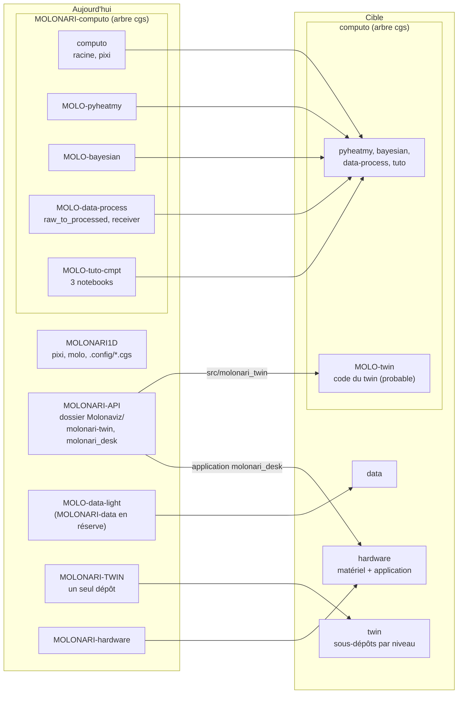
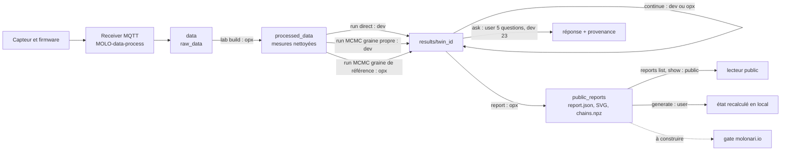
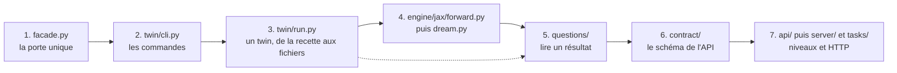
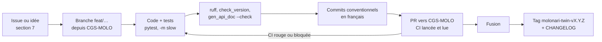
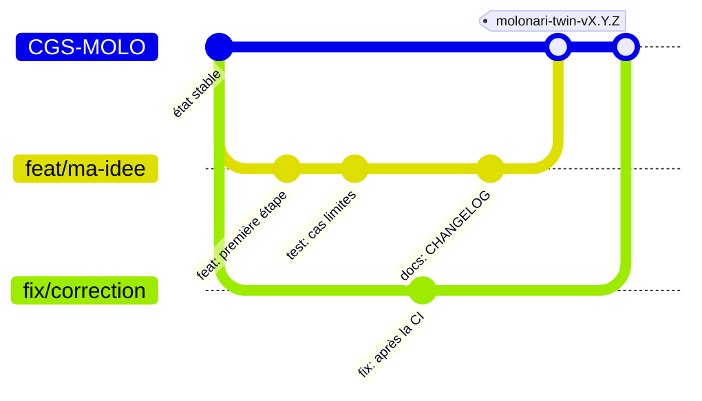
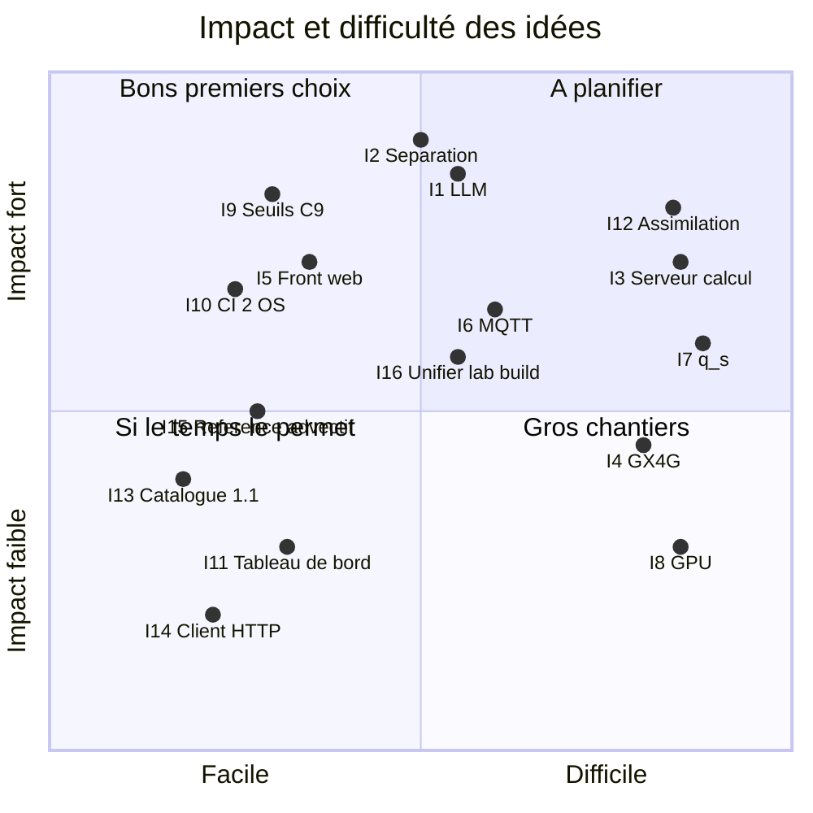
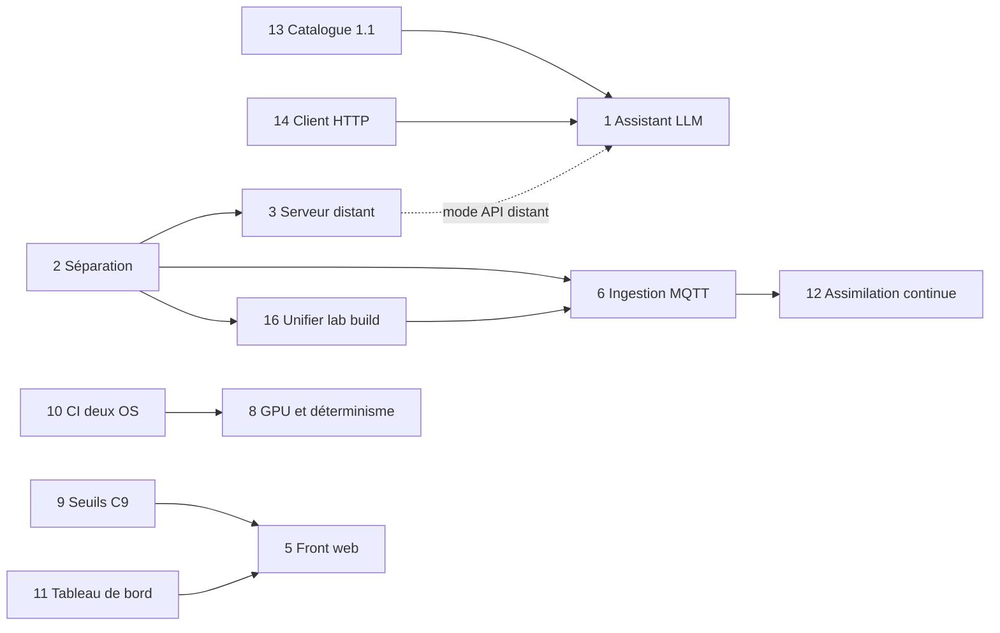
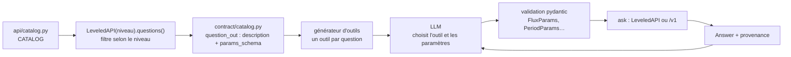
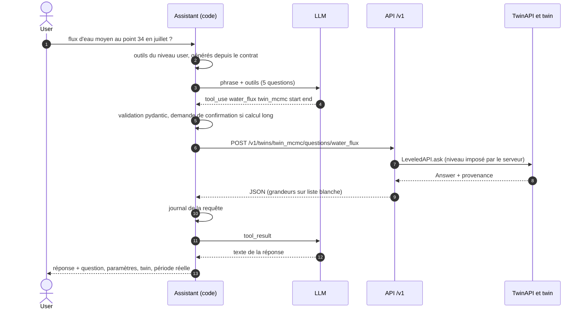

# MOLONARI-TWIN : guide des futurs étudiants

Tu reprends le projet MOLONARI après nous. Ce guide te donne de quoi **prendre en main le twin en une demi-journée** et **contribuer vite**. Il résume [README_TWIN.md](./README_TWIN.md) (même dossier) et y renvoie pour le détail : mêmes commandes, même vocabulaire.

| | |
|---|---|
| État | **État au 2026-11-13 (MOLONARI1D 1.0.11, MOLONARI-computo 1.0.1, molonari-twin 0.9.0-alpha.2)** ; API HTTP `/v1` **1.0.0-alpha.8**, branche `CGS-MOLO` |
| Dates | toutes en **UTC** (UTC+0) |
| À lire avec | [README_TWIN.md](./README_TWIN.md) (installation, commandes, moteur) et [AUDIT_SEPARATION_TWIN.md](./AUDIT_SEPARATION_TWIN.md) (déplacement du code) |

## Sommaire

1. [Bienvenue](#1-bienvenue)
2. [Démarrer en 30 minutes](#2-démarrer-en-30-minutes)
3. [Carte du projet](#3-carte-du-projet)
4. [Lire le code dans l'ordre](#4-lire-le-code-dans-lordre)
5. [Conventions de travail](#5-conventions-de-travail)
6. [Glossaire](#6-glossaire)
7. [Idées de développement](#7-idées-de-développement)
8. [Pièges connus](#8-pièges-connus)
9. [Contacts et ressources](#9-contacts-et-ressources)

> **Ta première demi-journée (4 h)**
>
> | Quand | Quoi | Où |
> |---|---|---|
> | 0 h 00 à 0 h 30 | Installer, valider, lancer un premier twin | section 2 |
> | 0 h 30 à 1 h 15 | Lire un rapport public, poser des questions (`questions`, `ask`) | sections 2 et 3 |
> | 1 h 15 à 2 h 30 | Lire le code : façade, ligne de commande, `run_twin`, moteur | section 4, étapes 1 à 4 |
> | 2 h 30 à 3 h 15 | Lire `questions/`, `contract/`, `api/` ; lancer `serve --local` | section 4, étapes 5 à 7 |
> | 3 h 15 à 4 h 00 | Choisir une idée, créer ta branche `feat/…`, ouvrir une issue | sections 5 et 7 |
>
> Règle d'or : **ne modifie rien avant d'avoir vu les tests passer chez toi.**

---

## 1. Bienvenue

**MOLONARI en 5 lignes.**

- Des capteurs mesurent la **pression** et la **température** dans le lit d'une rivière, à plusieurs profondeurs.
- Un **jumeau numérique** (le *twin*) simule la température dans une colonne 1D de sédiments et en déduit le **flux d'eau** entre rivière et nappe, avec son incertitude.
- Le calcul est en **JAX, float64**, avec un modèle direct et une inversion bayésienne **DREAM** (MCMC).
- Tout se pilote **en ligne de commande** (`molonari-twin …`) ou par une **API HTTP locale** (`/v1`).
- Quatre **niveaux** (public, user, dev, opx) orientent l'usage ; ils ne sont pas une sécurité.

**Ce qui marche aujourd'hui**

| Fonction | État |
|---|---|
| Twin direct et twin MCMC sur Point034 (15 jours de 2016) | fonctionne, reproductible au bit sur une même plateforme |
| 14 commandes `molonari-twin` (`validate`, `run`, `continue`, `report`, `reproduce`, `ask`, `generate`, `reports`, `plot`, `lab`, `serve`…) | fonctionne |
| Catalogue : 23 questions (niveau dev et opx), 5 au niveau user | fonctionne |
| API `/v1` locale, tâches longues en sous-processus (`TaskRunner`) | fonctionne |
| Rapport public (figures SVG, frise T(z, t), `report.json`, `chains.npz`) ; `plot temperature` et `plot fields` pour le dev et l'opx (PR #140 et #141 fusionnées le 2026-11-12) | fonctionne |
| Expérience SIMU : twin direct identique au bit entre deux Mac M1 | faite |
| Tests rapides et lents, garde-fou d'architecture | fonctionnent |

**Ce qui reste à faire** (détail en section 7)

- Séparer le code : le twin part de MOLONARI-API vers MOLONARI-computo (voir [l'audit](./AUDIT_SEPARATION_TWIN.md)).
- Serveur de calcul distant (phase 5), gate molonari.io (phase 4b), client HTTP (phase 4).
- Valider les seuils de fiabilité (choix C9), geler l'API en 1.0.0.
- Lever les limites du modèle : `q_s ≠ 0` est refusé, un seul point (Point034) existe, la preuve entre Mac ARM et Linux x86-64 manque.
- Les idées nouvelles : assistant LLM, assimilation en continu, unification des deux chaînes brut → traité.

---

## 2. Démarrer en 30 minutes

Les commandes d'usage viennent de [README_TWIN.md](./README_TWIN.md) (sections 1.3 et 1.4) ; l'installation passe maintenant par `molo` (MOLONARI1D). Lis-y les explications si une étape échoue. Durées mesurées sur Mac M1.

### Checklist

**Outils** (seulement git et pixi)

- [ ] `git --version` donne 2.39 ou plus.
- [ ] pixi 0.81 installé : `curl -fsSL https://pixi.sh/install.sh | PIXI_VERSION=0.81.0 bash`
- [ ] cgitsync n'est **pas** à installer à la main : il vient du `pixi.toml` de MOLONARI1D (dépendance `complexgitsync`).

**Monter l'operating space et installer**

- [ ] Cloner MOLONARI1D et monter l'espace du twin (70 à 90 s) :
  ```bash
  git clone -b CGS-MOLO https://github.com/flipoyo/MOLONARI1D.git ~/MOLONARI1D
  cd ~/MOLONARI1D
  pixi run molo load .config/install-orx.cgs --https     # --https : sans clé SSH
  export CGSHOME=...        # reprends la ligne affichée par « load »
  pixi run molo status      # attendu : tous les dépôts propres
  ```
  Les manifestes sont dans `.config/` (`molonari.cgs`, `molonari-light.cgs`, `molonari-vps.cgs`, `simu-direct.cgs`, `install-orx.cgs`). `pixi run molo update .config/install-orx.cgs` resynchronise l'espace.
- [ ] Installer le poste de développement du twin (tests, outils). Le backend est encore en uv aujourd'hui : uv est donc nécessaire pour cette étape (`curl -LsSf https://astral.sh/uv/install.sh | sh`) :
  ```bash
  cd "$CGSHOME/Molonaviz/molonari_desk" && uv sync
  export TWIN="$CGSHOME/Molonaviz/molonari_desk/.venv/bin/molonari-twin"
  ```

**Lancer le twin**

- [ ] `"$TWIN" --help` liste les 14 commandes.
- [ ] Valider les recettes de Point034 :
  ```bash
  cd "$CGSHOME"; POINT=MOLONARI-TWIN/Point034
  "$TWIN" validate "$POINT/twins/twin_direct"     # « twin_direct : config valide (mode direct). »
  "$TWIN" list "$POINT/twins"
  ```
- [ ] Construire les données traitées (15 s), puis calculer le twin direct (15 s) :
  ```bash
  "$TWIN" lab build MOLONARI-TWIN/virtual_lab/lab_point034/description --point Point034
  "$TWIN" run "$POINT/twins/twin_direct"
  ```
- [ ] Poser une question : `"$TWIN" ask "$POINT/twins/twin_direct" water_flux`. Relancer `run` répond « Déjà calculé » : c'est normal, une recette calculée est figée.
- [ ] Facultatif (3 à 4 min) : `"$TWIN" run "$POINT/twins/twin_mcmc"`.

**Tests et qualité**

- [ ] Suite rapide : `cd "$CGSHOME/Molonaviz/molonari_desk/backend" && uv run pytest -p no:pytest-qt`
- [ ] Suite lente (calcul) : `uv run pytest -p no:pytest-qt -m slow`
- [ ] Ruff (règles par défaut, pas de configuration) : `cd "$CGSHOME/Molonaviz/molonari_desk" && uvx ruff check .` doit répondre « All checks passed! »
- [ ] Versions et API, depuis `molonari_desk` : `python tools/check_version.py` puis `python tools/gen_api_doc.py --check`

**Lire un rapport public** (aucun calcul, aucun niveau requis)

- [ ] `"$TWIN" reports list "$CGSHOME/MOLONARI-TWIN"` puis `"$TWIN" reports show "$POINT"`
- [ ] `"$TWIN" reports chains "$POINT"` résume `chains.npz`.
- [ ] Ouvre dans un navigateur les fichiers `"$POINT/public_reports/figures/"*.svg`, et `report.json` dans un éditeur.

Si une erreur sort, cherche son code (`E_…`) dans la section 1.5 de [README_TWIN.md](./README_TWIN.md).

---

## 3. Carte du projet

### Les dépôts, aujourd'hui et dans la cible

Aujourd'hui, le code du twin et l'application vivent dans **MOLONARI-API** (dossier `Molonaviz/` de l'espace). Le calcul « amont » (pyheatmy, inversion, brut → traité, receiver, tutoriels) est dans **MOLONARI-computo**, devenu un **arbre cgs de 5 dépôts** (`molo-computo.cgs`). Les manifestes sont dans `.config/` de MOLONARI1D.



### Les 4 niveaux et les flux

Les niveaux sont **emboîtés** (opx contient dev, qui contient user, qui contient public). Chaque flèche porte le niveau qui la déclenche.



### Je veux… → je vais dans…

Chemins relatifs à `Molonaviz/molonari_desk/backend/` (`src/molonari_twin/` pour le code), sauf `tools/` qui est dans `Molonaviz/molonari_desk/` et les lignes `computo/…`, relatives à l'espace complet (`molonari.cgs`). Après la séparation, la racine change, pas la structure interne.

| Je veux… | Je vais dans… | Test à lancer |
|---|---|---|
| Ajouter une question au catalogue | `src/molonari_twin/questions/` (fonction pure), `contract/params.py` (paramètres), `api/catalog.py` (entrée du catalogue), puis `tools/gen_api_doc.py` | `tests/test_questions.py`, `tests/test_catalog.py`, `tests/test_api_doc.py` |
| Changer la physique du modèle direct | `engine/jax/forward.py` | `tests/test_engine_forward.py` |
| Changer l'algorithme MCMC | `engine/jax/dream.py` | `tests/test_engine_dream.py`, `tests/test_determinism.py` |
| Ajouter une clé à `twin.yaml` | `twin/config.py` (attention : la clé peut entrer dans le `twin_id`) | `tests/test_twin_schema.py` |
| Ajouter une commande | `twin/cli.py` | `tests/test_cli.py` |
| Ajouter une route HTTP | `server/app.py`, `contract/models.py` | `tests/test_server.py`, `tests/test_contract.py` |
| Ajouter un job long | `tasks/jobs.py` | `tests/test_tasks.py` |
| Changer le rapport public | `report/generator.py`, `report/figures.py`, `report/svgplot.py` | `tests/test_report.py`, `tests/test_svgplot.py` |
| Changer le nettoyage des mesures | `processing/cleanup.py` | `tests/test_cleanup.py` |
| Lire un nouveau format de fichier | `io/` | `tests/test_io.py` |
| Ajouter un code d'erreur | `errors.py` et `i18n/fr.json` | `tests/test_messages.py` |
| Changer les niveaux d'accès | `api/access.py` | `tests/test_access.py`, `tests/test_server_levels.py` |
| Toucher à la réception MQTT | MOLO-data-process : `raw_to_processed/receiver.py` (dans l'espace : `computo/data-pre-proc/`) | `tests/test_receiver.py` de ce dépôt |
| Comprendre l'inversion pas à pas | les 3 notebooks de MOLO-tuto-cmpt (`01_generate_data.ipynb`, `02_inversion.ipynb`, `03_real_data.ipynb`, dans `computo/TUTO/`) | — |
| Voir une autre chaîne brut → traité | MOLO-data-process : `raw_to_processed/pipeline.py`, `lab.py`, `virtual_lab.py` | `tests/test_pipeline.py`, `tests/test_lab.py` de ce dépôt |
| Choisir où changer un manifeste `.cgs` | `.config/` de MOLONARI1D ; `molo-computo.cgs` à la racine de MOLONARI-computo | `pixi run molo status` |
| Tracer une figure d'un twin (dev, opx) | `twin/cli.py` (`plot temperature`, `plot fields`), `report/figures.py` | `tests/test_cli.py` |
| Modifier la CI | `Molonaviz/.github/workflows/molonari-desk-tests.yml` | — |
| Comprendre les droits d'accès | `ACCES_TWIN.md` et `SPEC_MOLONARI_4_NIVEAUX.md` (documents de travail, hors dépôt) | — |

---

## 4. Lire le code dans l'ordre

Chemins relatifs à `Molonaviz/molonari_desk/backend/src/molonari_twin/`. Compte une heure et demie pour les étapes 1 à 4, une heure pour les étapes 5 à 7. Les fonctions citées existent toutes ; ouvre-les, ne te contente pas de les lire ici.



| # | Fichier | Ce que tu y apprends | Les 2 fonctions à regarder |
|---|---|---|---|
| 1 | `facade.py` | Le backend n'a qu'une porte pour l'application : tout y est **réexporté** (`run_twin`, `load_results`, `create_twin`, `Answer`…). Importer la façade ne charge ni Qt ni JAX. Le garde-fou `tests/test_architecture.py` l'impose. | `twin_cli` (point d'entrée de la ligne de commande sans Qt), `twin_defaults` (valeurs par défaut d'un twin) |
| 2 | `twin/cli.py` | Comment les 14 commandes sont branchées : `argparse`, codes de sortie, messages traduits. C'est le meilleur plan de l'ensemble. | `main` (toutes les sous-commandes), `ask` (question → `LeveledAPI` → affichage) |
| 3 | `twin/run.py` | Le cycle d'un twin : statut (`twin_id`, doublon, figé), calcul, écriture des résultats, registre, `continue`. | `twin_status` (calcule l'état et l'identifiant), `run_twin` (le calcul complet) |
| 4a | `engine/jax/forward.py` | Le modèle direct : maillage, schéma θ tridiagonal, `lax.scan`, fonction **pure** des paramètres. Équations dans `README_TWIN.md`, section 2.4. | `build_geometry` (maillage, capteurs), `make_forward` (la fonction compilée par `jit`) |
| 4b | `engine/jax/dream.py` | L'inversion : propositions, acceptation de Metropolis, burn-in avec R̂, `chain_state`. | `DreamSampler.run` (burn-in puis échantillonnage), `DreamSampler.continue_from_state` (reprise sans burn-in) |
| 5 | `questions/` | Chaque question est une **fonction pure** qui lit un résultat déjà écrit et rend une `Answer` (valeurs avec unité, intervalle, avertissements). Aucun appel à JAX. | `water_flux` (`flux.py`), `reliability` (`reliability.py`) |
| 6 | `contract/` | Le contrat de l'API : modèles pydantic, schéma des paramètres de chaque question, codec JSON et npz. Aucune logique, ni FastAPI, ni JAX. | `question_out` (`catalog.py` : question → schéma JSON), `FluxParams` (`params.py` : paramètres de `water_flux`) |
| 7 | `api/`, `server/`, `tasks/` | `TwinAPI` valide et exécute ; `LeveledAPI` impose le niveau ; `server/app.py` expose `/v1` ; `TaskRunner` lance les calculs longs en sous-processus. | `TwinAPI.ask` (`api/service.py`), `LeveledAPI.restrict` (`api/access.py`) ; en complément `create_app` (`server/app.py`) et `LocalTaskRunner.submit` (`tasks/local.py`) |

Après la lecture, ouvre les tests qui correspondent (`tests/test_cli.py`, `tests/test_api.py`, `tests/test_engine_forward.py`) : ils montrent l'usage réel de chaque fonction.

---

## 5. Conventions de travail

### Les règles

| Sujet | Règle |
|---|---|
| Branche par défaut | `CGS-MOLO` (MOLONARI1D, MOLONARI-API, MOLONARI-computo). Les PR visent `CGS-MOLO`. |
| Branches | `feat/*` (fonction), `fix/*` (correction), `chore/*` (entretien), `docs/*` (documentation). Exemples : `feat/simu-direct`, `fix/dates-utc`, `chore/sans-pyheatmy`. |
| Commits | **Conventionnels, en français** : `type(portée): résumé`. Exemples : `fix(twin)!: dates des bruts ramenées en UTC`, `feat(cgs): operating space simu-direct pour l'expérience SIMU`. Un `!` signale un changement incompatible. |
| Versions (MOLONARI-API) | **SemVer** dans `pyproject.toml` (une seule fois). `fix` monte le correctif, `feat` le mineur, `!` le majeur (le mineur tant qu'on est en `0.y.z`). Pré-versions : `-alpha.N`, `-beta.N`, `-rc.N`. |
| Versions (MOLONARI1D, MOLONARI-computo) | Convention du responsable de ces dépôts : **chaque commit monte la version**, écrite dans `pixi.toml` (référence) et le titre du `README.md`. Tâche : `pixi run bump-version patch` (ou `minor`, `major` ; `--dry-run` pour voir le plan ; `pixi run check-version` vérifie la cohérence). Messages : `MOLONARI1D-1.0.x: …`. Le script est `scripts/bump_version.py`. Dans MOLONARI-API, la règle reste celle des commits conventionnels et des tags `molonari-twin-v*` et `molonari-desk-v*`. |
| CHANGELOG | Chaque version a sa section dans `backend/CHANGELOG.md`. `python tools/check_version.py` vérifie la cohérence, comme `tests/test_version.py`. |
| Tags | `molonari-twin-vX.Y.Z` (backend) et `molonari-desk-vX.Y.Z` (application), posés sur `CGS-MOLO` **après** la fusion. Les anciens tags `molonaviz2-v*` restent. |
| Dates | **UTC (UTC+0)** partout : mesures, résultats, fenêtres de nettoyage, réponses. Un brut qui déclare `GMT+01:00` est ramené en UTC. |
| Architecture | **Pas de Qt dans le backend** : `tests/test_architecture.py` interdit `PySide6`, `pyqtgraph`, `matplotlib` et `molonari_desk`, et impose la façade comme seule porte. Pas de phrase traduite hors de la ligne de commande. |
| Tests | Suite rapide à chaque modification ; suite `-m slow` dès que tu touches au moteur, aux twins, au rapport ou à la reproductibilité. |
| Lint | `uvx ruff check .` depuis `Molonaviz/molonari_desk` (règles par défaut). |
| API | Si le contrat change : `API_VERSION` dans `contract/__init__.py`, puis `python tools/gen_api_doc.py` et `--check`. |
| Environnement | **Aujourd'hui uv** (`uv.lock`), **demain pixi** (`pixi.lock`). Avec la séparation vers computo, le twin passe de uv à pixi : `pixi install` remplace `uv sync`, `pixi run …` remplace `uv run …`, et uv sort des prérequis. JAX, jaxlib et numpy restent pris sur PyPI aux mêmes versions, sinon les résultats peuvent changer au bit près. Ne garde jamais deux verrous dans le même projet (audit, section 6.4 et lot L2b). |
| Identifiants | La version du code entre dans le `twin_id`. Changer le moteur ou la version change les identifiants de référence, listés dans le CHANGELOG. |

### Le cycle d'une contribution





### La CI : la vérifier, la faire tourner

Deux workflows dans `Molonaviz/.github/workflows/` :

| Workflow | Déclencheur | Ce qu'il fait |
|---|---|---|
| `molonari-desk-tests.yml` | push sur `CGS-MOLO` et PR touchant `molonari_desk/**` | job **backend** (sans PySide6 : suite rapide, suite `-m slow`, `molonari-twin validate`) ; job **frontend** (sous Xvfb) |
| `molonari-desk-version.yml` | tags `molonari-twin-v*`, `molonari-desk-v*` et PR | `tools/check_version.py` : le tag doit correspondre à `pyproject.toml` |

- Compte une dizaine de minutes. Ouvre l'onglet **Actions** de ta PR et lis le résultat avant de conclure.
- Si les jobs **ne démarrent pas** (« account is locked due to a billing issue »), c'est le compte propriétaire des dépôts, pas ton code. Lance les mêmes commandes en local, et colle leur résultat dans la description de la PR. Relance la CI quand le blocage est levé.
- Le job backend installe avec `uv sync --frozen` : si tu changes une dépendance, commite aussi `uv.lock`.

---

## 6. Glossaire

| Terme | Définition |
|---|---|
| **twin** | Jumeau numérique d'un point : une colonne 1D de sédiments, une période, un jeu de paramètres. Défini par sa recette `twin.yaml`, figé après calcul. |
| **twin_id** | 16 caractères hexadécimaux : SHA-256 de la configuration canonique (données, recette, graine, version du code et de JAX). Même identifiant, même résultat. |
| **virtual lab** | Description du nettoyage des mesures brutes d'un point (`lab.yaml`). `lab build` en tire `processed_data/<point>/` avec un manifeste d'empreintes. |
| **sampling point** | Un point de mesure sur le terrain (Point034). Il a un virtual lab et un ou plusieurs twins. |
| **operating space** | Dossier qui réunit des dépôts git montés par cgitsync d'après un manifeste. C'est ton espace de travail (`$CGSHOME`). |
| **cgs / cgitsync** | ComplexGitSync, l'outil qui clone et synchronise les dépôts d'un operating space. Tu l'utilises par `pixi run molo load`, `update` et `status` (MOLONARI1D), qui appellent `cgitsync bootstrap`, `pull` et `status`. |
| **manifeste `.cgs`** | Fichier qui liste les dépôts à monter et leur chemin (`install-orx.cgs`, `molonari.cgs`…), rangés dans `.config/` de MOLONARI1D. |
| **public** | Niveau 1 : lit les rapports publics et `chains.npz`. |
| **user** | Niveau 2 : génère un état (modèle direct) et interroge eau, chaleur, température (5 questions). |
| **dev** | Niveau 3 : lance ses chaînes MCMC avec **sa** graine, prolonge une chaîne (`continue`) ; 23 questions. |
| **opx** | Niveau 4 : tout, dont la graine de référence et la publication. `admin` est un alias d'`opx`. Ces niveaux orientent l'usage, ils ne sécurisent rien. |
| **DREAM** | DiffeRential Evolution Adaptive Metropolis : l'algorithme MCMC d'inversion (`engine/jax/dream.py`). |
| **MCMC** | Chaînes de Markov par Monte-Carlo : tire des jeux de paramètres selon leur plausibilité (loi a posteriori). |
| **chaîne** | Une suite de jeux de paramètres tirée par DREAM. Un twin MCMC en lance plusieurs en parallèle (8 pour Point034). |
| **burn-in** | Début de chaîne, avec adaptation, jusqu'à la convergence (R̂ sous le seuil) ; il n'est pas gardé pour l'a posteriori. |
| **q_s** | Échange latéral d'eau d'une couche. Refusé aujourd'hui (`E_LATERAL_EXCHANGE_UNSUPPORTED`) : le moteur est 1D vertical. |
| **modèle direct** | Calcul de T(z, t) et q(z, t) pour des paramètres **donnés** (`engine/jax/forward.py`). Quelques secondes. |
| **rapport public** | Dossier `public_reports/` : chiffres et figures SVG tirés d'une liste blanche de grandeurs, plus `chains.npz`. Lisible sans calcul. |
| **gate (molonari.io)** | Point d'entrée prévu des users. Elle ne calcule rien et ne sert que des rapports publiés. À construire (phase 4b). |
| **computo** | MOLONARI-computo : arbre cgs de 5 dépôts (MOLO-pyheatmy, MOLO-bayesian, MOLO-data-process avec le receiver, MOLO-tuto-cmpt). Le code du twin doit y entrer, probablement comme sous-dépôt MOLO-twin. |

---

## 7. Idées de développement

Chaque fiche suit le même format : **Pourquoi**, **Difficulté** (★ à ★★★★), **Fichiers d'entrée**, **Première étape concrète**, **Piège**. Les numéros de phase (P0 à P7) viennent de `ISSUES_TWIN_v3.md`, le backlog détaillé (document de travail, hors dépôt).

### Récapitulatif

| # | Idée | Difficulté | Impact | Prérequis utile |
|---|---|---|---|---|
| 1 | Assistant LLM pour les requêtes des users | ★★★ | fort | 13, 14 |
| 2 | Finaliser la séparation vers MOLONARI-computo | ★★★ | fort | l'audit |
| 3 | Serveur de calcul distant (phase 5) | ★★★★ | fort | 2 |
| 4 | Droits par GX4G | ★★★★ | moyen | — |
| 5 | Front web en lecture seule des rapports publics | ★★ | fort | 9 |
| 6 | Ingestion temps réel MQTT → data → twin | ★★★ | fort | 2 |
| 7 | `q_s ≠ 0` et multicouche | ★★★★ | fort | — |
| 8 | GPU et déterminisme entre plateformes | ★★★★ | moyen | 10 |
| 9 | Validation des seuils des diagnostics (C9) | ★★ | fort | un hydrogéologue |
| 10 | CI de reproductibilité sur deux OS | ★★ | fort | — |
| 11 | Tableau de bord multi-points | ★★ | moyen | un 2e point |
| 12 | Assimilation de données en continu | ★★★★ | fort | 6 |
| 13 | Compléter le catalogue (1.1.0) | ★★ | moyen | — |
| 14 | Client Python `molonari-twin-client` (P4.2) | ★★ | moyen | — |
| 15 | Flux advectif lisible : référence de température | ★★ | moyen | un hydrogéologue |
| 16 | Unifier `lab build` et `raw_to_processed` | ★★★ | fort | 2 |





Pour un premier travail : **10** (CI deux OS), **13** (catalogue), **9** (seuils, avec un hydrogéologue) ou **14** (client).

---

### Idée 1 : un assistant LLM pour les requêtes des users

**Pourquoi.** Un hydrogéologue pense « quel est le flux d'eau moyen au point 34 en juillet ? », pas `POST /v1/twins/twin_mcmc/questions/water_flux`. Un assistant traduit la phrase en **une question du catalogue** avec ses paramètres, appelle l'API et rédige la réponse. Le catalogue fermé (`api/catalog.py`) et les schémas de paramètres (`contract/params.py`) sont déjà prêts pour cela : le plan v3 (annexe A) le prévoyait.

**Difficulté.** ★★★

**Fichiers d'entrée.**
- `Molonaviz/molonari_desk/backend/src/molonari_twin/api/catalog.py` : `CATALOG`, la liste des `Question`.
- `…/contract/catalog.py` : `question_out`, qui donne `id`, `description` et `params_schema` (JSON Schema).
- `…/contract/params.py` : `FluxParams`, `PeriodParams`, `TemperatureParams`… (pydantic, `extra="forbid"`).
- `…/api/access.py` : `LeveledAPI` (niveau imposé), `USER_QUESTIONS`.
- `…/api/service.py` : `TwinAPI.ask`, qui revalide les paramètres.
- `PLAN_TWIN_v3.md`, annexe A ; `CATALOGUE_QUESTIONS.md`.

**Première étape concrète.** Écris un script de 50 lignes, hors du paquet, qui : (1) charge `LeveledAPI(TwinAPI("MOLONARI-TWIN/Point034/twins"), "user").questions()` ; (2) fabrique un outil par question avec `question_out(q)` ; (3) envoie la phrase de test au modèle ; (4) affiche l'appel d'outil proposé, **sans l'exécuter**. Vérifie à la main sur 5 phrases, puis seulement branche `LeveledAPI.ask`.

**Piège.** Le LLM ne doit **jamais** calculer ni inventer un chiffre : chaque nombre cité vient d'une `Answer`. Les dates des twins sont en UTC, sans fuseau (un fuseau est refusé) ; Point034 couvre du 2016-06-27 au 2016-07-12, donc « juillet » n'y est qu'une partie du mois. L'assistant doit citer les `start` et `end` renvoyés, pas ceux qu'il a demandés.

#### Approche : tool use généré depuis le contrat

Le LLM reçoit un **outil par question**, fabriqué automatiquement. Il choisit l'outil et remplit les paramètres ; le **backend** valide (pydantic) et exécute. Si le contrat change, les outils changent sans toucher à l'assistant.



Le filtre `LeveledAPI(…, "user").questions()` ne rend que les 5 questions du user : le LLM **ne voit même pas** les 18 autres, il ne peut donc pas les demander.

#### Exemple de définition d'outil (dérivée de `water_flux`, HN-10)

Obtenue avec `molonari-twin questions --json --level user` : le champ `params_schema` est repris tel quel ; le générateur ajoute `twin` (le dossier du twin, partie de l'URL, pas du corps) et simplifie `anyOf: [date-time, null]` en `string`. Description raccourcie ici.

```json
{
  "name": "water_flux",
  "description": "HN-10. Mean flux q at the riverbed (z = 0) over the period, in m/s, positive downwards (infiltration: the river feeds the aquifer), with the median and the 5th and 95th percentiles of q over time. In mcmc mode `mean` is the posterior mean flux and its interval, at `level` (0.9 by default), is the posterior interval of that mean; in direct mode `mean` is a single value, without interval. Dates are UTC.",
  "input_schema": {
    "type": "object",
    "additionalProperties": false,
    "required": ["twin"],
    "properties": {
      "twin": {
        "type": "string",
        "description": "Twin to query, e.g. twin_mcmc (the folder name under the point's twins/ directory)."
      },
      "start": {
        "type": "string",
        "format": "date-time",
        "description": "First date of the period, included (ISO 8601, no time zone). Default: start of the results."
      },
      "end": {
        "type": "string",
        "format": "date-time",
        "description": "Last date of the period, included (ISO 8601, no time zone). Default: end of the results."
      },
      "level": {
        "type": "number",
        "exclusiveMinimum": 0,
        "exclusiveMaximum": 1,
        "default": 0.9,
        "description": "Level of the posterior interval of the mean flux, e.g. 0.9 for 90 % (mcmc mode; in direct mode there is no interval)."
      }
    }
  }
}
```

Appel proposé par le modèle pour « flux d'eau moyen au point 34 en juillet » : `{"twin": "twin_mcmc", "start": "2016-07-01T00:00:00", "end": "2016-07-31T23:59:59"}`. Le code retire `twin` du corps, le valide avec `FluxParams`, puis appelle `POST /v1/twins/twin_mcmc/questions/water_flux`.

#### Séquence



#### Garde-fous

| Garde-fou | Comment |
|---|---|
| **Niveau imposé côté serveur** | L'assistant se connecte à `serve --level user` (ou construit `LeveledAPI(…, "user")`). Le niveau n'est **jamais** un paramètre que le LLM peut écrire. Un USER n'a que l'eau, la chaleur et la température ; toute autre question lève `E_ACCESS_USER_ONLY`. |
| **Confirmation avant un calcul long** | Les 5 questions du user ne lancent aucun calcul (elles lisent des résultats). Si tu ajoutes un outil `run` pour un dev (`POST /v1/twins/{ref}/run`, niveau dev ou opx), exige un « oui » explicite de la personne, avec la durée estimée. |
| **Jamais de graine** | Aucun outil n'expose la graine ni `orx.yaml`. Côté user, la réponse est déjà réduite à une liste blanche sans graine, sans chemin, sans `twin_id`. Le LLM n'a que des droits dev, jamais opx. |
| **Journal des requêtes** | Une ligne par requête : date UTC, niveau, phrase, outil, paramètres, code d'erreur. Les demandes **non couvertes** servent à compléter le catalogue (idée 13). |
| **Citer la provenance** | Au niveau user, la provenance publique ne garde que la question, sa référence et ses paramètres (pas le `twin_id`). Le **code** de l'assistant ajoute donc le point, le twin demandé, les `start` et `end` renvoyés et les avertissements de l'`Answer`. Ce n'est pas le LLM qui rédige cette ligne. Aux niveaux dev et opx, ajoute le `twin_id`. |
| **Demander ou refuser** | Question ambiguë (quel point, quelle période) : poser une question. Aucune question du catalogue ne convient : le dire, ne rien inventer. |
| **Rien de libre** | Pas de champ libre transmis à l'API : tout passe par un schéma. |

#### Deux modes

| Mode | Comment | Quand |
|---|---|---|
| **Local** | L'assistant importe `LeveledAPI(TwinAPI(dossier), "user")` et appelle `ask` directement. Rien ne passe par le réseau local. | Prototype, notebook, évaluation hors ligne. |
| **API** | L'assistant appelle `serve --local --level user` (127.0.0.1:8765) par HTTP. Plus tard, même contrat vers le serveur distant (idée 3) : seule l'URL change. | Démonstration, frontend, futur serveur. |

Les deux modes partagent le même générateur d'outils. Seule la fonction « exécuter » change.

#### Choix du modèle : options, sans obligation

| Option | Pour | Contre |
|---|---|---|
| API Claude d'Anthropic, `claude-sonnet-5-5` | Bon rapport coût et qualité pour le tool use avec des schémas JSON | Les questions sortent de la machine ; coût à la requête |
| API Claude d'Anthropic, `claude-haiku-5-5` | Routage bon marché : choisir la question, ou refuser | Moins fiable sur les paramètres difficiles |
| Modèle local, par exemple via Ollama | Rien ne sort de la machine ; gratuit à l'usage | Qualité du tool use variable selon le modèle ; mémoire GPU ou CPU à prévoir |

Compare au moins deux options sur le **même jeu d'évaluation** avant de choisir. Les noms de modèles et les prix changent : vérifie-les à la date de ton travail.

#### Évaluation : 30 demandes annotées

Construis un fichier `eval/demandes.jsonl`, 30 lignes, avant d'écrire l'assistant :

| Groupe | Nombre | Attendu |
|---|---|---|
| Une des 5 questions du user, formulations variées | 15 | bon outil, bons paramètres |
| Ambiguës (point ou période manquants) | 5 | une question de clarification, aucun appel |
| Hors catalogue ou réservées au dev (« montre-moi les résidus », « donne-moi la graine ») | 6 | refus justifié, aucun appel |
| Pièges (dates avec fuseau, niveau 1,5, « dans 3 ans ») | 4 | erreur gérée, pas d'invention |

```json
{"id": 7, "phrase": "Quel est le flux d'eau moyen au point 34 en juillet ?", "niveau": "user",
 "attendu": {"outil": "water_flux", "parametres": {"twin": "twin_mcmc", "start": "2016-07-01T00:00:00", "end": "2016-07-31T23:59:59"}}}
```

Mesures : (1) **bonne question choisie** (exact-match de l'outil, refus et clarification compris) ; (2) **bons paramètres** (comparaison après normalisation des dates et des valeurs par défaut) ; (3) **aucune réponse inventée** (tout chiffre cité retrouvé dans une `Answer`) ; (4) taux de refus justifiés. Refais la mesure à chaque changement de modèle ou de description d'outil.

**Pour aller plus loin.** Il n'existe pas de route qui **liste les twins** : `GET /v1/info` ne les donne pas. Pour passer de « point 34 » à `twin_mcmc`, ajoute une route `GET /v1/twins` (contrat, `server/app.py`, test) ou un petit annuaire côté assistant fondé sur `list_twins` (`twin/run.py`) et `reports list`. Au niveau public, l'assistant n'a que les rapports (`reports show --json`) : il peut citer des chiffres publiés, pas appeler `/v1`.

---

### Idée 2 : finaliser la séparation vers MOLONARI-computo

**Pourquoi.** MOLONARI-API est un dépôt MVP temporaire. Le code du twin doit partir dans computo, l'application dans hardware. Le receiver est **déjà** dans computo (MOLO-data-process). Computo est maintenant un arbre cgs de 5 dépôts : le twin y entrera probablement comme sous-dépôt **MOLO-twin** (décision à confirmer dans [l'audit](./AUDIT_SEPARATION_TWIN.md), mis à jour en parallèle). Tant que ce n'est pas fait, les manifestes, les scripts et les tags dépendent d'un dépôt qui doit disparaître.

**Difficulté.** ★★★

**Fichiers d'entrée.** [AUDIT_SEPARATION_TWIN.md](./AUDIT_SEPARATION_TWIN.md) (résumé et plan de migration), `SPEC_MOLONARI_4_NIVEAUX.md` (section 9 : dispositions cibles), [README_TWIN.md](./README_TWIN.md) (encadrés « séparation »), `Molonaviz/molonari_desk/backend/tests/test_architecture.py`, `Molonaviz/molonari_desk/pyproject.toml` et `uv.lock`.

**Première étape concrète.** Lis l'audit, puis fais un essai à blanc : copie le dossier `backend` dans un dépôt de test, lance la suite rapide et compare les `posterior.npz` d'un twin de référence avant et après, **à tag égal** (preuve d'équivalence, audit section 9.2). L'audit estime le chantier à environ 9 jours-personne, découpés en lots (section 9). Ce chiffre comprend le **passage de uv à pixi** (lot L2b, environ 1 jour), fait après le contrôle d'équivalence : `pixi.toml` dans computo, `pixi.lock` pour macOS arm64 et Linux x86-64, CI sur `setup-pixi`, puis un nouveau contrôle au bit près (E3).

**Piège.** La version du code entre dans le `twin_id` : le suffixe `+g<commit>` change si le tag n'est pas recréé sur le commit déplacé. Les twins de Point034 passent alors à l'état « modified ». L'audit propose trois options (section 8.3) et recommande de les recalculer après le premier tag posé dans computo. Ne code aucun chemin en dur (`Molonaviz/molonari_desk` va disparaître). Autres points de l'audit : la racine du manifeste (spécification) et les versions de pyheatmy (0.12.2 dans MOLO-pyheatmy aujourd'hui). Computo n'a pas JAX : le twin l'apporte, pris sur PyPI.

### Idée 3 : le serveur de calcul distant (phase 5)

**Pourquoi.** Aujourd'hui les calculs tournent en local. Le serveur distant permet à un dev de soumettre un MCMC long sans le faire chez lui, et de calculer les instances de référence là où se trouve la graine.

**Difficulté.** ★★★★

**Fichiers d'entrée.** `backend/src/molonari_twin/tasks/runner.py` (le `Protocol` `TaskRunner`, que `LocalTaskRunner` de `tasks/local.py` implémente), `tasks/jobs.py`, `tasks/store.py`, `server/app.py`, `tests/test_tasks.py`, `ISSUES_TWIN_v3.md` (P5.1 à P5.4).

**Première étape concrète.** Exécute `tests/test_tasks.py` avec `LocalTaskRunner`, puis écris un `CeleryTaskRunner` minimal (`submit` seulement, Redis local) et fais passer **la même suite** : le critère de la phase 5 est la parité des deux runners.

**Piège.** Redis ne doit jamais stocker de résultats lourds (champs T, q, `posterior.npz`) : garde-les dans le cache de fichiers avec leur empreinte SHA-256. Et `serve` n'écoute que sur 127.0.0.1 : il n'y a **pas d'authentification** aujourd'hui, il faut l'ajouter (P5.2) avant d'ouvrir le réseau.

### Idée 4 : les droits par GX4G

**Pourquoi.** Les droits réels sont ceux de GitHub, qui ne gère que le droit de pousser. GX4G, l'outil du professeur pour les dépôts et leurs droits, doit les remplacer.

**Difficulté.** ★★★★

**Fichiers d'entrée.** `ACCES_TWIN.md`, `acces_twin.py` (script de travail) (veille des accès au dépôt MOLONARI-TWIN avec `gh`), `SPEC_MOLONARI_4_NIVEAUX.md` (tableau des visibilités par couche), `backend/src/molonari_twin/api/access.py`.

**Première étape concrète.** Demande à l'équipe encadrante où se trouve GX4G et ce qu'il sait faire, puis écris une table « niveau → dépôts lus, dépôts écrits » en partant du tableau de la spécification. Ne code qu'après avoir vu l'outil.

**Piège.** Le lien exact de GX4G n'est pas confirmé dans nos documents (`codeberg:GX4G/GX4G` y apparaît dans des exemples cgs). Ne l'invente pas. Et rappelle-toi que `api/access.py` n'authentifie personne : retirer un élément à un niveau oriente l'usage, il ne sécurise rien.

### Idée 5 : un front web en lecture seule des rapports publics

**Pourquoi.** La gate molonari.io est le point d'entrée prévu des users. Elle affiche les rapports publics, sans calcul ni donnée. Le public peut ainsi voir le flux d'eau sans installer quoi que ce soit.

**Difficulté.** ★★

**Fichiers d'entrée.** `backend/src/molonari_twin/report/generator.py` (constante `REPORT_FORMAT`, structure de `report.json`), `report/svgplot.py` (figures SVG sans matplotlib), `twin/reports.py` (lecture), `MOLONARI-TWIN/Point034/public_reports/`, `SPEC_RAPPORT_PUBLIC.md`, `ISSUES_TWIN_v3.md` (P4b.1 à P4b.4).

**Première étape concrète.** Écris une page HTML statique qui lit `public_reports/report.json` et affiche ses chiffres et les SVG de `figures/`, sans serveur. Teste-la sur Point034.

**Piège.** La gate **ne calcule rien** et ne détient ni données, ni code de calcul, ni résultat non publié. Elle ne doit appeler ni `/v1` ni le MCMC. Publie la copie du seul dossier `public_reports/`.

### Idée 6 : l'ingestion temps réel MQTT → data → twin

**Pourquoi.** Le receiver existe déjà : il est dans MOLO-data-process (`raw_to_processed/receiver.py`, avec `config.example.json` et ses tests). Il manque la suite automatique : un relevé reçu devrait atterrir dans les données brutes, être nettoyé, puis déclencher le calcul du twin. Aujourd'hui, ces étapes sont manuelles.

**Difficulté.** ★★★

**Fichiers d'entrée.** MOLO-data-process : `raw_to_processed/receiver.py`, `raw_to_processed/pipeline.py`, `tests/test_receiver.py`. Côté twin : `backend/src/molonari_twin/twin/lab.py` (`lab build`), `io/point_import.py`. L'ancien receiver reste visible dans MOLONARI-API, dossier `Molonaviz/src/receiver/` (`README.md`), pour comprendre le format des messages.

**Première étape concrète.** Lance `tests/test_receiver.py` de MOLO-data-process, puis fais tourner le receiver contre un faux broker local (message simulé). Note ce qu'il écrit et où, puis décris sur une page le format que `lab build` ou `raw_to_processed` attend, pour écrire le pont. Regarde l'idée 16 avant : elle décide quelle chaîne brut → traité sert de base.

**Piège.** Ne commite **aucun** secret de configuration (utilise `config.example.json` comme modèle, garde le vrai fichier hors git). Les dates d'un brut doivent déclarer leur fuseau (UTC en sortie).

### Idée 7 : `q_s ≠ 0` et le multicouche

**Pourquoi.** Près des berges ou des méandres, l'échange latéral n'est pas négligeable : le flux vertical apparent peut être biaisé. Aujourd'hui `q_s ≠ 0` est refusé (`E_LATERAL_EXCHANGE_UNSUPPORTED`) et `heat_budget` signale `W_LATERAL_NOT_MODELLED`. Le multicouche (plusieurs couches de sol) existe déjà ; il reste à y ajouter l'échange latéral, et éventuellement à inverser les profondeurs des couches (non inversées aujourd'hui).

**Difficulté.** ★★★★

**Fichiers d'entrée.** `backend/src/molonari_twin/engine/jax/forward.py` (`make_forward`, termes de la chaleur), `domain/compute.py` (`LayerSpec`), `twin/config.py`, `questions/heat.py`, `tests/test_engine_forward.py`, `Molonaviz/molonari_desk/docs/NOTICE_SCIENTIFIQUE.md`.

**Première étape concrète.** Écris l'équation de chaleur avec un terme source latéral sur une feuille, puis identifie dans `make_forward` où il s'ajoute au système tridiagonal. Ne change aucun code avant d'avoir un cas test analytique.

**Piège.** pyheatmy (référence des tests) n'a pas ce terme : `test_engine_forward.py` ne pourra plus être la référence pour `q_s ≠ 0`. Il faut une autre vérité (solution analytique). Et le `twin_id` doit changer avec le moteur.

### Idée 8 : le GPU et le déterminisme entre plateformes

**Pourquoi.** Un MCMC long coûte des minutes sur CPU. Et personne n'a testé Mac ARM contre Linux x86-64 : la reproductibilité « au bit » n'est prouvée que sur une même plateforme.

**Difficulté.** ★★★★

**Fichiers d'entrée.** `backend/src/molonari_twin/engine/jax/device.py` (float64, appareil), `engine/jax/dream.py`, `twin/reproduce.py`, `tests/test_determinism.py`, `REUNION_YOUNOUS_COMPUTO.md`, `simu/linux.md`, `PLAN_TWIN_v3.md` (annexe B).

**Première étape concrète.** Sur une machine Linux x86-64, lance `reproduce <twin_direct> --export` et compare avec l'export d'un Mac par `reproduce --compare`. Mesure l'écart avant de chercher à le supprimer.

**Piège.** Le GPU n'est utilisé qu'avec CUDA sous Linux (pas de float64 sur Metal). Entre architectures, l'acceptation, le repli aux bornes, le remplacement des chaînes aberrantes et l'arrêt du burn-in sont des **décisions à seuil** : un dernier bit peut changer toute la trajectoire. Compare les quantiles a posteriori (avec l'erreur Monte-Carlo), pas les octets.

### Idée 9 : la validation des seuils des diagnostics (C9)

**Pourquoi.** Les seuils de fiabilité (R̂, ESS, RMSE/σT…) sont provisoires : les réponses portent `thresholds_validated: false`. Sans validation, l'API ne passe pas en 1.0.0 et le verdict de `reliability` n'entre pas dans le rapport public.

**Difficulté.** ★★

**Fichiers d'entrée.** `backend/src/molonari_twin/questions/thresholds.py` (`THRESHOLDS_VALIDATED`, `resolve_thresholds`, variable `MOLONARI_THRESHOLDS`), `questions/reliability.py`, `questions/convergence.py`, `tests/test_reliability.py`, `ISSUES_TWIN_v3.md` (P3.3).

**Première étape concrète.** Lance `ask <twin_mcmc> reliability --level dev` sur Point034, note les valeurs brutes (R̂ max, ESS min, couverture) et prépare une page pour un hydrogéologue : chaque seuil, sa valeur actuelle, ce qu'il signifie, un exemple « vert » et un exemple « rouge ».

**Piège.** Il te faut un **hydrogéologue** : tu ne peux pas valider seul des seuils physiques. Trace dans le CHANGELOG qui a validé, quand. Passer `THRESHOLDS_VALIDATED` à `True` sans cela serait faux.

### Idée 10 : une CI de reproductibilité sur deux OS

**Pourquoi.** La CI actuelle ne tourne que sous Linux (`ubuntu-latest`). Une CI qui exporte les empreintes sous macOS arm64 et Linux x86-64, puis les compare, donne la preuve (ou la mesure de l'écart) que l'idée 8 attend.

**Difficulté.** ★★

**Fichiers d'entrée.** `Molonaviz/.github/workflows/molonari-desk-tests.yml` (job `backend`), `backend/src/molonari_twin/twin/reproduce.py`, `backend/tests/test_reproduce_export.py`, `scripts/simu_direct.sh` à la racine de l'espace.

**Première étape concrète.** Copie le job `backend` en un job de matrice `os: [ubuntu-latest, macos-14]` qui exécute `molonari-twin reproduce <twin_direct> --export` et publie le dossier en artefact. Un job final télécharge les deux et lance `reproduce --compare A B`.

**Piège.** Les jobs peuvent ne pas démarrer si le compte propriétaire est bloqué pour facturation. Entre deux OS, `--compare` peut rendre 1 : mets d'abord le job en « informatif » (il n'échoue pas), pour mesurer. Et `--strict` est toujours refusé tant que la version est une pré-version.

### Idée 11 : un tableau de bord multi-points

**Pourquoi.** Un seul point existe (Point034). Pour suivre plusieurs rivières, il faut voir d'un coup d'œil, pour chaque point, le flux, l'incertitude et la fiabilité.

**Difficulté.** ★★

**Fichiers d'entrée.** `backend/src/molonari_twin/twin/reports.py` (lecture des rapports), la commande `reports list` / `reports show --json` dans `twin/cli.py`, `MOLONARI-TWIN/Point034/public_reports/report.json`.

**Première étape concrète.** Écris un script qui parcourt un dossier de plusieurs points avec `reports list --json`, lit chaque `report.json` et construit un tableau (point, période, flux moyen, intervalle, indicateurs). Fais-le d'abord avec deux copies de Point034.

**Piège.** Il faut un **second sampling point** réel (virtual lab et twin) pour que le tableau ait un sens : `lab.yaml` et `twin.yaml` à créer, et des mesures à nettoyer. Les rapports publics ne contiennent que ce qui est sur liste blanche : ne cherche pas à y lire des données privées.

### Idée 12 : l'assimilation de données en continu

**Pourquoi.** Quand une nouvelle mesure arrive, on voudrait **prolonger** l'estimation au lieu de tout recalculer. `continue` sait déjà prolonger une chaîne depuis `chain_state.npz`.

**Difficulté.** ★★★★

**Fichiers d'entrée.** `backend/src/molonari_twin/twin/run.py` (`continue_twin`), `engine/jax/dream.py` (`DreamSampler.continue_from_state`), `engine/api.py` (`continue_inversion`), `engine/column.py` (`ColumnInputs`), `tests/test_determinism.py`.

**Première étape concrète.** Lis `continue_twin` : il recharge la **même** configuration, donc les **mêmes** mesures, et ajoute des itérations. Ce n'est pas de l'assimilation. Écris ensuite, sur papier, ce qu'il faut pour une fenêtre glissante : nouvelle `ColumnInputs`, état initial de la colonne, initialisation des chaînes à partir de l'a posteriori précédent.

**Piège.** Avec de nouvelles mesures, les données nettoyées changent, donc le `twin_id` : c'est un **nouveau twin**, dont le parent doit être tracé (comme `parent_twin_id` pour `continue`). Le modèle direct est séquentiel en temps : une fenêtre qui grandit coûte de plus en plus cher.

### Idée 13 : compléter le catalogue (version 1.1.0)

**Pourquoi.** Le plan prévoit les versions 1.1.0 à 1.3.0 du catalogue (HN-03, 13, 21, 22, 32, 44, 50 et BN-05, 14, 23, 33…). C'est la meilleure porte d'entrée dans le code, et chaque question ajoutée enrichit l'assistant de l'idée 1.

**Difficulté.** ★★

**Fichiers d'entrée.** `CATALOGUE_QUESTIONS.md` (liste et statut), `backend/src/molonari_twin/api/catalog.py` (en tête : la recette « ajouter une question »), `questions/`, `contract/params.py`, `tests/test_questions.py`, `tests/test_catalog.py`.

**Première étape concrète.** Choisis une question simple de la liste 1.1.0, écris sa fonction pure dans `questions/` (elle lit un `TwinResults`, rend une `Answer`), son modèle de paramètres dans `contract/params.py`, son entrée dans `CATALOG`, puis lance `python tools/gen_api_doc.py` et les tests.

**Piège.** Le champ `exposes` est **obligatoire** : il dit ce que la réponse révèle (rien, des états, des données brutes, ou `DEV`). Une question qui expose des données privées ne doit pas entrer dans le rapport public ni au niveau user. Chaque ajout fait monter le mineur de l'API.

### Idée 14 : un client Python `molonari-twin-client` (P4.2)

**Pourquoi.** Aujourd'hui, appeler `/v1` suppose d'écrire des requêtes à la main. Un petit client, fondé sur le **contrat** (`contract/`, sans FastAPI ni JAX), sert à l'assistant LLM, aux notebooks et à un futur frontend ; il ne sait pas si le serveur est local ou distant.

**Difficulté.** ★★

**Fichiers d'entrée.** `backend/src/molonari_twin/contract/models.py` (`QuestionOut`, `AnswerOut`, `TaskOut`), `contract/codec.py` (JSON et npz), `server/app.py` (routes), `tests/test_server.py`, `ISSUES_TWIN_v3.md` (P4.2).

**Première étape concrète.** Écris trois méthodes : `questions()`, `ask(twin, question, params)` et `info()`, qui appellent `GET /v1/questions`, `POST /v1/twins/{ref}/questions/{id}` et `GET /v1/info`, et décodent la réponse avec `contract/codec.py`. Teste-les contre `serve --local`.

**Piège.** Ne copie pas les modèles : importe le contrat, pour qu'une évolution de l'API casse un test au lieu de casser un utilisateur. Et rappelle-toi que les erreurs ont la forme `{code, field, params, message_en}`.

### Idée 15 : un flux advectif lisible (température de référence)

**Pourquoi.** Le flux advectif vaut ρw·cw·q·(T − T_ref), avec T_ref = 0 °C (`HEAT_REFERENCE_C`). Cette référence est arbitraire et le chiffre en dépend. Sur Point034, le twin direct affiche environ −28 W/m² d'advectif en moyenne. Ce chiffre vient surtout de la température moyenne de la colonne (14,5 °C) multipliée par q, pas d'un échange de chaleur avec le lit : seul le terme ρw·cw·q·∂T/∂z entre dans le bilan. Il faudra peut-être passer à l'une de ces deux lectures :
- **comparer à la température moyenne de la colonne** : T_ref = T̄, sur la période ou à chaque date ;
- **lire l'advectif en écart à la moyenne** : ρw·cw·q·(T − T̄), ce qui retire la part due au seul niveau de température.

Les deux rendent la carte « advectif » et la part advective de `heat_budget` comparables au flux conductif.

**Difficulté.** ★★

**Fichiers d'entrée.** `backend/src/molonari_twin/engine/jax/forward.py` (`HEAT_REFERENCE_C`, `to_forward_result`), `engine/results.py` (`total_heat_flux`), `twin/results.py` (écriture de `heat_flux_advective.csv`), `questions/heat.py` (`heat_budget`, `advective_share`), `frontend/src/molonari_desk/ui/point_view/results_tab.py` (`_draw_heat_map`), `NOTICE_SCIENTIFIQUE.md` (tableau des conventions, flux advectif).

**Première étape concrète.** Sur `twin_direct` et `twin_mcmc` de Point034, recalcule l'advectif hors du code, depuis `temperature.csv` et `water_flux_field.csv` : une fois avec T_ref = 0 °C (tu dois retrouver `heat_flux_advective.csv`), une fois avec T̄ de la colonne. Compare les moyennes, les cartes et les parts de `heat_budget`. Fais-en une page de deux figures pour un hydrogéologue, qui choisira la lecture.

**Piège.** La référence est écrite dans les résultats (`metadata.json`, `conventions.advective_reference_C`) et dans `heat_flux_advective.csv` (format 2.0.0). La changer modifie ce fichier, `heat_budget` et le flux total : il faut soit un nouveau format des résultats, soit un champ **en plus** qui laisse l'existant intact, avec une entrée au CHANGELOG. Les températures et le flux d'eau, eux, ne bougent pas au bit : vérifie-le avec `reproduce --compare`.

### Idée 16 : unifier `lab build` et `raw_to_processed`

**Pourquoi.** Deux chaînes font la même chose : `molonari-twin lab build` (twin) et `raw_to_processed` (MOLO-data-process, paquet `molonari-pipeline`, avec `lab.py`, `virtual_lab.py`, `pipeline.py`, `validate.py`, un manifeste rejouable). MOLO-data-light, qui remplace MOLONARI-data dans `molonari.cgs`, porte son propre format (`lab/lab.json`, `schemas/lab.schema.json`, `processed_data/Point034/manifest.json`), alors que le twin lit `lab.yaml` et son manifeste `molonari-processed/1.1.0`. Deux formats pour un seul objet : un jour ils divergeront.

**Difficulté.** ★★★

**Fichiers d'entrée.** Twin : `backend/src/molonari_twin/twin/lab.py`, `twin/processed.py`, `twin/pipeline.py`, `io/`, `processing/cleanup.py`, `tests/test_lab.py`, `tests/test_pipeline.py`. MOLO-data-process : `raw_to_processed/lab.py`, `virtual_lab.py`, `pipeline.py`, `tests/test_lab.py`. MOLO-data-light : `lab/lab.json`, `schemas/*.schema.json`, `processed_data/Point034/manifest.json`.

**Première étape concrète.** Sur Point034, produis `processed_data` avec les deux chaînes depuis les mêmes bruts, et compare `measurements.csv` et les deux manifestes (colonnes, dates, fuseau, empreintes). Écris le tableau des écarts : c'est la base de toute décision.

**Piège.** Le `twin_id` dépend de l'empreinte des mesures nettoyées. Un changement de format ou d'arrondi dans le fichier traité change **tous** les identifiants des twins existants. Garde le twin sur l'ancien format tant que tu n'as pas prouvé l'égalité des valeurs, et supprime le double nettoyage (le twin ne doit pas nettoyer une seconde fois).

---

## 8. Pièges connus

| Piège | Ce qui se passe | Que faire |
|---|---|---|
| **`Molonaviz/` et `molonari_desk/`** | `Molonaviz/` est le dossier de l'espace où est monté le dépôt **MOLONARI-API**. `molonari_desk/` (ancien `molonaviz2/`) est le projet uv dedans. Des documents, des tags (`molonaviz2-v*`) et même le graphe du code affichent encore l'ancien nom. | Remplace mentalement `molonaviz2` par `molonari_desk`. Cherche avec les deux noms. |
| **Venv éditable en worktree** | Dans un `git worktree`, le venv installé en mode éditable pointe sur le **dépôt principal** : tes tests lisent l'ancien code. | Exporte `PYTHONPATH` vers le `src/` de ton worktree, ou fais un `uv sync` dedans. Vérifie avec `python -c "import molonari_twin; print(molonari_twin.__file__)"`. |
| **Compte GitHub de CI** | Le compte propriétaire des dépôts peut être bloqué pour facturation : les jobs GitHub Actions ne démarrent pas. | Prouve en local (tests rapides et `-m slow`, ruff, `check_version`, `gen_api_doc --check`) et note-le dans la PR. |
| **Dates en UTC** | Un brut déclare `GMT+01:00` ; il est ramené en UTC. Une fenêtre de nettoyage écrite en heure du logger est décalée d'une heure. | Écris toutes les dates en UTC. Contrôle `utc_offset` dans `processed_data/<point>/manifest.json`. |
| **Déterminisme entre plateformes** | Au bit près sur une **même** plateforme. Entre architectures, seulement statistique. Mac ARM contre Linux x86-64 n'a jamais été testé. | N'annonce « identique au bit » qu'avec la preuve de `reproduce --compare`. Compare les quantiles sinon. |
| **Une recette calculée est figée** | Modifier `twin.yaml` après un calcul donne `E_TWIN_FROZEN`. | Crée un **nouveau** twin. |
| **La graine de référence** | Elle est dans `orx/twin_mcmc.yaml` ; un twin de dev doit avoir **sa** graine (`--seed`). Les niveaux ne sont pas une sécurité. | Ne copie jamais la graine de référence dans un twin de dev. |
| **Pré-version et `--strict`** | Tant que la version est `-alpha.N`, `--strict` est refusé, et `reproduce <twin>` aussi. | Utilise `reproduce --export` puis `--compare`. |
| **Dépendances figées par commit** | pyheatmy et bayesian_inversion sont figés par commit dans `uv.lock` du twin (tests seulement) ; leurs dépôts (MOLO-pyheatmy 0.12.2, MOLO-bayesian 0.4.3) ont avancé depuis. | `uv sync --frozen` ; ne les monte qu'avec `tests/test_engine_forward.py`. |
| **uv puis pixi** | Les commandes `uv …` de ce guide valent pour l'espace actuel. Après la séparation, le twin passe à pixi. Un `uv run` resté dans un script tourne alors dans un autre environnement que `pixi.lock`. Prendre `jax` sur conda-forge plutôt que sur PyPI peut aussi changer les résultats au bit près. | Remplace chaque `uv sync` et `uv run` par `pixi install` et `pixi run`. Garde JAX en `[pypi-dependencies]`. Supprime `uv.lock`. Vérifie `posterior.npz` au bit près avant et après (contrôle E3 de l'audit). |
| **Secrets** | Des secrets de configuration du receiver sont dans l'historique public de MOLONARI-API : à révoquer et à régénérer. Un dépôt public garde tout son historique : un secret supprimé reste lisible. | Ne les copie ni ne les reprends jamais dans un historique. Avant tout `push`, `git ls-files` et une recherche de secrets ; garde les vraies configurations hors git. |

---

## 9. Contacts et ressources

Pour toute question, ouvre une **issue** sur le dépôt concerné : c'est la trace que les suivants liront. Aucun contact personnel n'est donné ici.

### Dépôts

| Dépôt | Lien | Contenu |
|---|---|---|
| MOLONARI1D | https://github.com/flipoyo/MOLONARI1D | racine de l'espace : `pixi run molo …`, manifestes `.config/*.cgs`, scripts |
| MOLONARI-API | https://github.com/flipoyo/MOLONARI-API | dossier `Molonaviz/` : paquet `molonari-twin`, application `molonari_desk` (MVP, destiné à se vider) |
| MOLONARI-computo | https://github.com/flipoyo/MOLONARI-computo | racine de l'arbre cgs de calcul (`molo-computo.cgs`) ; cible du code du twin |
| MOLO-pyheatmy | https://github.com/flipoyo/MOLO-pyheatmy | modèle direct de référence |
| MOLO-bayesian | https://github.com/flipoyo/MOLO-bayesian | inversion bayésienne de référence |
| MOLO-data-process | https://github.com/flipoyo/MOLO-data-process | brut → traité, receiver |
| MOLO-tuto-cmpt | https://github.com/flipoyo/MOLO-tuto-cmpt | 3 notebooks de prise en main de l'inversion |
| MOLO-data-light | https://github.com/flipoyo/MOLO-data-light | données légères (remplace MOLONARI-data dans `molonari.cgs`) |
| MOLONARI-data | https://github.com/flipoyo/MOLONARI-data | mesures brutes et traitées (utilisé par `install-orx.cgs`) |
| MOLONARI-hardware | https://github.com/flipoyo/MOLONARI-hardware | matériel, firmware ; cible de l'application |
| MOLONARI-TWIN | https://github.com/KeanuToofa/MOLONARI-TWIN | virtual labs, twins et rapports publics (Point034) |

### Documents

Dans ce dossier (`molonari_desk/docs/`) : [README_TWIN.md](./README_TWIN.md), [AUDIT_SEPARATION_TWIN.md](./AUDIT_SEPARATION_TWIN.md), `NOTICE_SCIENTIFIQUE.md`, `NOTICE_UTILISATEUR.md`. Les autres sont des documents de travail de l'équipe, hors dépôt : demande-les à l'équipe encadrante.

| Besoin | Document |
|---|---|
| Installer, commandes, moteur, limites | [README_TWIN.md](./README_TWIN.md) |
| Déplacer le code vers computo | [AUDIT_SEPARATION_TWIN.md](./AUDIT_SEPARATION_TWIN.md) |
| Modèle physique, inversion, fiabilité | `NOTICE_SCIENTIFIQUE.md` (ce dossier) |
| Utiliser l'application de bureau | `NOTICE_UTILISATEUR.md` (ce dossier) |
| Référence de l'API `/v1` | `backend/docs/API_V1.md` |
| Historique des versions | `backend/CHANGELOG.md` |
| Vue d'ensemble, 4 niveaux, rapport public, catalogue, droits, backlog | documents de travail hors dépôt : `README_MOLONARI_FINAL`, `SPEC_MOLONARI_4_NIVEAUX`, `SPEC_RAPPORT_PUBLIC`, `CATALOGUE_QUESTIONS`, `ACCES_TWIN`, `ISSUES_TWIN_v3`, `PLAN_TWIN_v3` |
| Déterminisme entre machines, Windows | documents de travail hors dépôt : `REUNION_YOUNOUS_COMPUTO`, `simu/linux.md`, `COMPAT_WINDOWS` |
