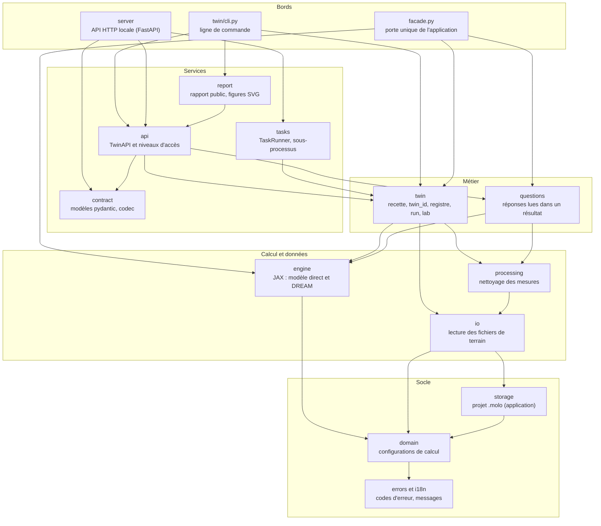
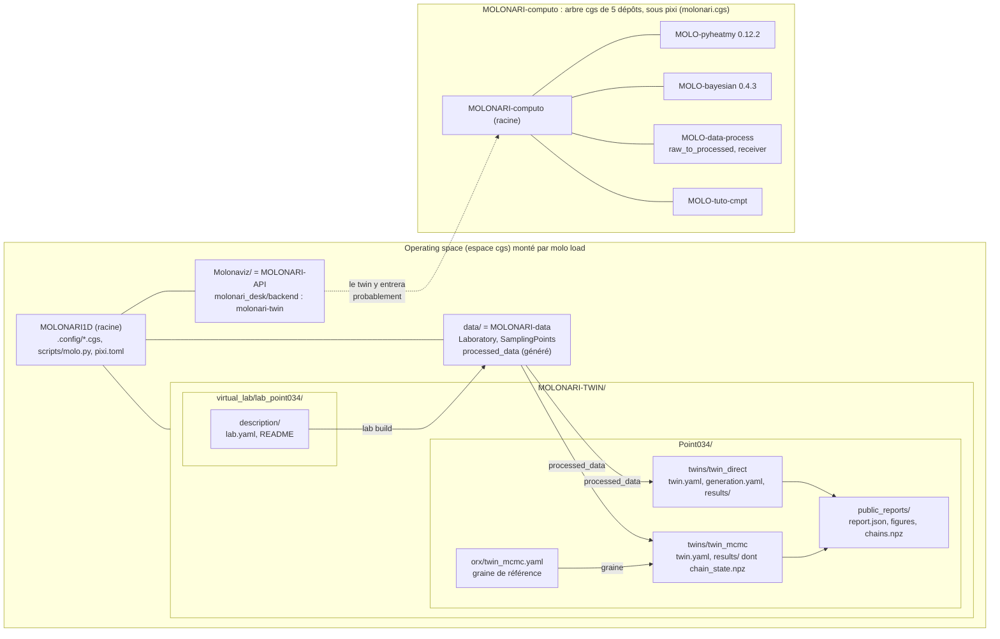
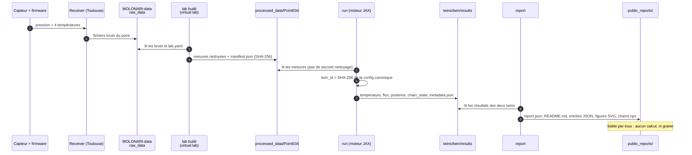
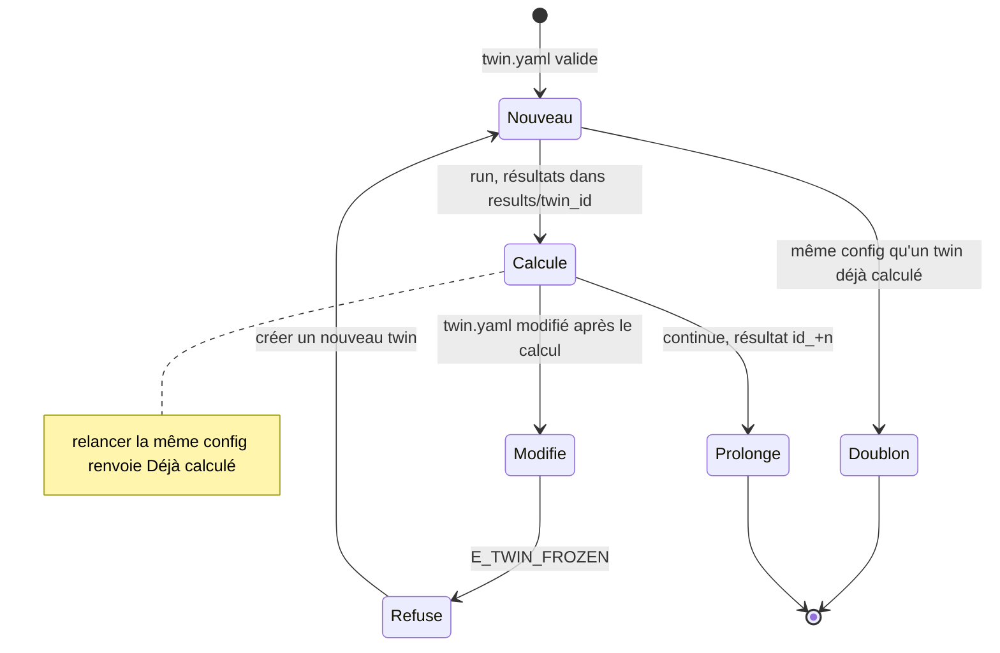
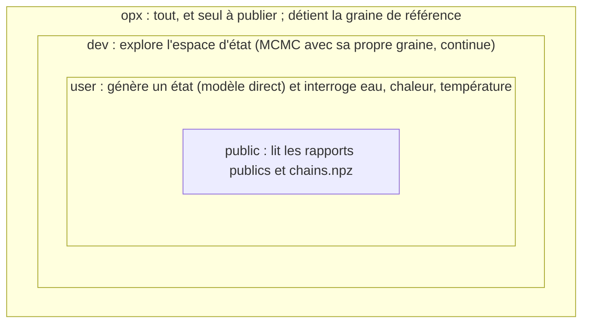
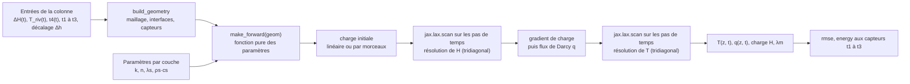
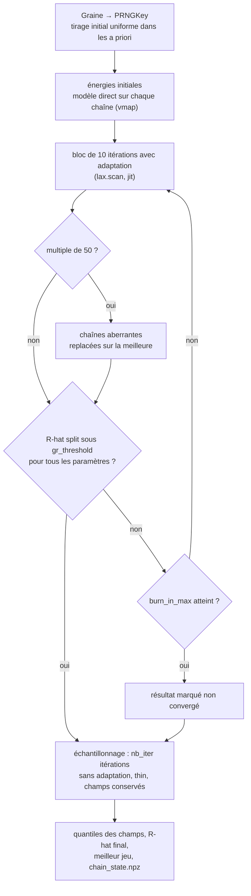
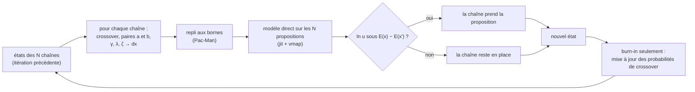
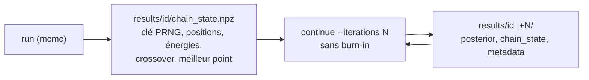
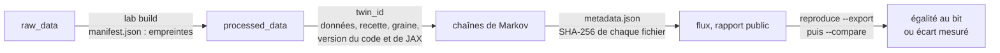

# MOLONARI-TWIN : prise en main et fonctionnement

Jumeau numérique d'un point de mesure de rivière : à partir de la température et de la pression relevées dans le lit, le twin estime l'eau et la chaleur qui s'échangent entre la rivière et la nappe, avec leur incertitude.

| | |
|---|---|
| Paquet décrit | `molonari-twin` **0.9.0-alpha.2** (commande `molonari-twin`), API HTTP `/v1` **1.0.0-alpha.8**, schéma de twin `molonari-twin/2.0.0` |
| État | **État au 2026-11-13 (MOLONARI1D 1.0.11, MOLONARI-computo 1.0.1, molonari-twin 0.9.0-alpha.2)**. Le dernier tag du backend reste `molonari-twin-v0.9.0-alpha.2` ; le CHANGELOG a une section « Non publié » (figures F1, `plot` F2), pas encore taguée |
| Branche | `CGS-MOLO` des dépôts MOLONARI1D et MOLONARI-API |
| Dates | toutes en **UTC** (UTC+0) |
| Public visé | partie 1 : toute personne qui installe et utilise le twin ; partie 2 : développeur ou hydrogéologue ; partie 3 : tout le monde, avant de s'appuyer sur un résultat |

> **En 30 secondes**
>
> - Un **twin** = une colonne 1D de sédiments sous le lit, une période, un jeu de paramètres. Il simule la température θ(z, t) et en déduit le **flux d'eau q(t)** (q > 0 : la rivière alimente la nappe).
> - Deux modes : **direct** (paramètres du sol fixés, quelques secondes) et **mcmc** (paramètres estimés par inversion bayésienne DREAM, quelques minutes, avec incertitude).
> - Tout se fait **en ligne de commande** : `molonari-twin validate | run | report | ask | …` (14 commandes, voir section 1.3).
> - Le calcul est en **JAX, float64**, sur CPU. Même recette, mêmes données, même code, même graine : mêmes fichiers **au bit près sur une même plateforme**, seulement **statistiquement** entre plateformes.
> - **4 niveaux** orientent l'usage : `public` (lit les rapports), `user` (interroge l'eau, la chaleur, la température), `dev` (lance ses chaînes avec sa propre graine), `opx` (tout, dont la graine de référence). Ce n'est **pas** une sécurité.
> - Installer : `git clone` de MOLONARI1D, `pixi run molo load .config/install-orx.cgs`, puis `uv sync` dans `Molonaviz/molonari_desk` (section 1.1). Vérifier : `molonari-twin --help` puis `molonari-twin validate <twin>`.
> - À savoir avant de croire un chiffre : `q_s ≠ 0` est refusé (pas d'échange latéral), les seuils de fiabilité **ne sont pas validés**, et un MCMC court peut ne pas avoir convergé (partie 3).

> ⚠️ **Après la séparation.** Ce document décrit l'état **actuel, qui fonctionne aujourd'hui**. Le code du twin partira de MOLONARI-API vers MOLONARI-computo, l'application vers MOLONARI-hardware, et l'operating space n'aura plus que hardware, computo, twin et data. MOLONARI-computo est désormais un arbre cgs de 5 dépôts, entièrement sous pixi (MOLONARI-computo, MOLO-pyheatmy, MOLO-bayesian, MOLO-data-process, MOLO-tuto-cmpt) ; le twin y entrera probablement comme un sous-dépôt de plus. Changeront alors : le dossier du code (`Molonaviz/molonari_desk/backend` aujourd'hui), les manifestes `.cgs` de `.config/` (`install-orx.cgs`, `simu-direct.cgs`), les scripts (`scripts/demo_lundi.sh`, `scripts/simu_direct.sh`), **le gestionnaire d'environnement, qui passera de uv à pixi** (`uv.lock` remplacé par `pixi.lock`, `uv sync` et `uv run` remplacés par `pixi install` et `pixi run`), la recherche de la racine des données et, selon le suffixe de version, les `twin_id`. Les chemins concernés sont signalés par « ⚠️ séparation » ; le détail est dans [`AUDIT_SEPARATION_TWIN.md`](./AUDIT_SEPARATION_TWIN.md).

## Sommaire

- [Partie 1 : prise en main du twin](#partie-1--prise-en-main-du-twin)
  - [1.1 Installer l'operating space](#11-installer-loperating-space)
  - [1.2 Fonctionnalités](#12-fonctionnalités)
  - [1.3 Commandes](#13-commandes)
  - [1.4 Parcours type](#14-parcours-type--du-clonage-au-rapport-public)
  - [1.5 Que faire si…](#15-que-faire-si)
- [Partie 2 : fonctionnement du twin](#partie-2--fonctionnement-du-twin)
  - [2.1 Architecture](#21-architecture)
  - [2.2 Ce qu'est un twin](#22-ce-quest-un-twin)
  - [2.3 Les 4 niveaux](#23-les-4-niveaux)
  - [2.4 Le moteur JAX](#24-le-moteur-jax)
- [Partie 3 : limites et dangers possibles](#partie-3--limites-et-dangers-possibles)
- [Pour aller plus loin](#pour-aller-plus-loin)

---

# Partie 1 : prise en main du twin

## 1.1 Installer l'operating space

Un **operating space** est un dossier qui réunit plusieurs dépôts git, chacun à sa place, monté par ComplexGitSync (`cgitsync`) d'après un fichier `.cgs`. MOLONARI1D (version 1.0.11) est « administré avec pixi, fondé sur ComplexGitSync » : **cgitsync vient du `pixi.toml` de MOLONARI1D**, il n'y a plus de ComplexGitSync à installer à la main. Une seule commande, `molo`, recompose l'espace.

### Prérequis et versions

| Outil | Version | Rôle |
|---|---|---|
| git | 2.39 ou plus (exigence de `.config/simu-direct.cgs`) | clonage des dépôts |
| pixi | 0.81 (exigence de `.config/simu-direct.cgs`) | installe Python et `cgitsync` d'après le `pixi.toml` de MOLONARI1D (Python 3.11 à 3.13) |
| Système | **macOS arm64** ou **Linux x86-64** (glibc 2.27 ou plus) | calcul du twin (jaxlib 0.11.2 dans `uv.lock`) |

- Pour l'**étape 4** seulement (installer le backend du twin), uv 0.9 ou plus est encore nécessaire aujourd'hui ; il disparaîtra avec le passage à pixi (encadré de l'étape 4).
- **Mac Intel** : pas de paquet `jaxlib` 0.11.2, donc pas de calcul. **Alpine (musl)** : même chose. **Windows** : non testé (voir la partie 3).
- Accès réseau à GitHub. Sans clé SSH, ajouter `--https` à `molo load`.

### Les manifestes de `.config/`

Les manifestes sont à la racine de MOLONARI1D, dans `.config/` (branche `CGS-MOLO`) ; il n'y en a plus à la racine. Contenu relevé sur `origin/CGS-MOLO` le 2026-11-13.

| Manifeste | Dépôts montés | Usage |
|---|---|---|
| `.config/install-orx.cgs` | MOLONARI1D (racine), MOLONARI-API → `Molonaviz/`, **MOLONARI-data → `data/`**, MOLONARI-hardware → `hardware/`, MOLONARI-TWIN → `MOLONARI-TWIN/` | **espace de travail du twin** : à utiliser pour ce document |
| `.config/simu-direct.cgs` | MOLONARI1D, MOLONARI-API, MOLONARI-data, MOLONARI-TWIN, SIMU → `SIMU/` ; section `[environment]` (git 2.39, uv 0.9, pixi 0.81) | expérience de reproductibilité entre machines |
| `.config/molonari.cgs` | MOLONARI1D, MOLONARI-API, **MOLO-data-light → `data/`** (MOLONARI-data est commenté), hardware, gate → `molonari.io/`, **MOLONARI-computo → `computo/`**, ComplexGitSync → `dev-hub/` (privé) | espace complet de l'équipe, **sans MOLONARI-TWIN** |
| `.config/molonari-light.cgs` | comme `molonari.cgs` sans données ni TWIN | espace léger |
| `.config/molonari-vps.cgs` | dépôts publics de `molonari.cgs`, dont MOLO-data-light | serveur du site molonari.io |

**À propos de MOLO-data-light.** `molonari.cgs`, `molonari-vps.cgs` montent MOLO-data-light dans `data/` au lieu de MOLONARI-data, et aucun de ces deux manifestes ne monte MOLONARI-TWIN. Le contenu de MOLO-data-light, relevé par `gh api` : `lab/lab.json`, `processed_data/Point034/` (avec `manifest.json`), `raw_data/Point034/v1_hobo/`, `raw_data/laboratory/`, `sampling_points/`, `schemas/`. Le `lab.yaml` du twin attend un laboratoire `Laboratory` et des bruts dans `SamplingPoints/Point034` (disposition de MOLONARI-data) : **cette disposition n'est pas celle de MOLO-data-light**, donc `lab build` ne s'y appliquera pas tel quel. Je n'ai **pas** essayé de faire tourner le twin sur MOLO-data-light : sa compatibilité n'est pas vérifiée. Pour le twin, utiliser `install-orx.cgs` (MOLONARI-data).

> ⚠️ **séparation.** Le code du twin quittera MOLONARI-API pour MOLONARI-computo, qui est désormais lui-même un arbre cgs de 5 dépôts, entièrement sous pixi (voir 2.1). Le chemin `Molonaviz/molonari_desk` utilisé ci-dessous changera ; le détail est dans [`AUDIT_SEPARATION_TWIN.md`](./AUDIT_SEPARATION_TWIN.md).

### Étape 1 : git et pixi (macOS ou Linux)

```bash
# git : déjà présent sur macOS (Apple Git 2.39). Linux : sudo apt update && sudo apt install -y curl git ca-certificates
git --version                  # attendu : 2.39 ou plus

# pixi 0.81
curl -fsSL https://pixi.sh/install.sh | PIXI_VERSION=0.81.0 bash
exec $SHELL                    # recharge le PATH (~/.pixi/bin)
pixi --version                 # attendu : pixi 0.81.0
```

Si `git --version` donne moins de 2.39 sous Linux : `pixi global install git`.

### Étape 2 : cloner MOLONARI1D

```bash
git clone --branch CGS-MOLO https://github.com/flipoyo/MOLONARI1D.git
cd MOLONARI1D
pixi install                   # installe l'environnement de MOLONARI1D, dont cgitsync
```

### Étape 3 : monter l'operating space avec `molo`

```bash
pixi run molo load .config/install-orx.cgs --https     # --https : sans clé SSH ; sinon, retirer l'option
```

`molo load` appelle `cgitsync bootstrap` (le manifeste peut aussi se désigner par son nom : `install-orx`). À la fin, il affiche la ligne `export CGSHOME=…` à recopier :

```bash
export CGSHOME=<dossier indiqué à la fin de molo load>     # par défaut sous ~/.cgs/
pixi run molo status                                      # état de l'espace de $CGSHOME (cgitsync status)
```

`pixi run molo update .config/install-orx.cgs` resynchronise l'espace plus tard (`cgitsync pull`). Contrôle des dépôts :

```bash
for d in . Molonaviz data MOLONARI-TWIN; do
  printf '%-15s %s  %s modif.\n' "$d" "$(git -C "$CGSHOME/$d" rev-parse --short HEAD)" "$(git -C "$CGSHOME/$d" status --porcelain | wc -l)"
done                            # attendu : 0 modif. partout
```

### Étape 4 : installer le backend avec `uv sync`

```bash
cd "$CGSHOME/Molonaviz/molonari_desk"
# Calcul seul : versions figées de uv.lock, sans les outils de test ni l'application graphique
uv sync --frozen --package molonari-twin --no-default-groups
# Avec l'API HTTP locale (FastAPI, uvicorn)
uv sync --frozen --package molonari-twin --extra server --no-default-groups
# Poste de développement (tests, pyheatmy et bayesian_inversion de référence, application, PyInstaller)
uv sync
```

- `--frozen` installe **exactement** les versions de `uv.lock` (jax et jaxlib 0.11.2, numpy 2.5.4). C'est ce qui permet de comparer deux machines : la version de JAX entre dans le `twin_id`.
- La commande est dans `Molonaviz/molonari_desk/.venv/bin/molonari-twin`. On la désigne par une variable pour la suite :

```bash
export TWIN="$CGSHOME/Molonaviz/molonari_desk/.venv/bin/molonari-twin"
```

> ⚠️ **séparation : de uv à pixi.** Dans l'espace cible, uv disparaît. Le twin aura un `pixi.toml` et un `pixi.lock` dans computo, et l'installation deviendra :
>
> | Aujourd'hui (uv) | Après la séparation (pixi) |
> |---|---|
> | `uv sync --frozen --package molonari-twin --no-default-groups` | `pixi install --frozen` |
> | `uv sync --frozen … --extra server …` | `pixi install --frozen -e server` |
> | `uv sync` (poste de développement) | `pixi install -e dev` |
> | `$TWIN …` ou `uv run molonari-twin …` | `pixi run molonari-twin …` |
> | `uv run pytest` / `-m slow` | `pixi run -e dev test` / `test-slow` |
>
> JAX, jaxlib et numpy resteront pris sur PyPI, aux mêmes versions (0.11.2, 0.11.2, 2.5.4), pour que les résultats ne changent pas au bit près. Le détail et la preuve d'équivalence sont dans `AUDIT_SEPARATION_TWIN.md`, section 6.4 et lot L2b.

### Étape 5 : les données

Un twin 2.0.0 lit ses mesures par des chemins **relatifs à la racine des données**. Cette racine est cherchée dans cet ordre (`data_root` dans `twin/config.py`) :

| Ordre | Source | Cas d'usage |
|---|---|---|
| 1 | variable d'environnement `MOLONARI_DATA` | **cas à retenir** |
| 2 | fichier `data_root.txt` dans le dossier du twin | twin de dev hors de l'espace (écrit seul par `run --sigma-temperature --space`) |
| 3 | dossier `data/` de l'espace cgs qui contient le twin, repéré par un fichier `molonari.cgs` **à la racine** | ancien cas |

Le manifeste `molonari.cgs` est maintenant dans `.config/` : le code actuel ne le trouve plus à la racine d'un espace fraîchement monté. **Fixer `MOLONARI_DATA` explicitement** :

```bash
export MOLONARI_DATA="$CGSHOME/data"          # ou : echo "$CGSHOME/data" > <dossier du twin>/data_root.txt
ls "$MOLONARI_DATA"                            # Laboratory  SamplingPoints  processed_data  …
```

`data/` est le dépôt MOLONARI-data (avec `install-orx.cgs`). `data/processed_data/` est **généré** par `lab build` ; il apparaît en `??` dans `git status` de `data/`, c'est normal.

> ⚠️ **séparation.** La recherche par `molonari.cgs` (`WORKSPACE_MARKER`) est à revoir avec la nouvelle disposition ; `MOLONARI_DATA` reste la règle sûre.

### Étape 6 : vérifier que tout marche

```bash
"$TWIN" --help                                                    # liste des 14 commandes
POINT="$CGSHOME/MOLONARI-TWIN/Point034"
"$TWIN" validate "$POINT/twins/twin_direct"                       # attendu : « twin_direct : config valide (mode direct). »
"$TWIN" list "$POINT/twins"                                       # attendu : twin_direct et twin_mcmc, avec leur twin_id
"$TWIN" reports list "$CGSHOME/MOLONARI-TWIN"                     # attendu : Point034  rapport  chains.npz
```

Si `validate` répond `E_TWIN_DATA_ROOT`, la racine des données n'est pas trouvée (étape 5). Messages en français par défaut ; `MOLONARI_LANG=en` les passe en anglais.

---

## 1.2 Fonctionnalités

Le **niveau** est celui que vise la spécification (*SPEC_MOLONARI_4_NIVEAUX*, document de travail hors dépôt). Le code ne **vérifie** que l'option `--level` de `questions`, `ask` et `serve` ; pour le reste, le niveau est une convention d'usage (voir 2.3).

| Fonctionnalité | À quoi ça sert | Niveau requis |
|---|---|---|
| **Twin direct** (`run` d'un twin `mode: direct`) | Simuler T(z, t) et q avec des paramètres de sol **fixés** par la recette. Quelques secondes (15 s avec la compilation, sur Mac M1). Pas d'incertitude : un seul calcul. | dev ; le user obtient un état comparable avec `generate` |
| **Twin inverse MCMC** (`run` d'un twin `mode: mcmc`) | Estimer les 4 paramètres du sol (−log₁₀ k, n, λs, ρs·cs) par couche et en déduire q avec un **intervalle** (DREAM, chaînes en parallèle). 3 à 4 min pour Point034 sur Mac M1. Exige une graine dans `orx.yaml`. | dev (sa propre graine) ; opx (graine de référence) |
| **Twin de σ** (`run --sigma-temperature`) | Relancer l'inversion avec une autre incertitude de température, dans un twin frère `<twin>_sigmaT<σ>`, sans toucher au twin d'origine (figé). | dev |
| **Reprise d'une chaîne** (`continue`) | Prolonger un MCMC depuis `chain_state.npz`, sans refaire le burn-in ni connaître la graine. Crée le résultat `<twin_id>_+<n>`. | dev, opx |
| **Rapport public** (`report`, `reports`) | Publier des chiffres et des figures **SVG** à partir d'une liste blanche de grandeurs : flux d'eau, **cartes T(z, t)** et q(z, t) (frises), températures à plusieurs profondeurs, a posteriori, chaînes, avec `README.md` en français (constats chiffrés, limites) et `chains.npz` (sous-échantillon des chaînes). Les champs en profondeur ne sont publics que si `visibility.states` l'est dans chaque twin. Le public lit les fichiers ; `reports list/show/chains` les résume. | écriture : opx ; lecture : public et tous |
| **Figures de l'admin** (`plot temperature`, `plot fields`) | Tracer, hors de `public_reports/`, les mesures face à la simulation par thermomètre (bandes crédible et prédictive à 90 % pour un mcmc, résidus, RMSE) et les frises de T et de q du meilleur ajustement, même si les états du twin sont privés. Refusé au niveau `user`. | dev, opx |
| **État généré** (`generate`) | Recalculer un état complet par le modèle direct à partir d'un **échantillon publié** (par défaut celui de plus basse énergie) ou de ses propres paramètres dans les bornes. Reste local. | user |
| **Reproductibilité et export** (`twin_id`, `metadata.json`, `run --strict`, `reproduce`) | Prouver qu'un résultat se rejoue : empreintes SHA-256 de chaque fichier, provenance (dépôts, commits, environnement), comparaison de deux machines (`--export`, `--compare`). | opx (`reproduce`) ; tous lisent `metadata.json` |
| **Questions du catalogue** (`questions`, `ask`) | Poser à un twin calculé une question prête à l'emploi (flux, sens de l'échange, volume, bilan de chaleur, température, qualité d'ajustement, fiabilité, provenance…). **23 questions** au niveau opx, **5** au niveau user. Réponse immédiate, sans recalcul. | user (5 questions) ; dev et opx (23) |
| **API HTTP locale** (`serve --local`) | Servir `/v1` sur `127.0.0.1:8765` : questions, lancement de calculs en tâches de fond (SSE), pour un frontend. Les calculs tournent dans des sous-processus, jamais dans le serveur. | user (questions) ; dev et opx (calculs et tâches) |
| **Virtual lab** (`lab build`) | Transformer les mesures brutes d'un point en `processed_data/<point>/` (mesures nettoyées + `manifest.json` avec empreintes). Un lab décrit le nettoyage et la version du code (`lab.yaml`). | opx |
| **Niveaux d'accès** (`--level`) | Réduire le catalogue et les réponses à ce qui convient à chaque profil. | tous |

Les cinq questions du user : `water_flux`, `exchange_direction`, `exchanged_volume`, `heat_budget`, `temperature` (eau, chaleur, température). Toute autre question revient au niveau dev ou opx.

---

## 1.3 Commandes

Source : `molonari-twin --help` et le `--help` de chaque sous-commande (relevés le 2026-11-13, après la fusion de F1 et F2). `python -m molonari_twin …` est équivalent. Codes de sortie : 0 succès, 1 configuration invalide ou erreur, 2 usage incorrect.

`<twin>` désigne un dossier `twin_xx` ou son `twin.yaml`. `<point>` est le dossier d'un sampling point (celui qui contient `public_reports/`).

| Commande | Rôle | Options utiles | Niveau |
|---|---|---|---|
| `validate <twin>` | Valider la recette (clés inconnues refusées, tous les problèmes rapportés ensemble) | — | dev |
| `id <twin>` | Afficher le `twin_id` (16 caractères hexadécimaux) et l'état : à calculer, calculé, doublon, modifié (figé) | — | dev |
| `run <twin>` | Calculer (ou signaler un doublon) et ranger les résultats dans `results/<twin_id>/` | `--strict` : refuse une pré-version, un code non publié, un dépôt modifié ou une provenance illisible ; `--sigma-temperature SIGMA` : crée et lance le twin de dev `<twin>_sigmaT<SIGMA>` (mcmc) ; `--space FOLDER` : où le créer (dossier courant par défaut, jamais le dépôt du point) ; `--seed SEED` : **votre** graine, écrite dans son `orx.yaml` (`--space` et `--seed` exigent `--sigma-temperature`) | dev (graine propre), opx (graine de référence) |
| `continue <twin>` | Prolonger une chaîne MCMC depuis son état final | `--iterations N` (obligatoire) : itérations supplémentaires | dev, opx |
| `list <dossier>` | Lister les twins d'un dossier, leur mode, leur `twin_id` et leur état | — | dev |
| `report <twin>` | Écrire le rapport public d'un twin calculé et de son twin frère (le twin qui porte la clé `report`) | `--output DOSSIER` (défaut : `Public Report` dans le dossier du twin ; en publication, `<point>/public_reports`) ; `--forward DOSSIER` : rapport **local** d'un twin de σ contre un twin direct, jamais écrit dans `public_reports/` | opx ; `--forward` : dev |
| `reproduce [<twin>]` | Relancer sans cache et comparer tous les fichiers à la référence ; ou exporter ; ou comparer deux exports | `--output DOSSIER` : où écrire le compte rendu JSON et texte ; `--export DOSSIER` : ne recalcule rien, exporte résultats, empreintes et valeurs clés ; `--compare A B` : compare deux exports (code 0 si identiques, 1 sinon) ; `--json` : avec `--compare`, sortie JSON | opx |
| `questions [<twin>]` | Lister les questions du catalogue (celles du mode du twin, s'il est donné) | `--level {user,dev,opx,admin}` (défaut `user`) ; `--json` : le JSON de `/v1` | user |
| `ask <twin> <question>` | Poser une question (identifiant `water_flux` ou référence `HN-10`) à un twin calculé, ou à un **état généré** | `--params JSON` : corps du POST ; `--level {user,dev,opx,admin}` ; `--json` | user (5), dev et opx (23) |
| `generate <point>` | Générer un état par le modèle direct depuis `public_reports/chains.npz` et `generation.yaml` | `--sample CHAÎNE:ITÉRATION` (défaut : l'échantillon publié de plus basse énergie) ou `--params FICHIER` (YAML ou JSON, une entrée par couche, dans les bornes) ; `--output DOSSIER` (défaut `./<point>_state`, jamais dans `public_reports/` ni `results/`) | user |
| `reports list [<dossier>]` | Lister les points qui ont un `public_reports/` (dossier courant par défaut) | `--json` | tous |
| `reports show <point>` | Afficher l'index du rapport : twins, plateforme, entrées, entrées sautées, figures | `--json` | tous |
| `reports chains <point>` | Résumer `chains.npz` : chaînes, échantillons, couches, `publication_thin`, empreintes | `--json` | tous |
| `plot temperature <twin>` / `plot fields <twin>` | Tracer les figures de l'admin : `temperature.svg` (mesure, simulation, bandes, résidus) ; `fields-temperature.svg` et `fields-water_flux.svg` (frises) | `--level {user,dev,opx,admin}` (défaut `user`, **refusé**) ; `--output DOSSIER` (défaut `./<twin>_plots`, jamais dans `public_reports/` ni `results/`) ; `--start DATE`, `--end DATE` (ISO 8601, sans fuseau) ; `--json` | dev, opx |
| `lab build <lab> --point <point>` | Nettoyer un point d'après `lab.yaml` et écrire `processed_data/<point>/` (`measurements.csv`, `manifest.json`) | `--point POINT` (obligatoire) : une clé de `points` dans `lab.yaml` ; `<lab>` : dossier qui contient `lab.yaml`, ou le fichier | opx |
| `serve` | Servir `/v1` en HTTP sur `127.0.0.1` (extra `server`) | `--local` ; `--port PORT` (8765) ; `--twins-folder DOSSIER` ; `--tasks-db FICHIER` (défaut `$XDG_CACHE_HOME/molonari-twin/tasks.sqlite`) ; `--max-workers N` (1) ; `--level {user,dev,opx,admin}` (défaut `user`) | user ; calculs : dev et opx |

Notes :

- `admin` est un **alias d'`opx`**, gardé pour compatibilité.
- `run`, `report`, `continue` et `reproduce` n'ont pas d'option `--level` : le niveau y est une convention, pas un contrôle.
- `reports` ne charge pas JAX : il se lit sans le moteur de calcul.
- Variables d'environnement : `MOLONARI_DATA` (racine des données), `MOLONARI_LANG` (`fr` ou `en`), `MOLONARI_THRESHOLDS` (fichier YAML de seuils de fiabilité), `XDG_CACHE_HOME` (cache des tâches).
- `plot --help` (sans sous-commande) **plante** avec une `ValueError` (un `%` dans un texte d'aide) ; utiliser `plot temperature --help` ou `plot fields --help`.
- Le CHANGELOG du backend a une section « Non publié » (F1, F2) : le code est fusionné (PR #140 et #141 de MOLONARI-API, le 2026-11-12), mais le dernier tag reste `molonari-twin-v0.9.0-alpha.2`.

---

## 1.4 Parcours type : du clonage au rapport public

Hypothèse : étapes 1 à 6 de la section 1.1 faites, `CGSHOME`, `TWIN` et `POINT` définis. Durées mesurées sur Mac M1 pour Point034 (15 jours de mesures de 2016).

```bash
cd "$CGSHOME"
POINT=MOLONARI-TWIN/Point034
```

1. **Cloner et installer** (1.1, étapes 2 à 4), puis **vérifier** (étape 6).

2. **Construire les données traitées** (virtual lab, niveau opx, ~15 s) :
   ```bash
   "$TWIN" lab build MOLONARI-TWIN/virtual_lab/lab_point034/description --point Point034
   ```
   Attendu : « Données traitées écrites : …/data/processed_data/Point034 (1430 lignes, … empreinte …) ». Vérifier que les dates sont en UTC : `grep -E '"(utc_offset|source_utc_offset)"' data/processed_data/Point034/manifest.json` doit donner `+00:00` et `+01:00`.

3. **Valider les deux recettes** :
   ```bash
   "$TWIN" validate "$POINT/twins/twin_direct"
   "$TWIN" validate "$POINT/twins/twin_mcmc"
   "$TWIN" id "$POINT/twins/twin_mcmc"       # twin_id et état dans le registre
   ```

4. **Calculer le twin direct** (~15 s) :
   ```bash
   "$TWIN" run "$POINT/twins/twin_direct"
   ```
   La recette est figée après le premier calcul. Relancer la même config renvoie « Déjà calculé » sans recalcul.

5. **Calculer le twin MCMC** (3 à 4 min). Il lit la graine dans `Point034/orx/twin_mcmc.yaml` (graine de référence, niveau opx). Un dev crée à côté de sa recette un `orx.yaml` avec `mcmc: {seed: <entier>}` (le fichier du point l'emporte s'il existe) : son `twin_id` sera différent.
   ```bash
   "$TWIN" run "$POINT/twins/twin_mcmc"
   ```
   Pour un essai avec une autre incertitude de température, sans toucher au twin de référence :
   ```bash
   MOLONARI_DATA="$CGSHOME/data" "$TWIN" run "$POINT/twins/twin_mcmc" \
     --sigma-temperature 0.08 --space "$HOME/mon-espace" --seed 7
   ```

6. **Prolonger la chaîne** (facultatif, dev ou opx) : repart de `chain_state.npz`, sans burn-in :
   ```bash
   "$TWIN" continue "$POINT/twins/twin_mcmc" --iterations 1000
   ```

7. **Interroger les résultats** (user) :
   ```bash
   "$TWIN" questions "$POINT/twins/twin_mcmc"                              # 5 questions au niveau user
   "$TWIN" ask "$POINT/twins/twin_mcmc" water_flux --params '{"level": 0.9}'
   "$TWIN" ask "$POINT/twins/twin_mcmc" heat_budget
   "$TWIN" ask "$POINT/twins/twin_mcmc" residuals --level dev              # hors liste user
   ```

8. **Écrire le rapport public** (niveau opx) :
   ```bash
   "$TWIN" report "$POINT/twins/twin_mcmc" --output "$POINT/public_reports"
   ```
   Le rapport compare `twin_direct` (forward) et `twin_mcmc` (inversion) ; il écrit aussi `generation.yaml` dans le dossier de `twin_direct`.

9. **Lire le rapport** (tous niveaux, sans calcul) :
   ```bash
   "$TWIN" reports list MOLONARI-TWIN
   "$TWIN" reports show "$POINT"
   "$TWIN" reports chains "$POINT"
   ```
   Les fichiers sont aussi lisibles directement : `report.json` (format 1.1.0), `README.md`, un JSON par entrée, `figures/*.svg` (dont les frises T(z, t) si les états sont publics), `chains.npz`.

10. **Générer un état chez soi** (user) :
    ```bash
    "$TWIN" generate "$POINT" --output "$HOME/etat_point034"
    "$TWIN" ask "$HOME/etat_point034" water_flux
    ```
    La réponse est une valeur seule, sans intervalle, avec l'avertissement `W_GENERATED_STATE` : l'intervalle a posteriori est dans le rapport public.

11. **Servir l'API en local** (facultatif ; installer l'extra `server`) :
    ```bash
    "$TWIN" serve --local --level user --twins-folder "$POINT/twins" --port 8765 &
    curl -s http://127.0.0.1:8765/v1/info
    curl -s -X POST -H 'content-type: application/json' -d '{"level":0.9}' \
      http://127.0.0.1:8765/v1/twins/twin_mcmc/questions/water_flux
    ```
    Au niveau `user`, `POST /v1/twins/<twin>/run` et `/v1/tasks/*` répondent 403 ; avec `--level dev` ou `opx`, `POST …/run` renvoie 202 et un `task_id`, suivi par `GET /v1/tasks/<id>/events` (flux SSE) et annulable par `DELETE /v1/tasks/<id>`.

12. **Prouver la reproductibilité** (opx) : exporter, puis comparer à l'export d'une autre machine :
    ```bash
    "$TWIN" reproduce "$POINT/twins/twin_direct" --export "$HOME/exports/ma-machine"
    "$TWIN" reproduce --compare "$HOME/exports/ma-machine" "$HOME/exports/autre-machine" --json
    ```
    Code de sortie 0 : identiques au bit. Le script `scripts/simu_direct.sh` enchaîne tout cela pour l'expérience SIMU (lancé depuis un espace monté par `.config/simu-direct.cgs` ; l'environnement pixi `simu` de l'ancienne racine n'existe plus, voir l'en-tête du script).

> ⚠️ **séparation.** Les chemins `Molonaviz/molonari_desk/.venv`, `MOLONARI-TWIN/virtual_lab/…` et le nom des dépôts dans les scripts changeront. Les commandes `molonari-twin …` elles-mêmes ne changent pas.

---

## 1.5 Que faire si…

Chaque erreur attendue a un **code stable** (`E_…` pour une erreur, `W_…` pour un avertissement), défini dans `errors.py`. Avec `--json`, l'erreur sort sur la sortie standard au format `{code, field, params, message_en}`.

| Symptôme (code) | Cause | Que faire |
|---|---|---|
| `E_TWIN_DATA_ROOT` : « le dépôt de données est inconnu » | ni `MOLONARI_DATA`, ni `data_root.txt`, ni espace cgs reconnu | `export MOLONARI_DATA="$CGSHOME/data"` (1.1, étape 5) |
| `E_TWIN_DATA_NOT_FOUND` | le chemin `data: {processed: …}` n'existe pas | lancer `lab build` ; vérifier le chemin relatif à la racine des données |
| `E_PROCESSED_DIGEST`, `E_PROCESSED_SCHEMA` | `processed_data/` ne correspond plus à son manifeste, ou ancien schéma 1.0.0 (dates en heure du logger) | refaire `lab build` |
| `E_LAB_DATA_ROOT`, `E_LAB_POINT_UNKNOWN`, `E_LAB_BUILD_EMPTY` | racine des données inconnue ; point absent de `lab.yaml` ; plus aucune mesure après le nettoyage | corriger `--point` ; vérifier la fenêtre `processing.start/end` (en **UTC**) |
| `E_TWIN_FROZEN` | la recette a été modifiée après un calcul | créer **un nouveau twin** : une config calculée ne se modifie pas |
| Duplicate / « Déjà calculé » | même configuration, même données, même code, même graine | rien : les résultats existent déjà dans `results/<twin_id>/` |
| `E_TWIN_REQUIRED` sur `orx.mcmc.seed` ; `W_TWIN_NO_SEED` | un twin mcmc sans graine peut être lu, pas calculé | dev : écrire `orx.yaml` (`mcmc: {seed: N}`) à côté de `twin.yaml` ; opx : monter la couche `orx` |
| `E_TWIN_SEED_ORX` ; `E_TWIN_VISIBILITY_SEED` | graine écrite dans `twin.yaml`, ou déclarée « publique » | la déplacer dans `orx.yaml` ; la graine n'est pas un élément de visibilité |
| `E_LATERAL_EXCHANGE_UNSUPPORTED` | `q_s ≠ 0` dans une couche : le moteur n'a pas d'échange latéral | retirer `q_s` (ou `q_s: 0`) ; `t_lateral` est ignoré |
| `E_ACCESS_USER_ONLY` (403 en HTTP) | question réservée au dev ou à l'opx | ajouter `--level dev` ou `--level opx` (usage, pas sécurité) |
| `E_TWIN_NOT_COMPUTED`, `E_CONTINUE_NO_RESULTS` | le twin n'a pas de résultats | `run` d'abord |
| `E_CONTINUE_NO_STATE` ; `E_CONTINUE_MCMC_ONLY` | pas de `chain_state.npz` (calcul ancien) ; twin en mode direct | relancer le twin avec ce code ; `continue` ne vaut que pour le mcmc |
| `E_STRICT_REFUSED` (avec `E_STRICT_PRERELEASE`, `E_STRICT_LOCAL_BUILD`, `E_STRICT_DIRTY`, `E_STRICT_UNTAGGED`, `E_STRICT_NO_PROVENANCE`) | mode strict : pré-version (`-alpha.N`), code non publié (`+g<commit>`), dépôt modifié, twin sans tag, pas de git | lancer sans `--strict` pour un essai ; pour une référence, tagger et nettoyer les dépôts. Avec la version 0.9.0-alpha.2, `--strict` est **toujours refusé** (pré-version) ; `reproduce <twin>`, qui lance `run --strict` par défaut (d'après `twin/reproduce.py`), devrait l'être aussi : utiliser `--export` et `--compare` |
| `E_TWIN_CODE_VERSION` | le twin déclare une autre version du code (schémas 1.x) | créer un nouveau twin pour ce code |
| `E_MEASURES_NOT_CHRONOLOGICAL` | dates non croissantes : en général un tableur a reconverti des dates | réexporter le fichier depuis le logiciel du logger |
| `E_MEASURES_TIMEZONE_*`, `E_PIPELINE_TIMEZONE_*` ; `W_MEASURES_TIMEZONE_UNDECLARED` | fuseau ambigu, en conflit ou non déclaré | respecter la convention des bruts (décalage déclaré, ramené en UTC) ; sans déclaration, les dates restent « comme écrites » |
| `E_COLUMN_TOO_FEW_TIMES`, `E_TWIN_TOO_FEW_MEASUREMENTS` | moins de 3 dates exploitables | élargir la période de nettoyage |
| `E_MODEL_NON_FINITE` | le modèle produit des NaN ou des infinis | vérifier les paramètres et les mesures ; bornes a priori plus raisonnables |
| `E_MCMC_NB_CHAINS` | moins de 2·δ + 1 chaînes (7 avec δ = 3) | augmenter `mcmc.nb_chains` |
| `E_QUESTION_PARAMS` | paramètres de question invalides (ex. `temperature` sans `z` ni `t`) | `questions --json` donne les schémas ; corriger `--params` |
| `E_REPORTS_NO_REPORT`, `E_REPORTS_NO_CHAINS`, `E_GENERATE_NO_CHAINS` | pas de rapport ou de `chains.npz` publié | `cgitsync pull` pour récupérer les rapports publics |
| `E_GENERATE_NO_SETTINGS` | `generation.yaml` absent | l'opx l'écrit en publiant le rapport (`report`) |
| `E_GENERATE_OUTPUT_FORBIDDEN`, `E_REPORT_LOCAL_OUTPUT_FORBIDDEN` | sortie dans `public_reports/` ou `results/` | choisir un dossier local : seul l'opx publie |
| `E_TWIN_SIGMA_SPACE` | `--space` pointe dans le dépôt du point | choisir son propre dossier (`--space ~/mon-espace`) |
| `E_SERVER_EXTRA_MISSING` | FastAPI et uvicorn absents | `uv sync --package molonari-twin --extra server` |
| « seule une adresse locale est permise » | `serve` n'écoute que `127.0.0.1` tant qu'il n'y a pas d'authentification | normal : le user fait ses requêtes sur la machine qui sert l'API |
| Lenteur ou mémoire au premier calcul | compilation XLA (une fois par forme de problème) | patienter ; réduire `nb_cells`, `nb_chains`, `store_fields` si besoin |

---

# Partie 2 : fonctionnement du twin

## 2.1 Architecture

### Les couches

Le backend `molonari_twin` s'importe et s'exécute **sans Qt** ni interface (`tests/test_architecture.py` le vérifie). Les flèches vont de celui qui dépend vers celui dont il dépend ; les imports différés de la ligne de commande ne sont pas tous dessinés.



Règle de base : `engine` ne connaît ni les twins ni les fichiers ; `twin` orchestre ; `questions` lisent des résultats déjà écrits (elles n'appellent pas JAX) ; `contract` ne contient aucune logique et n'importe ni FastAPI ni JAX.

> ⚠️ **séparation.** Ce découpage interne est conservé tel quel dans MOLONARI-computo (`src/molonari_twin/src/molonari_twin/…`), pour que `code_path()` et les chemins de tests restent valables ; seul le dossier racine du paquet change.

### Disposition des dépôts et de MOLONARI-TWIN



- Dans ce schéma, `molonari.cgs` monte MOLONARI-computo dans `computo/` ; `install-orx.cgs` ne le monte pas. MOLO-data-process (`raw_to_processed`, avec `lab.py`, `virtual_lab.py`, `pipeline.py` et le receiver) **recoupe peut-être** `lab build` et `io/` du twin : à clarifier dans l'audit, rien n'est tranché ici.
- Le chemin d'un sous-dossier est le même à tous les niveaux : le code n'a pas à s'adapter au niveau.
- Pour l'instant MOLONARI-TWIN est **un seul dépôt public** (`KeanuToofa/MOLONARI-TWIN`) : la graine de référence y est lisible. Dans la cible, chaque dossier ci-dessus devient un sous-dépôt avec son niveau (voir 2.3).
- `results/` est rangé **dans le dossier de chaque twin** (`twins/<twin>/results/<twin_id>/`) avec son `registry.csv`. L'ancienne disposition (`results/` partagé au niveau du point) est encore lue, avec l'avertissement `W_RESULTS_LEGACY_LOCATION`.

> ⚠️ **séparation.** Dans la cible, MOLONARI-TWIN est un dépôt de tête contenant des sous-dépôts (`public_reports`, `twin_direct`, `twin_mcmc`, `description` du lab), et MOLONARI-DATA passe en accès restreint. Les chemins ne changent pas ; les droits d'accès, si.

### Du capteur au rapport



Le receiver et la partie matérielle sont hors du code du twin (dépôts hardware et computo) ; le twin commence à `processed_data`.

### Sous-paquets

Chemins relatifs à `Molonaviz/molonari_desk/backend/src/molonari_twin/`.

| Sous-paquet | Rôle | Fichier clé |
|---|---|---|
| `io` | lire les fichiers de terrain (HOBO, formats de dates, laboratoire) ; convertir en UTC | `io/point_import.py`, `io/dates.py` |
| `processing` | nettoyer les mesures : période, valeurs aberrantes (IQR, Z-score), exclusions, conversion tension → charge | `processing/cleanup.py` |
| `domain` | configurations de calcul (couches, a priori, DREAM), bornes physiques et valeurs par défaut | `domain/compute.py` |
| `engine` | moteur de calcul : modèle direct, DREAM, identité du moteur | `engine/jax/forward.py`, `engine/jax/dream.py`, `engine/api.py` |
| `twin` | recette `twin.yaml`, `twin_id`, registre, provenance, exécution, virtual lab, reproduction, génération, ligne de commande | `twin/config.py`, `twin/run.py`, `twin/cli.py` |
| `questions` | réponses calculées à partir d'un résultat (flux, volumes, chaleur, fiabilité, chaînes) | `questions/answer.py`, `questions/reliability.py` |
| `contract` | modèles pydantic de l'API `/v1`, schémas des paramètres, codec JSON et npz | `contract/models.py`, `contract/codec.py` |
| `api` | `TwinAPI` (catalogue, `ask`, lancement), niveaux `user/dev/opx` | `api/service.py`, `api/access.py` |
| `server` | application FastAPI locale (`/v1`) | `server/app.py` |
| `tasks` | `TaskRunner` : tâches longues en sous-processus, SQLite, annulation, timeout | `tasks/runner.py`, `tasks/local.py` |
| `report` | rapport public : liste blanche, figures SVG sans matplotlib, `report.json` | `report/generator.py`, `report/svgplot.py` |
| `storage` | fichier projet `.molo` (SQLite) de l'application de bureau | `storage/project.py` |
| `i18n` | traduction pure à partir des codes ; catalogue français | `i18n/fr.json` |
| `facade.py` | seule porte du backend pour l'application de bureau | `facade.py` |

---

## 2.2 Ce qu'est un twin

Un twin est **un point, une période, un jeu de paramètres**. Il est défini entièrement par une **recette** et ne peut plus changer une fois calculé.

| Élément | Ce que c'est |
|---|---|
| **Config figée** (`twin.yaml`) | données (`data: {processed: …}` ou brut), nettoyage, couches de sol (`z_low`, paramètres), `numerics.nb_cells`, `sensors.sigma_temperature`, bloc `mcmc` (a priori, chaînes, itérations…), bloc `report`. Les clés inconnues sont refusées. Modifier la recette après un calcul → `E_TWIN_FROZEN`. |
| **`twin_id`** | SHA-256 (16 premiers caractères hexadécimaux) de la **config canonique** : mode, empreinte des mesures nettoyées, profondeurs, `nb_cells`, a priori, réglages DREAM, **graine**, et **version du code** (`engine_version()` : version du paquet, suffixe git `+g<commit>` éventuel, **version de JAX**). Les libellés (nom, description, noms de couches) et la clé `report` n'y entrent pas. |
| **Registre** (`registry.csv`) | une ligne par exécution du twin : `twin_id`, nom, mode, statut (`computed`, doublon), date, durée, version du code, dossier des résultats. Il sert à reconnaître un **doublon** : config identique relancée sous un autre nom → renvoi au résultat existant, sans recalcul. |
| **Provenance** (`metadata.json["provenance"]`) | URL, commit, tags et état (propre ou modifié) du dépôt du code et du dépôt du twin ; environnement (Python, plateforme, processeur, appareil, jax, jaxlib, numpy) ; empreinte du `.gts` cgs ; avertissements. Ce qui manque vaut `null`, avec un avertissement. |
| **Empreintes** (`metadata.json["files"]`) | SHA-256 de chaque fichier de résultats : c'est ce que compare `reproduce`. |
| **Résultats** (format 2.0.0) | `temperature.csv`, `water_flux.csv`, `residuals.csv`, `water_flux_field.csv`, `heat_flux_advective.csv`, `heat_flux_conductive.csv` ; en mcmc : `posterior_summary.csv`, `posterior_samples.csv`, `posterior.npz`, `quantiles.npz`, `fields_*.npz`, `chain_state.npz`. Conventions : z, q et flux de chaleur positifs vers le bas ; flux advectif rapporté à T_ref = 0 °C. |



États affichés par `id` et `list` : « valide, pas encore lancé », « déjà calculé », « doublon de … », « configuration modifiée après son lancement (figée) ».

> ⚠️ **séparation.** La version du code entre dans le `twin_id`. Un twin recalculé depuis le dépôt déplacé n'a les mêmes identifiants que si la version, le suffixe `+g<commit>` (tag `molonari-twin-v…` recréé sur le commit déplacé) et la version de JAX sont les mêmes. Seuls les résultats numériques restent identiques si la physique ne change pas.

---

## 2.3 Les 4 niveaux

Les niveaux sont **emboîtés** : chacun a tous les droits du précédent. Ils **orientent l'usage** ; ils ne contrôlent aucune identité. Les droits réels restent ceux de la forge (GitHub) tant que le gestionnaire d'accès GX4G n'existe pas.



| Niveau | Lit | Calcule | Écrit ou publie |
|---|---|---|---|
| **public** | rapports publics, sous-échantillon des chaînes (`chains.npz`) | rien | rien |
| **user** | en plus : données, recette du twin direct, bornes des paramètres (`generation.yaml`), 5 questions | le modèle direct (`generate`) | ses états, en local |
| **dev** | en plus : recettes des twins, cache complet, état final des chaînes ; 23 questions | le MCMC avec **sa propre graine**, `continue` | ses propres twins, dans son espace |
| **opx** | en plus : tout MOLONARI-TWIN, dont les graines de référence | tout : virtual lab, twins de référence, `reproduce` | publie rapports et sous-échantillon |

**Ce que le code contrôle réellement** (`api/access.py`) :

- `--level` de `questions`, `ask` et `serve` ;
- au niveau `user` : liste blanche de 5 questions, réponses réduites à une liste blanche de grandeurs (ni graine, ni chemin, ni `twin_id`, ni échantillons), et `POST …/run` et `/v1/tasks/*` refusés en 403.

**Ce qui est une convention** : qui lance `run`, `report`, `reproduce`, `lab build`. La seule barrière technique est la **graine** : sans `orx.yaml`, un twin mcmc ne se calcule pas.

---

## 2.4 Le moteur JAX

Fichiers : `engine/jax/forward.py` (modèle direct), `engine/jax/dream.py` (inversion), `engine/jax/device.py` (float64 et appareil), `engine/reference.py` (référence pyheatmy, tests seulement). Les constantes et équations sont celles du code.

### Pipeline du modèle direct



### Équations

z est compté **positivement vers le bas** à partir du lit ; L est la hauteur de la colonne (profondeur du capteur le plus profond + décalage Δh).

**Écoulement (charge H) :**

$$S_s\,\frac{\partial H}{\partial t}=\frac{\partial}{\partial z}\!\left(K\,\frac{\partial H}{\partial z}\right),\qquad K=\frac{\rho_w\,g\,k}{\mu},\qquad S_s=\frac{n}{L}$$

avec H(0, t) = ΔH(t) (charge mesurée) et H(L, t) = 0 (charge comptée par rapport à la nappe). Condition initiale : profil **linéaire** entre ΔH(t₀) et 0 pour une couche ; **linéaire par morceaux**, à flux continu aux interfaces, pour plusieurs couches (`forward.py`, bloc « Charge initiale »).

**Flux de Darcy** (q > 0 : infiltration) :

$$q=-K\,\frac{\partial H}{\partial z}$$

**Chaleur (advection-conduction) :**

$$\rho_m c_m\,\frac{\partial T}{\partial t}=\lambda_m\,\frac{\partial^2 T}{\partial z^2}-\rho_w c_w\,q\,\frac{\partial T}{\partial z}$$

$$\rho_m c_m=n\,\rho_w c_w+(1-n)\,\rho_s c_s,\qquad \lambda_m=\Bigl(n\sqrt{\lambda_w}+(1-n)\sqrt{\lambda_s}\Bigr)^{2}$$

avec T(0, t) = T_riv(t) et T(L, t) = t₄(t). Dans le code, avec $k_e=\lambda_m/\rho_m c_m$ et $a_e=\rho_w c_w K/\rho_m c_m$, l'équation s'écrit $\partial_t T=k_e\,\partial_{zz}T+a_e\,\partial_z H\,\partial_z T$, ce qui est la même équation puisque $q=-K\,\partial_z H$. Condition initiale : interpolation linéaire des températures mesurées à la première date, aux profondeurs [0, z₁, z₂, z₃, z₄ + Δh].

**Constantes** (`forward.py`) : ρw = 1000 kg·m⁻³, cw = 4185 J·kg⁻¹·K⁻¹, λw = 0,6071 W·m⁻¹·K⁻¹, g = 9,81 m·s⁻², μ = 10⁻³ Pa·s. Elles ne dépendent pas de la température.

### Discrétisation et schéma numérique

- **Maillage** : $N$ cellules centrées, $\Delta z=L/N$, $z_i=(i+\tfrac12)\,\Delta z$ (`nb_cells` : 100 par défaut, 10 à 2000). Les capteurs t₁ à t₃ sont comparés à la cellule la plus proche.
- **Temps** : les pas $\Delta t_n$ sont ceux des mesures (variables). On résout d'abord $H$, puis $T$ avec le gradient de charge obtenu.
- **θ-schéma semi-implicite**, $\alpha=0{,}6$ (constante `ALPHA`, poids de l'instant suivant, donc un peu plus implicite que Crank-Nicolson). Pour chaque pas, un système **tridiagonal** :

$$\Bigl(\tfrac{1}{\Delta t_n}\,\mathbf I-\alpha\,\mathbf L\Bigr)u^{n+1}=\Bigl(\tfrac{1}{\Delta t_n}\,\mathbf I+(1-\alpha)\,\mathbf L\Bigr)u^{n}+c^{n}$$

où $u$ est la charge (avec $S_s/\Delta t_n$ à la place de $1/\Delta t_n$) ou la température, $\mathbf L$ l'opérateur de diffusion (et d'advection pour $T$) discrétisé en différences finies centrées, et $c^n$ le terme des conditions aux limites.
- **Bords** : les conditions aux limites s'appliquent à une demi-cellule des centres extrêmes, par des coefficients décentrés d'ordre 2 (facteurs 4/3 et 8/3 dans `h_diagonals` et `t_step`).
- **Interfaces entre couches** : la conductivité à l'interface est une **moyenne harmonique pondérée par la position** de l'interface : $K_{eq}=\bigl(x/K_1+(1-x)/K_2\bigr)^{-1}$.
- **Résolution** : `jax.lax.linalg.tridiagonal_solve` ; boucle en temps par `jax.lax.scan` ; `forward` est une **fonction pure** des paramètres, compilée par `jax.jit` et vectorisée sur les chaînes par `jax.vmap`.
- **Précision** : `jax_enable_x64` est activé dans `device.py` : tout est en **float64**. Le GPU n'est utilisé qu'avec CUDA sous Linux (pas de float64 sur Metal ni de GPU natif sous Windows) ; sinon CPU, compilé par XLA.
- **Garde-fou** : si la température ou le flux ne sont pas finis, `E_MODEL_NON_FINITE`.

**Ajustement aux capteurs** (`rmse`, `energy`) :

$$\mathrm{RMSE}_i=\sqrt{\tfrac1{N_t}\sum_t\bigl(T^{sim}_i-T^{obs}_i\bigr)^2},\qquad \mathrm{RMSE}_{global}=\sqrt{\tfrac13\sum_i\mathrm{RMSE}_i^2}$$

### Paramètres inversés et bornes

Les paramètres sont tirés dans l'espace où les lois a priori sont **uniformes** : $\theta_\ell=(-\log_{10}k,\;n,\;\lambda_s,\;\rho_s c_s)$ pour chaque couche $\ell$ ; `to_physical` les convertit en $(k,n,\lambda_s,\rho_s c_s)$ avec $k=10^{-x}$ (`dream.py`). La perméabilité est donc log-uniforme.

| Paramètre | Unité | A priori par défaut (inversion) | Bornes physiques | Valeur du modèle direct par défaut |
|---|---|---|---|---|
| −log₁₀ k | k en m² | 11 à 15 | 3 à 20 | 12 |
| n (porosité) | – | 0,01 à 0,25 | 0,0001 à 0,9999 | 0,15 |
| λs | W·m⁻¹·K⁻¹ | 1 à 5 | 0,001 à 100 | 3,4 |
| ρs·cs | J·m⁻³·K⁻¹ | 10⁶ à 10⁷ | 10⁴ à 10⁸ | 5·10⁶ |

Les a priori se règlent par couche dans `mcmc.priors` du `twin.yaml`, dans les bornes physiques (`E_PRIOR_OUT_OF_BOUNDS` sinon). Les profondeurs des couches ne sont pas inversées.

**Vraisemblance** : erreurs gaussiennes indépendantes de même écart-type $\sigma_T$ (fixé, `sensors.sigma_temperature`, 0,1 °C par défaut ; 0,04 °C pour Point034), sur les trois capteurs et toutes les dates. L'« énergie » est l'opposé du logarithme de la vraisemblance :

$$E(\theta)=\frac{N_{obs}}{2}\,\ln\sigma_T^2+\frac{1}{2\sigma_T^2}\sum_{i=1}^{3}\sum_t\bigl(T^{sim}_i(t;\theta)-T^{obs}_i(t)\bigr)^2$$

La pression n'entre pas dans la vraisemblance : ΔH est un forçage supposé exact. Une énergie non finie vaut $+\infty$ (proposition rejetée).

### DREAM

`DreamSampler` (`dream.py`) est le DiffeRential Evolution Adaptive Metropolis (Vrugt et al., 2009), même algorithme que pyheatmy, avec **toutes les chaînes mises à jour en parallèle** à partir de l'état de l'itération précédente (`vmap`), exécuté **par blocs** d'itérations (`jax.lax.scan`) entre lesquels on rend compte de la progression, on teste la convergence et on peut annuler.

**Proposition** pour la chaîne $j$ et chaque couche (`propose_one`) :

$$\mathrm{d}x=\zeta+(1+\lambda)\,\gamma\sum_{p=1}^{\delta}\bigl(x_{a_p}-x_{b_p}\bigr),\qquad \gamma=\frac{2{,}38}{\sqrt{2\,d^{*}\,\delta}}$$

- $a_p, b_p$ : $2\delta$ **autres** chaînes tirées sans remise (`δ = 3` par défaut) ;
- **crossover** : une valeur $CR\in\{1/n_{CR},\dots,1\}$ est tirée selon les probabilités adaptatives `pcr` ; chaque dimension est mise à jour si $z\le CR$ avec $z\sim U(0,1)$, au moins une est forcée ; $d^{*}$ est le nombre de dimensions mises à jour ;
- $\lambda\sim U(-c,c)$ ($c=0{,}1$), $\zeta\sim\mathcal N(0,c_*^2)$ ($c_*=10^{-6}$) ;
- une fois sur cinq ($\gamma=1$ avec probabilité 0,2) : saut vers un autre mode ;
- **bornes** : repli périodique « effet Pac-Man », `low + mod(proposition - low, largeur)`.

**Acceptation de Metropolis** : la proposition est acceptée si $\ln u<E(x)-E(x')$, avec $u\sim U(0,1)$.

**Burn-in** (`BURN_IN_BLOCK = 10` itérations par bloc, avec adaptation) :

- les probabilités de crossover s'adaptent d'après la distance moyenne parcourue par valeur de CR ;
- toutes les **50 itérations** (`OUTLIER_CHECK_EVERY`), une chaîne **aberrante** est replacée sur la meilleure : son énergie moyenne récente dépasse $Q_3+\max(2\,\mathrm{IQR},\ \text{marge})$, avec marge = nombre de couches × 4 ; son passé est alors oublié pour le calcul de R̂ ;
- le burn-in s'arrête dès que le **R̂ « split »** (`split_rhat`), calculé sur la seconde moitié de l'historique (au moins 8 états), est inférieur à `gr_threshold` (1,2 par défaut) pour **tous** les paramètres ; sinon il s'arrête à `burn_in_max` et le résultat est marqué **non convergé**.

**Échantillonnage** : `nb_iter` itérations par chaîne, **sans adaptation** ; on garde une itération sur `thin` (paramètres, énergies, acceptation) ; des champs complets (T, q) sont conservés à intervalles réguliers (`n_field_samples` ou `fields_per_chain`) pour les quantiles et les bandes. Le meilleur jeu rencontré (énergie minimale) est suivi tout au long. Les énergies initiales sont calculées sur les températures simulées.

**Graine explicite** : `jax.random.PRNGKey(cfg.seed)` ; la clé est scindée (`jax.random.split`) pour le tirage initial uniforme dans les a priori, puis, à chaque itération, pour les propositions de chaque chaîne et l'acceptation. Aucun état aléatoire global : la même graine donne la même suite de tirages. La graine vient de `orx.yaml` (`mcmc.seed`) et entre dans le `twin_id`.





### `chain_state.npz` et `continue`

À la fin de `run`, l'état de fin (le `carry` de `dream.py`) n'est plus jeté : il est écrit dans `results/<twin_id>/chain_state.npz`, couvert par les empreintes de `metadata.json["files"]`.

| Clé | Contenu |
|---|---|
| `prng_key` | clé PRNG courante (**pas la graine**) |
| `x`, `e` | positions (chaînes × couches × 4) et énergies de chaque chaîne |
| `temperature`, `water_flux` | champs courants de chaque chaîne |
| `pcr`, `jumps`, `counts` | probabilités de crossover et compteurs d'adaptation |
| `burn_in_iterations`, `burn_in_duration_s`, `total_resets` | durée du burn-in, réinitialisations par chaîne |
| `best_x`, `best_e` | meilleur point rencontré et son énergie |

`continue <twin> --iterations N` (`continue_twin` → `DreamSampler.continue_from_state`) reconstruit le `carry` depuis ce fichier et poursuit l'échantillonnage **sans burn-in**. Comme il part de `prng_key`, il ne lit pas la graine : un dev peut prolonger une chaîne de référence sans la connaître. Le résultat reçoit le `twin_id` `<twin_id parent>_+<N>`, enregistré dans le registre sous le nom `<nom>_+<N>`. Propriété testée (test lent `test_continue_chain_gives_same_samples_and_energy_as_full_run`) : $N$ itérations puis $M$ en reprise donnent les mêmes `samples` et `energy` que $N+M$ d'un coup, si $N$ est un multiple du `thin`. `chain_state.npz` contient une durée de calcul : l'expérience SIMU l'écarte des comparaisons au bit, `reproduce --compare` le compare tableau par tableau.



### Validation contre pyheatmy et bayesian_inversion

`engine/reference.py` adapte **pyheatmy** (modèle direct) et **bayesian_inversion** (énergie du MCMC), figés **par commit** dans `molonari_desk/pyproject.toml` et `uv.lock` (pyheatmy 0.12.0, bayesian_inversion 0.4.0) ; ils ne servent qu'aux tests du moteur, ne sont pas embarqués dans l'application distribuée ni montés dans l'espace cgs. **Les références de test du twin restent figées sur les commits 0.12.0 (pyheatmy) et 0.4.0 (bayesian_inversion) de `YunusEmre4418`.** Les versions actuelles vivent désormais dans `flipoyo/MOLO-pyheatmy` (0.12.2) et `flipoyo/MOLO-bayesian` (0.4.3), dans l'arbre de MOLONARI-computo : le twin ne les utilise pas encore.

| Test | Ce qu'il établit | Marqueur |
|---|---|---|
| `tests/test_engine_forward.py` | le moteur JAX reproduit pyheatmy passé en float64 à **1e-9 près** en relatif (une et plusieurs couches, pas de temps variable, mesures réelles de Point034) ; l'énergie est celle de pyheatmy | rapide |
| `tests/test_engine_dream.py` | `split_rhat` égal à celui d'ArviZ ; retrouve une gaussienne corrélée ; **même graine, même résultat** ; retrouve des paramètres connus sur une colonne synthétique ; chaque champ conservé est le modèle direct de sa chaîne et de son itération | rapide et `slow` |
| `tests/test_dream_vs_bayesian_inversion.py` | les deux DREAM (JAX et bayesian_inversion) échantillonnent la **même loi** à l'erreur Monte-Carlo près (4 erreurs types) : une gaussienne aux moments connus, puis une colonne synthétique à une couche | `slow` |
| `tests/test_determinism.py` | même graine, mêmes fichiers, y compris dans deux processus distincts ; `thin` ; reprise = un seul bloc | rapide et `slow` |

Règle de synchronisation (docstring de `reference.py`) : si `test_engine_forward.py` échoue après avoir monté le commit figé de pyheatmy, on **porte d'abord le changement dans le moteur JAX**. Avec pyheatmy tel quel (float32), l'écart reste sous 0,05 K. Les suites : `cd Molonaviz/molonari_desk/backend && uv run pytest -p no:pytest-qt` (rapide) et `… -m slow` (longue).

### Reproductibilité en une image



---

# Partie 3 : limites et dangers possibles

| Limite ou danger | Conséquence | Que faire |
|---|---|---|
| **Déterminisme entre plateformes** | Au bit près **sur une même plateforme** (testé en deux processus ; l'expérience SIMU sur deux Mac M1 a reproduit le twin direct au bit près). Entre architectures, XLA ne garantit pas l'identité : acceptation, repli aux bornes, remplacement des chaînes aberrantes, arrêt du burn-in et `argmin` sont des **décisions à seuil**, qu'un dernier bit change. Mac ARM contre Linux x86-64 réel : **jamais testé** (annexe B du plan v3, tuto *simu/linux.md* (document de travail, hors dépôt)). | Comparer à identité **de plateforme** ; entre plateformes, comparer les quantiles a posteriori à l'erreur Monte-Carlo (ESS). Lire la plateforme dans `metadata.json`. N'annoncer « au bit » qu'avec la preuve. |
| **`q_s ≠ 0` refusé** | Pas d'échange latéral d'eau ; le flux de chaleur latéral n'est pas modélisé (`heat_budget` le dit par `W_LATERAL_NOT_MODELLED`). Près des berges, méandres, structures du lit, le flux vertical apparent peut être biaisé. | Savoir que `E_LATERAL_EXCHANGE_UNSUPPORTED` est voulu. Choisir des sites où le 1D vertical est plausible. |
| **Seuils de fiabilité non validés** | Les seuils de `reliability` (R̂ ≤ 1,05, ESS ≥ 400, RMSE/σT ≤ 1,5…) sont provisoires (choix C9) : la réponse porte `thresholds_validated: false`. Un « vert » n'est pas une garantie. | Les lire comme un guide, citer les valeurs brutes (R̂, ESS, couverture) ; les surcharger par `MOLONARI_THRESHOLDS` ; faire valider par un hydrogéologue. |
| **L'accès oriente l'usage sans le sécuriser** | `--level user` se change d'un mot ; aucune authentification ; `serve` n'écoute que sur `127.0.0.1` ; la graine de référence est lisible dans le dépôt public. Les vrais droits sont ceux de GitHub, qui ne gère que le droit de pousser. | Ne rien confier à un niveau comme secret. Régler les droits sur la forge ; publier seulement ce qu'on accepte de voir lu. |
| **Graine réservée à opx** | Sans `orx.yaml`, un twin mcmc se lit mais ne se calcule pas ; la graine entre dans le `twin_id` : un twin de dev a un autre identifiant que la référence, même avec la même recette. Elle reste retrouvable par un dev (essais, historique git) : barrière d'usage, pas de protection. | Chaque dev écrit **sa** graine (`--seed`). Ne jamais copier la graine de référence dans un twin de dev. Seul l'opx publie dans `public_reports/`. |
| **MOLONARI-API, dépôt MVP temporaire** | Le code du twin vit dans un dépôt public destiné à disparaître ; manifestes, scripts, chemins (`Molonaviz/molonari_desk`) et tags `molonari-twin-v*` en dépendent. | Lire l'`AUDIT_SEPARATION_TWIN.md` avant tout déplacement ; ne pas coder de chemin en dur ; contrôler après déplacement que les `twin_id` et le flux de référence restent les mêmes à version de JAX égale. |
| **CI GitHub soumise à la facturation** | Le compte propriétaire des dépôts étant bloqué pour facturation, les jobs GitHub Actions peuvent ne pas démarrer (« account is locked due to a billing issue ») : aucune vérification automatique, y compris les tests lents. | Vérifier **en local** avant de fusionner : suites rapide et `-m slow`, `ruff`, `tools/check_version.py`, `tools/gen_api_doc.py --check`. Relancer la CI à la levée du blocage. |
| **Coût CPU et mémoire de JAX, durée d'un MCMC** | JAX est une dépendance obligatoire (installation lourde, même pour qui ne lit que des rapports). Le coût croît avec chaînes × (burn-in + itérations) × cellules × pas de temps (boucle en temps séquentielle) ; la première exécution compile (XLA). Point034 (8 chaînes, 3 000 itérations, 50 cellules, 1 430 pas) : 3 à 4 min sur Mac M1 ; ≈ 23 Mo de résultats dont ≈ 9 Mo pour `chain_state.npz`. `store_fields: full` ≈ 115 Mo par variable. Pas de mesure pour une saison entière ni un serveur. | Commencer par le modèle direct (secondes) pour dimensionner ; ajuster `nb_cells`, `nb_chains`, `thin`, `store_fields` ; prévoir marge disque et temps pour une longue période ; GPU seulement avec CUDA sous Linux. Le serveur de calcul distant est prévu en phase 5. |
| **Dérive des dépendances (`uv.lock`)** | `pyproject.toml` autorise `jax>=0.4.30` : sans verrou, une autre version de JAX peut sortir d'autres nombres. La version de JAX entre dans le `twin_id`. pyheatmy et bayesian_inversion (tests) sont figés par **commit** sur des dépôts personnels de `YunusEmre4418` (réécriture ou suppression possibles), alors que les versions vivantes sont dans `flipoyo/MOLO-pyheatmy` et `flipoyo/MOLO-bayesian`. Le suffixe `+g<commit>` ou `.dirty` change aussi les identifiants quand le code n'est pas exactement une version taguée. | Toujours `uv sync --frozen` ; commiter `uv.lock` ; ne monter pyheatmy qu'avec `test_engine_forward.py` ; migrer les références de test vers MOLO-pyheatmy et MOLO-bayesian (tag), en gardant `test_engine_forward.py` comme juge ; tagger `molonari-twin-v…` avant de produire une référence. Au passage à pixi : garder JAX sur PyPI (un jaxlib de conda-forge peut changer les nombres) et ne garder qu'un seul verrou (`pixi.lock`). |
| **Qualité des données capteur** | Le nettoyage (période, IQR, Z-score, exclusions) change le résultat. Dates non chronologiques (tableur), fuseau mal déclaré, événements du logger, **dérive du capteur de pression** (biais direct sur q), erreur de quelques cm sur les profondeurs ou le décalage (le flux change). Les premières heures dépendent de la condition initiale linéaire. | Regarder `processing_preview` et `raw_series` avant d'inverser ; vérifier `manifest.json` (UTC, empreintes) ; choisir une période avec un signal journalier net ; écarter la mise en place et le retrait du capteur. |
| **Interprétation physique** | Modèle **1D vertical** saturé, propriétés constantes dans le temps, pression et condition aux limites supposées exactes. L'intervalle ne traduit que l'incertitude des paramètres, pas l'erreur de modèle ; σT est **fixé**, non estimé. Quand la valeur absolue de q est faible, la chaleur passe par conduction et k est mal contraint (loi qui bute sur une borne a priori : Point034 sur −log₁₀ k = 15). Un MCMC court peut ne pas avoir convergé (Point034 : R̂ max 1,13, ESS min 43). | Présenter l'intervalle comme **indicatif** tant que R̂ > 1,01 ou ESS < 400 ; allonger les chaînes, comparer deux graines ; élargir une borne saturée ; interpréter le flux avant les propriétés thermiques prises isolément. Voir `NOTICE_SCIENTIFIQUE.md`. |
| **Secrets** | Un dépôt public garde éternellement ce qui y a été commité : une clé ou un certificat supprimé reste lisible dans l'historique. | Avant tout `push` ou déplacement de dépôt, vérifier qu'**aucune clé, certificat ou mot de passe n'est versionné** (`git ls-files`, recherche dans l'historique, outil de détection de secrets) ; garder les configurations réelles hors git, avec un modèle `config.example` ; révoquer et régénérer toute clé exposée plutôt que se contenter de la retirer. |
| **Plateformes et fins de ligne** | Windows non testé ; des fins de ligne `\r\n` changeraient l'empreinte des mesures donc le `twin_id` ; Mac Intel sans calcul. | Calculer sur macOS arm64 ou Linux x86-64 ; voir *COMPAT_WINDOWS* (document de travail, hors dépôt). |

---

## Pour aller plus loin

Les documents marqués « hors dépôt » sont des documents de travail de l'équipe : ils ne sont pas dans MOLONARI-API, on les désigne seulement par leur nom.

| Sujet | Document |
|---|---|
| Vue d'ensemble de MOLONARI (dépôts, flux, droits) | *README_MOLONARI_FINAL* (hors dépôt) |
| Twin sampling point (recette, résultats, limites) | *README_TWIN_SAMPLING_POINT* (hors dépôt) |
| 4 niveaux, chaîne déterministe, répartition des dépôts | *SPEC_MOLONARI_4_NIVEAUX* (hors dépôt) |
| Rapport public | *SPEC_RAPPORT_PUBLIC* (hors dépôt) |
| Catalogue des questions | *CATALOGUE_QUESTIONS* (hors dépôt) ; référence générée : `Molonaviz/molonari_desk/backend/docs/API_V1.md` |
| Modèle physique et inversion, fiabilité | `Molonaviz/molonari_desk/docs/NOTICE_SCIENTIFIQUE.md` |
| Utilisation de l'application de bureau | `Molonaviz/molonari_desk/docs/NOTICE_UTILISATEUR.md` |
| Backend (installation seule, API, façade) | `Molonaviz/molonari_desk/backend/README.md`, `CHANGELOG.md` |
| Déterminisme entre machines | *REUNION_YOUNOUS_COMPUTO*, *simu/linux* (hors dépôt) |
| Démonstration | *demo_vendredi/DEROULE* (hors dépôt) |
| Accès au dépôt MOLONARI-TWIN | *ACCES_TWIN* (hors dépôt) |
| Séparation du code | [`AUDIT_SEPARATION_TWIN.md`](./AUDIT_SEPARATION_TWIN.md) |
| Guide pour les étudiants | [`README_ETUDIANTS.md`](./README_ETUDIANTS.md) |
